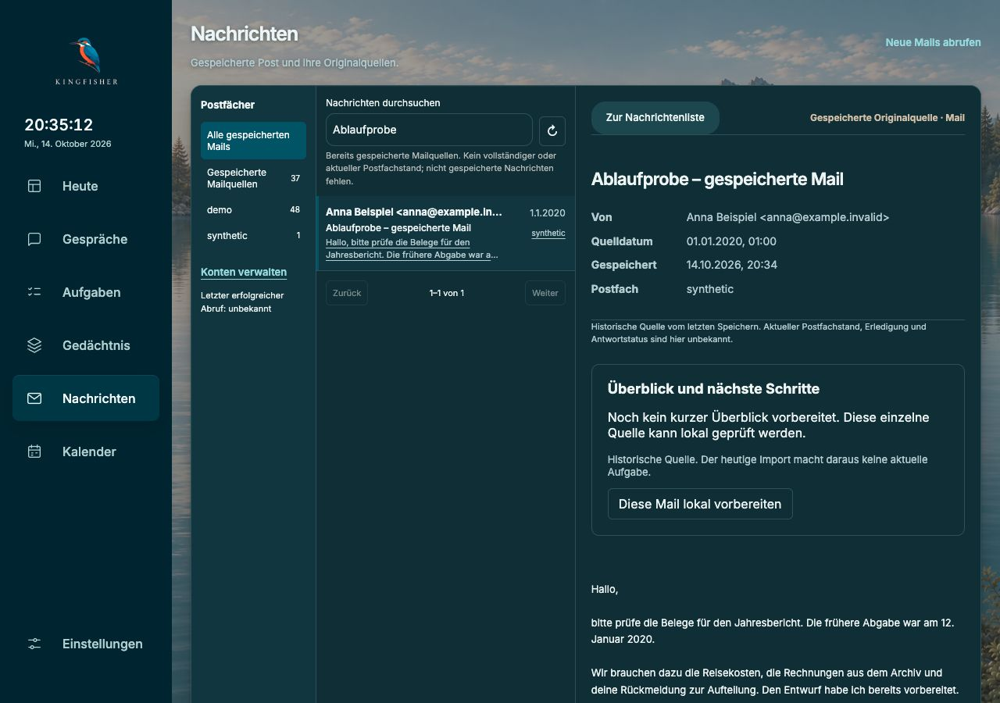
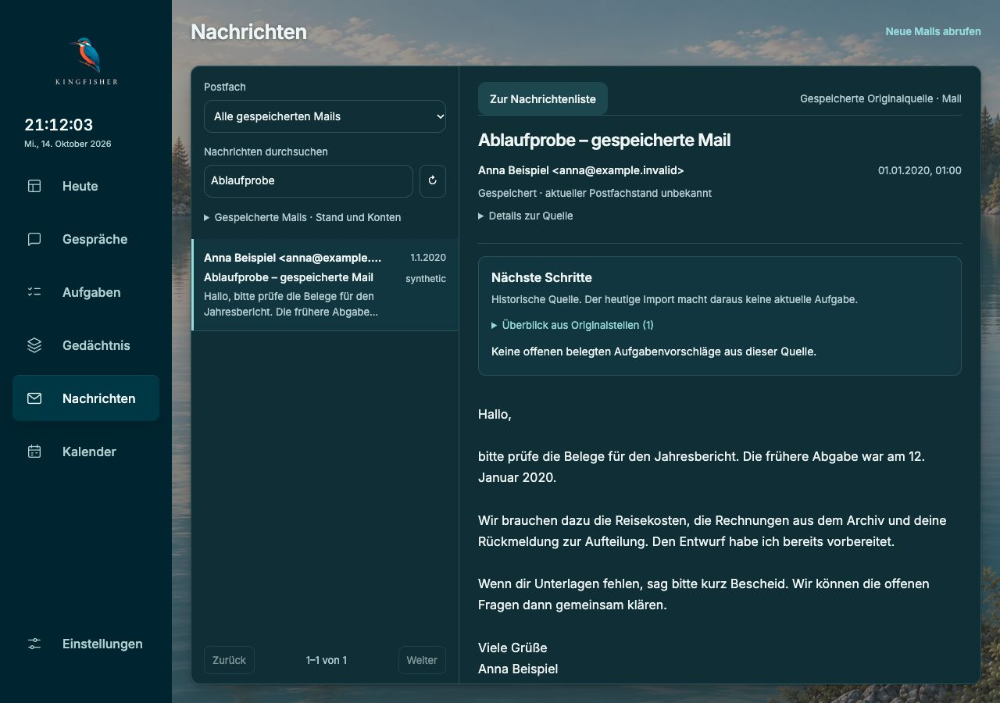
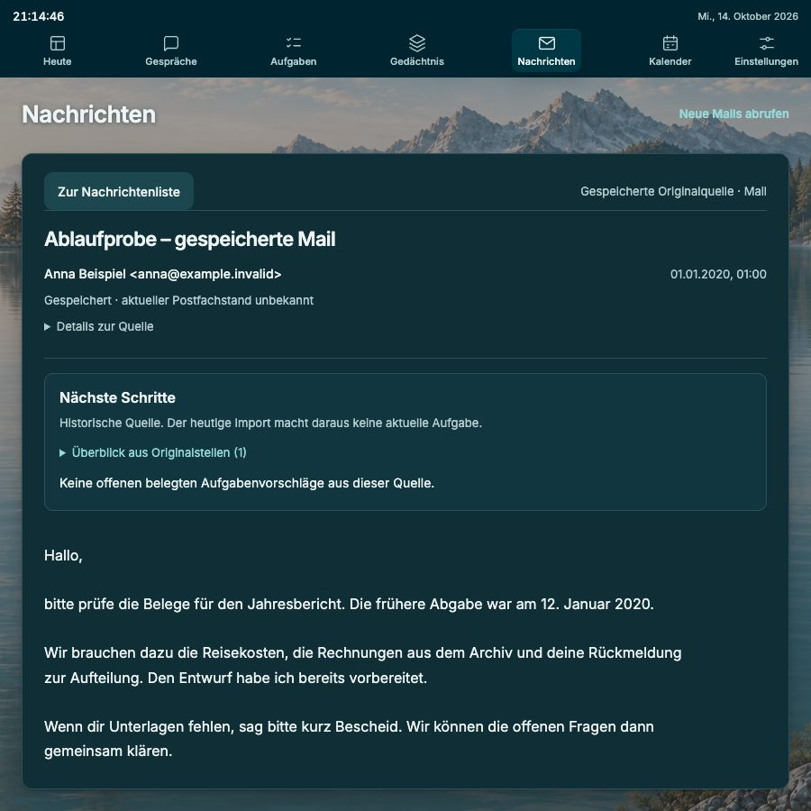
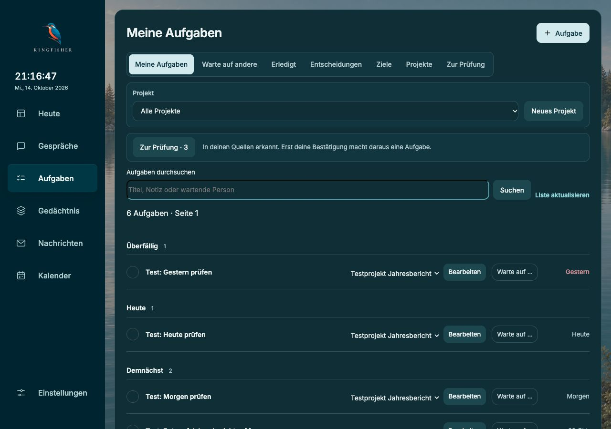
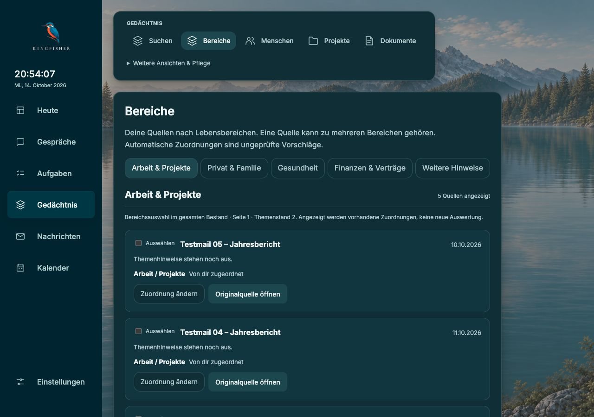

# Maillesen und kompakte Arbeitsflächen

Stand: 14.10.2026. Implementiert und getrennt mit künstlichen Daten geprüft. Noch nicht auf dem persönlichen Mac installiert. Der Gedächtniskern, Zugänge, Modelle und der pausierte Großimport werden durch diese Änderung nicht verändert.

## Ausgangspunkt und Ergebnis

Die frische Bedienprüfung zeigte große Metadatenblöcke vor der Mail, lange doppelte Belege vor Aufgabenfeldern und durch allgemeine Regeln überschriebene kompakte Aufgabenstile. Der eigentliche Inhalt kam dadurch spät ins Bild. Ein tief in der Liste geöffnetes Mail konnte zudem außerhalb des sichtbaren Lesebereichs liegen.

Jetzt steht die Postfachwahl über der Liste; der Lesebereich ist bei 1280 px rund 667 px breit. Kopfdaten sind kompakt, ergänzende Quellenverwaltung bleibt aufklappbar. Mailtext verwendet 16 px mit ruhigem Zeilenabstand; lange Aufgabentitel können in einem zweizeiligen Feld gelesen und bearbeitet werden. Historische Quellen, ungeprüfter Quellenstand, Fehler und unvollständige Auswertung bleiben ausdrücklich sichtbar.

Liste und Mail haben getrennte Scrollbereiche. Neue Auswahl beginnt am Anfang des Lesebereichs; Rückkehr erhält Suche, Kontofilter und Listenfokus. Für niedrige Fenster bleibt die gesamte Listenspalte als Rückfall scrollbar. Details zum gespeicherten Postfachstand können die Liste nicht auf Höhe null verdrängen.

Die Aufgabenansicht hat eine geschlossene Arbeitsfläche, sichtbare aktive Auswahl und 72 px hohe Zeilen im Desktopfall. Gemeinsame Schriftstufen liegen bei 26 px für Seitenüberschriften, 16 px für Lesetext, 14 px für Bedienung und 13 px für ergänzende Angaben. Die Lebensbereiche zeigen kürzere Quellenzeilen und Sammelwerkzeuge erst nach Auswahl.

## Bedienprobe

1. **Mail finden und lesen — bestanden.** Gespeicherte Mail über lokale Suche und Kontofilter öffnen; Originaltext ohne zusätzlichen Öffnungsklick. Kein Providerabruf oder neuer Modellschritt dabei. Bei 1280 und 900 px kein seitlicher Überlauf. Bei 390 × 450 px bleiben Liste und Reader scrollbar und die Suche erhalten.
2. **Aufgabe und Projekt bestätigen — bestanden.** Titel direkt geändert, neues Projekt gewählt und zusammen in einem Schritt bestätigt. Rückmeldung sichtbar; Aufgabe anschließend im richtigen Projekt unter „Ohne Termin“. Die Frist aus der Mail von 2020 wurde nicht als heutige Frist übernommen. Die Aufgabe wurde einmal angelegt.
3. **Aufgaben überblicken — bestanden.** Überfällig, Heute und Demnächst sind direkt erreichbar und früher im Bild. Aktive Auswahl verwendet getrennte Vorder- und Hintergrundwerte; 72 px Zeilenhöhe und 26 px Überschrift im Browser gemessen.
4. **Gedächtniszuordnung und Original öffnen — bestanden.** Ohne Auswahl kein leeres Sammelformular. Ein Checkboxklick zeigt die Sammelzuordnung, „Auswahl aufheben“ entfernt sie. Original direkt geöffnet; geöffnete Quellenansicht erhält volle Breite, Quellenwarnungen und Bezüge bleiben erreichbar.

Ein vom unabhängigen Review gefundener Reflowfehler wurde zuerst im Browser bestätigt: bei 1280 × 360 px und geöffnetem Kontostand war die Mailliste 0 px hoch. Danach beträgt sie mindestens 160 px; die Listenspalte ist scrollbar. Ein tiefer Listenplatz bei Scrollposition 1207 wurde geöffnet, Reader und Fenster standen dabei bei 0. Die längere Mail lässt sich unabhängig scrollen (Reader 178, Fenster 0).

## Bilder aus dieser Prüfung

Vorher: großer Hinweis- und Metadatenbereich vor dem Mailtext.

Finale normale Lesedarstellung mit mehr Platz und eigenem Scrollbereich.

## Technische Prüfung und Grenzen

- 701/701 UI-Tests bestanden. Vier neue Verhaltenstests wurden vor der Umsetzung fehlschlagend gesehen und danach bestanden: kompakte Quelldetails, Kontofilter ohne Providerabruf, lange Belege ohne Verdrängung der Bestätigung und Scroll-/Fokuswiederherstellung.
- Bestehende Prüfungen zu Quellenentzug, 503, erhaltenem Entwurf, Projektwiederholung und doppelter Bestätigung weiter bestanden.
- TypeScript und Produktionsbuild bestanden; der bestehende Hinweis zu großen JavaScript-Bundles bleibt. Asset-Vertrag: 16 Dateien und 15 Icons geprüft. Kein Backend-Diff und daher keine erneute vollständige Backend-Suite.
- Unabhängiges Review: Schriftstaffel korrigiert; bestätigter Reflowfehler behoben; keine offenen Findings im nachgelesenen Diff.
- Persönliche Prüfung: 16 maßgebliche Datentabellen unverändert. Keine Produktionsdaten in den Screenshots oder dem GitHub-Nachweis.
- Künstliche Daten und ein deterministischer lokaler Modellersatz prüfen Bedienung und Bindung an Quellen. Sie belegen keine Qualität echter Modellauswertung, keine vollständige WCAG-Konformität und keine Alltagsabnahme auf dem Mac. Das dunkle Farbschema wurde visuell geprüft; eine vollständige Prüfung aller Seiten und des hellen Schemas ist offen.

Nächster Abnahmeschritt: normaler Mac-Updateweg mit Sicherung, danach persönliche Mail- und Aufgabenabläufe mit dem vorhandenen lokalen Modell. Großimport bleibt pausiert.
