# Befunde der Persona-Prüfung: Paket A-I, verlässliche Antworten (A1, A2, A5)

Stand 26.10.2026, Branch `fix/befunde-antworten-1` auf dem Integrationsstand `docs/persona-pruefung-20261026`
(1.0.29 mit Paket D). Befunde aus [der Persona-Prüfung](../2026-10-26-persona-pruefung/README.md), Abschnitt
„2. Verlässliche Antworten“. Nur synthetische Daten: Helga Brandts Gartenverein und die Praxis der Ärztin, Skriptmodell
statt Ollama, keine Cloud. Nachgestellt im echten Chromium mit echtem Sidecar, **echter Uhr** in Browser und Sidecar
(Mails relativ zu jetzt), vorher auf dem Ausgangsstand, nachher auf diesem Branch.

## A1 Satzprüfung verwirft richtige Sätze

**Vorher.** „Wann ist die nächste Vorstandssitzung?“ ergab die Rohliste „Quelle berichtet · automatisch eingeordnet“,
„Angabe · … · neueste Quelle“, „Quellenzeit: …“. „Hat Herr Meier die Rechnung geschickt?“ verlor den Satz mit „Ja“.

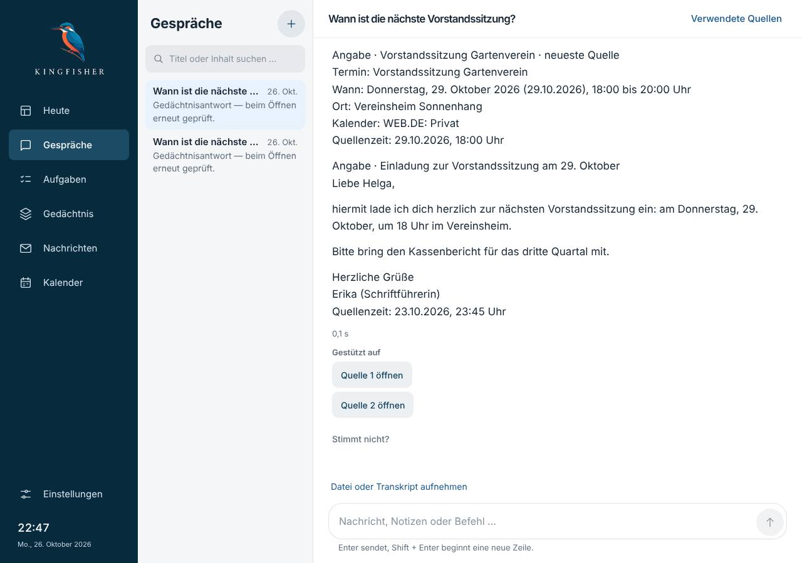 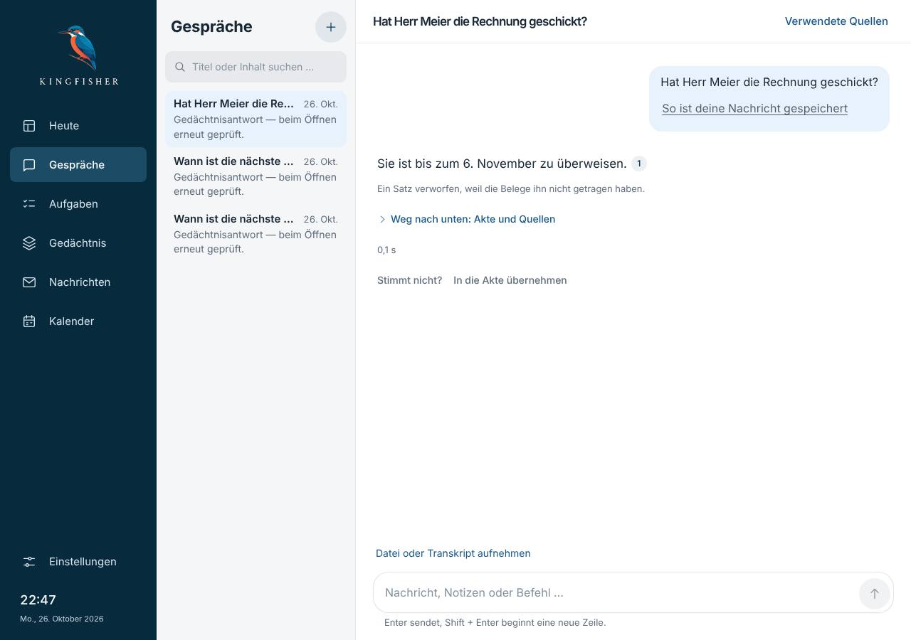

**Ursache.** Drei Regeln der Satzprüfung (`satzpruefung.py`), alle ohne Modell nachgestellt:
1. „um 18 Uhr“ ist die Relation `um`, der Termin „18:00 bis 20:00 Uhr“ ein Zeitraum; verlangt war Gleichheit.
2. „Ja“ am Satzanfang galt als großgeschriebener Name, der nicht im Beleg steht.
3. „geschickt“ ist eine Statusaussage; „anbei erhalten Sie unsere Rechnung Nr. 2026-117“ trug sie nicht, Meier steht
   nur in der Signatur, und der Punkt von „Nr.“ trennte die Stelle von ihrer Kennung.

Fiel der einzige Satz zum Termin, galt der Zitatmodus mit Fachwörtern.

**Behebung.** „um 18 Uhr“ besteht als Beginn eines Zeitraums ohne Einschränkung, nur wenn **jede** Angabe der Belege
zu dieser Uhrzeit ein Beginn ist (`_beginn_gleichwertig`). Uhrzeiten in Worten mit Tageszeit, „um 18.00“, „18h“;
„halb sieben“ ohne Tageszeit nur, wenn der Beleg genau eine Lesart oder denselben Wortlaut trägt. Antwortwörter
(„Ja“, „Genau“, „Richtig“, „Stimmt“, „Doch“) brauchen keinen Beleg; „Nein“ nur vor einem selbst verneinten, belegt
verneinten Satz. Der Absender im Belegkopf trägt seinen Namen für die erste Person und den Anhang („anbei“ zählt als
„geschickt“), nie für Weitergeleitetes oder Zitiertes. Der Rückfall heißt jetzt „So steht es in deinen Quellen:“ mit
einem Satz je Quelle („E-Mail „…“ von Erika Schulte vom 23. Oktober 2026, 20:48 Uhr, die neueste:“); bei einer Zusage
ohne Absender und mit „Urheber dort prüfen“.

**Nachher.**

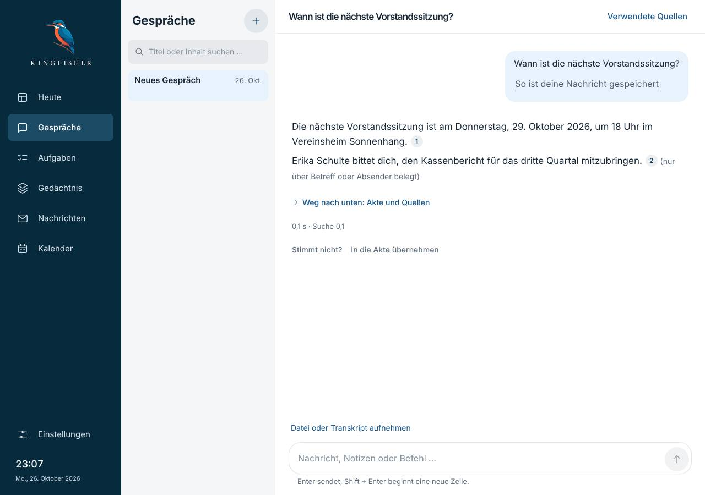 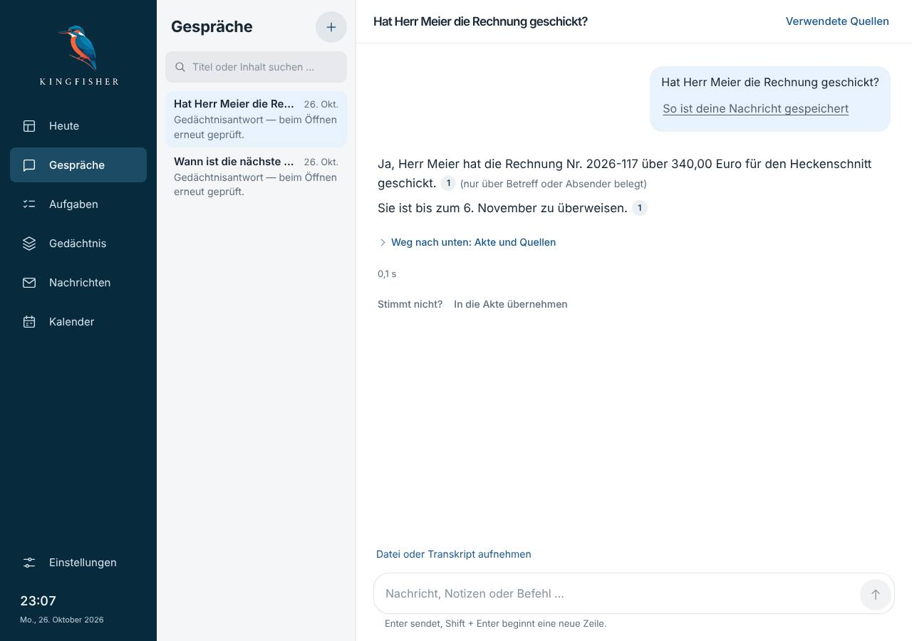
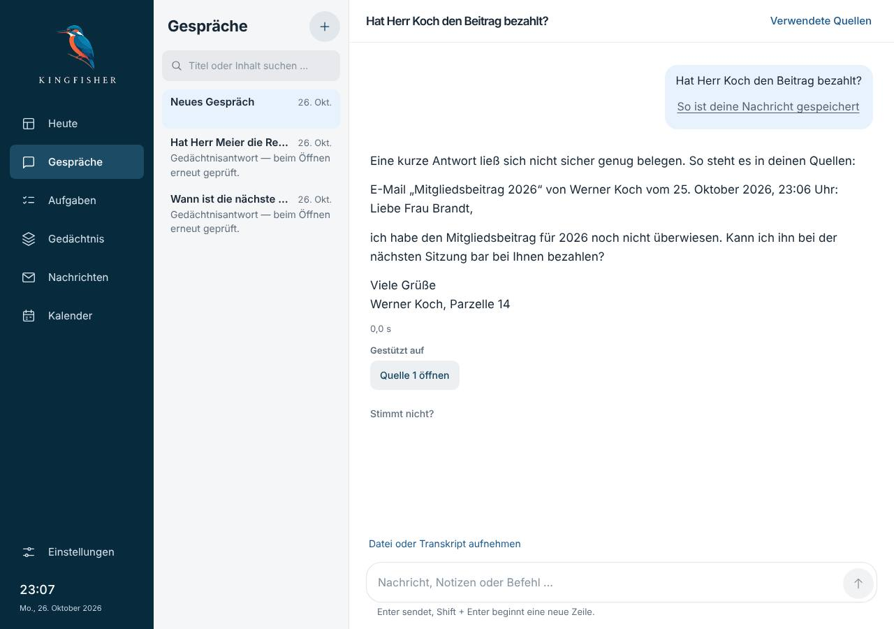
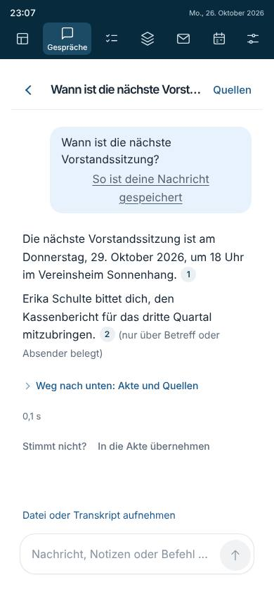 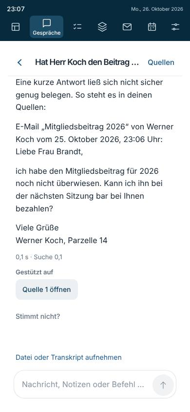
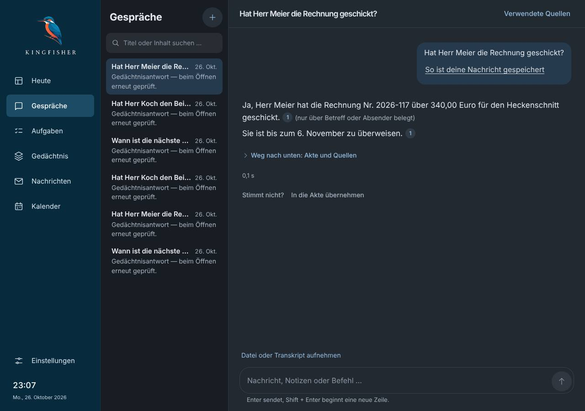

**Tests.** `test_satzpruefung_schreibweisen.py` (62): beide Richtungen. „um 19 Uhr“, „um 20 Uhr“ (Ende), „ab 18 Uhr“,
„um 17h“, „sieben Uhr abends“, „6 Uhr morgens“, „halb sieben“ gegen 18:00 fallen. Dazu falsches Datum, falscher
Wochentag, falsche Zahl in Worten, „Nein“ vor einem bejahten Satz, ein Name nach „Ja“, „Ja“ allein, ein Dritter oder
eine weitergeleitete Mail als Sprecher. `test_antwort_rueckfall.py`: keine Fachwörter im Rückfall, Wortlaut vollständig.

## A2 „nicht beantwortbar“ während des Einlesens

**Vorher.** Mail und Termin abgelegt, noch nicht eingeordnet: „Das kann ich mit den gefundenen Belegen nicht
beantworten.“ 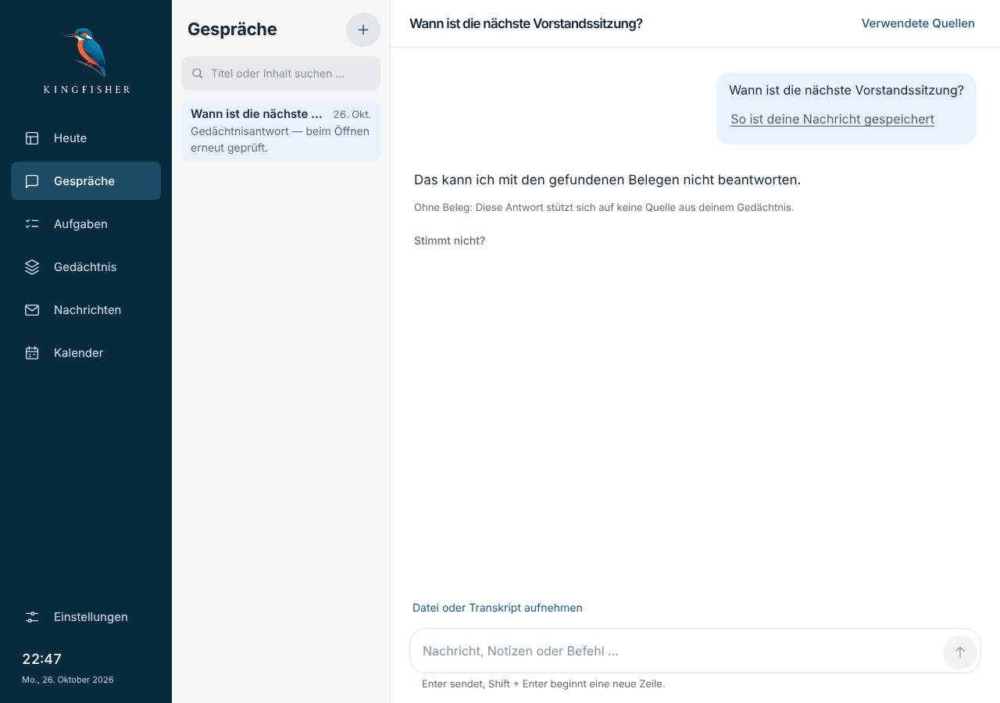

**Ursache.** Nicht nur ein fehlender Satz: Die Antwort durchsuchte die frischen Quellen zwar (Volltextindex), aber eine
noch nicht eingeordnete Quelle konnte kein Beleg werden (`source_candidates`, nur gezählt als `ohne_einordnung`). Ohne
Beleg gab `working_memory_answers.prepare` nichts zurück, und der Weg über bestätigtes Wissen fand nichts.

**Behebung.** Eine kurze, noch nicht eingeordnete Quelle (Zustand `pending`/`failed`, höchstens 12.000 Zeichen) wird
als Ganzes Beleg, Art `quelle` (`WorkingMemoryStore.roh_verweis`), ohne zitierten Verlauf. `resolve` prüft sie jedes
Mal (Fassung, eigener Text, nicht ausgenommen). Auswahl, Sätze, Satzprüfung und Frischeprüfung bleiben dieselben.
Findet Kingfisher dennoch nichts, während ein Postfach liest oder die eingeschaltete, nicht pausierte Einordnung Quellen
vor sich hat, sagt die Antwort das in einem Satz und bietet „Mit aktuellem Stand neu beantworten“ an
(`agent_verdrahtung.lesestand_satz`).

**Nachher.** 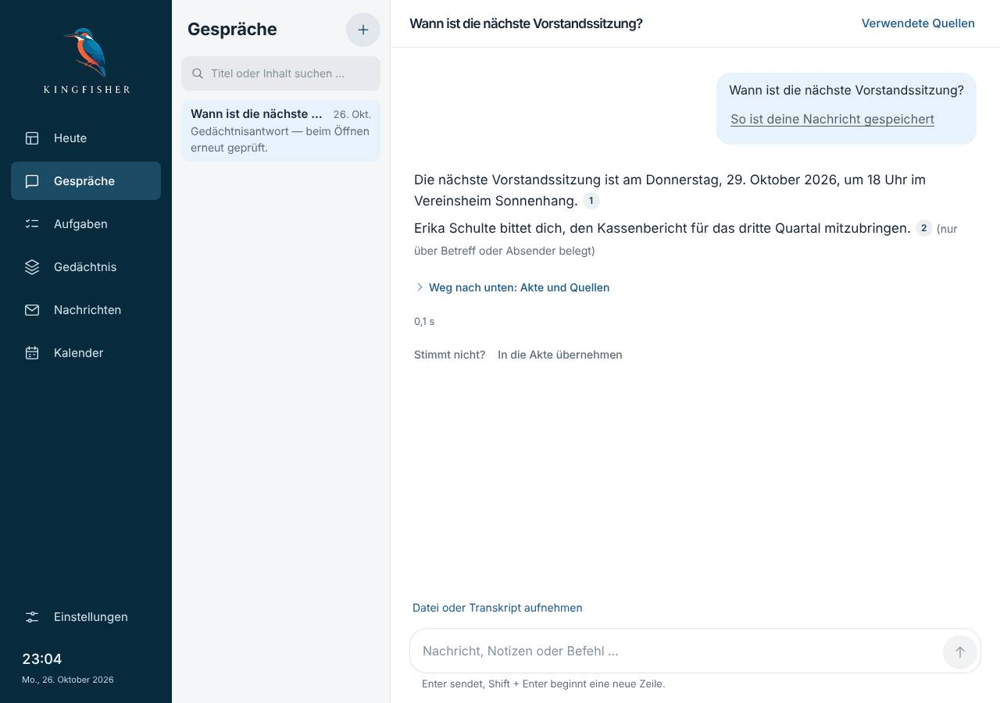 
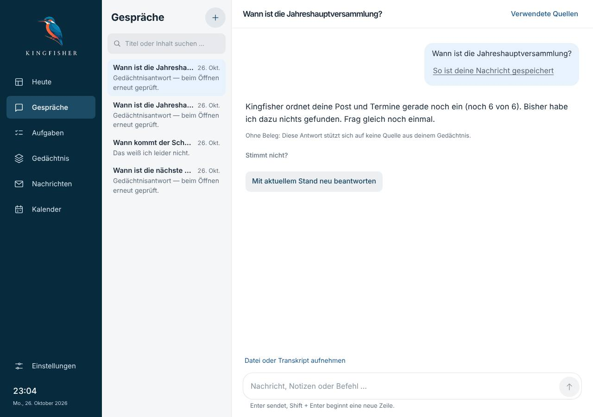 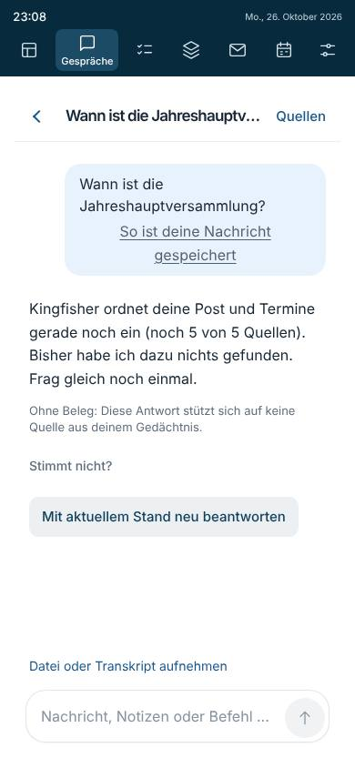
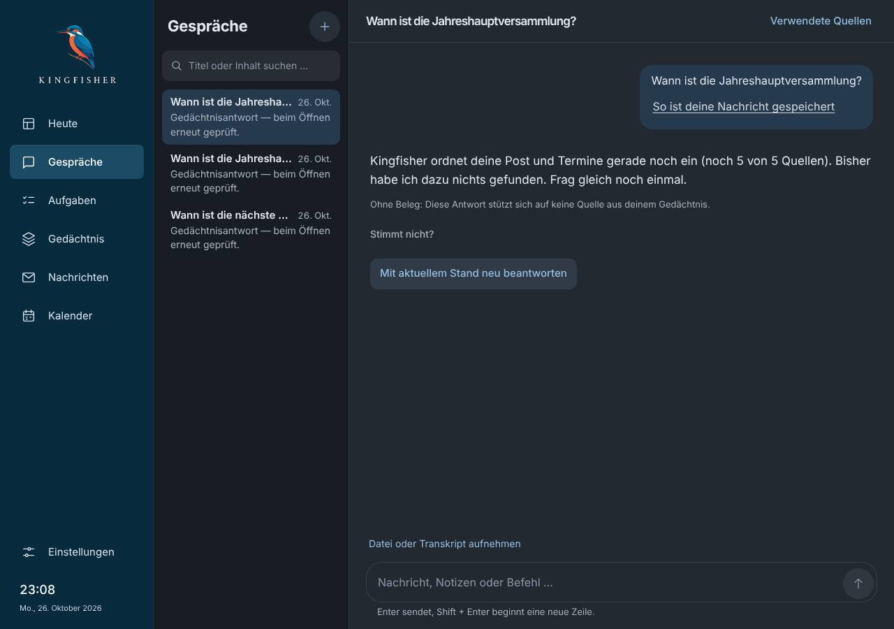

**Tests.** `test_antwort_beim_einlesen.py` (15): Rohquelle als Kandidat, Antwort und Satzantwort daraus (falsches
Datum fällt), nach der Einordnung gilt der Abschnitt, ausgenommene, zu lange und zitierte Teile nicht, Verweis nur
unverändert, entzogene Quelle entwertet; Satz und Knopf beim Einlesen, ohne Einlesen unverändert, Lesestand aus
Postfach und Einordnung, nichts bei aus- oder pausierter Einordnung.

## A5 „Historisch“ bei frischen Mails

**Prüfartefakt?** Zum Teil. Bei der Assistentin lag die Messlatte-Welt am 29.09.2026, der Sidecar lief mit echter Uhr
(26.10.): Ihre Mails waren vier Wochen alt, „Historisch“ war dort richtig. Bei der Ärztin liefen Sidecar und Mails
mit echter Uhr (nur der Browser einen Tag vor). Mit echter Uhr überall nachgestellt, bleibt der Befund: **echt**.

**Vorher.** Bitten von vor 5 bis 26 Stunden: „Historisch · Aktualität prüfen“, Heute „5 Vorschläge sind zeitlich
ungeklärt“. 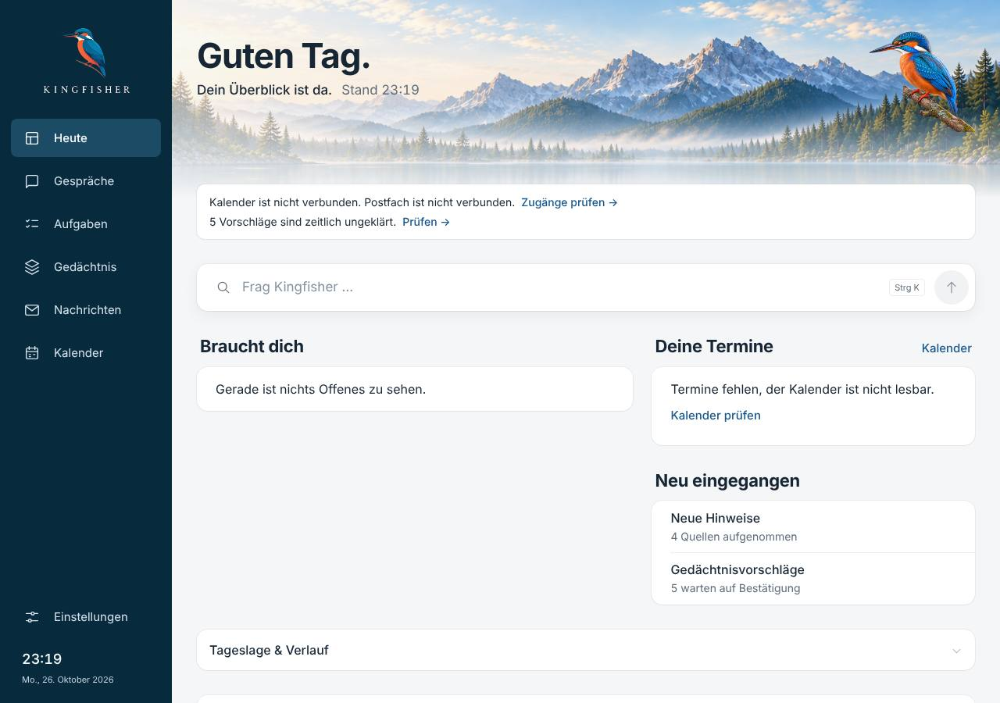 

**Ursache.** `mail_timeline.timings` stufte jede Mail der Bestandsaufnahme (Spur `history`) als `history` ein, auch
eine von vor einer Stunde. „Braucht dich“ zeigt nur `recent`; dazu stand „zeitlich ungeklärt“ ohne Erklärung.

**Behebung.** Eine Mail aus dem ersten Einlesen, die höchstens drei Tage vor dem Einlesen ankam
(`INVENTAR_ZEITNAH`), ist zeitnah wie neue Post: Vorschlag, auf Heute unter „Braucht dich“. Selbst angelegt wird aus
dem Bestand weiter nichts (Grund `bestand`), ältere Bestandspost bleibt zur Prüfung. Heute sagt dazu „Nichts Neues
wartet auf dich.“ und „Bei einem Vorschlag ist unklar, ob er noch gilt. Prüfen →“.

**Nachher.** 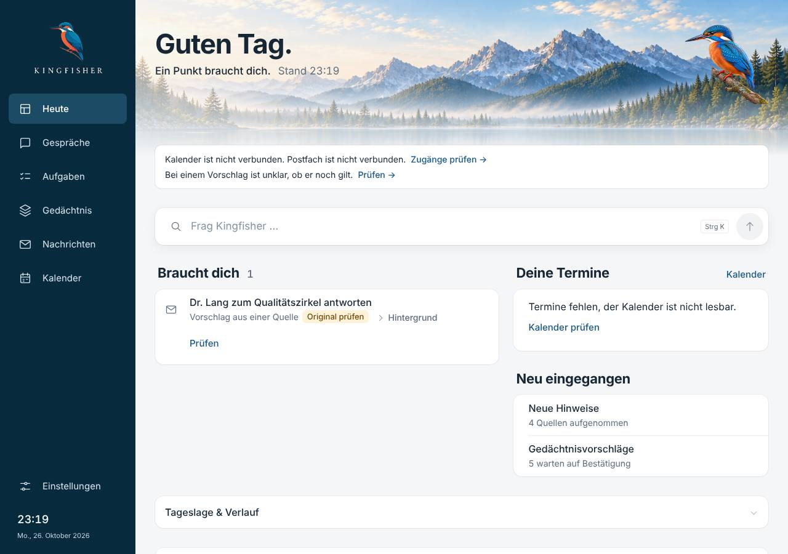 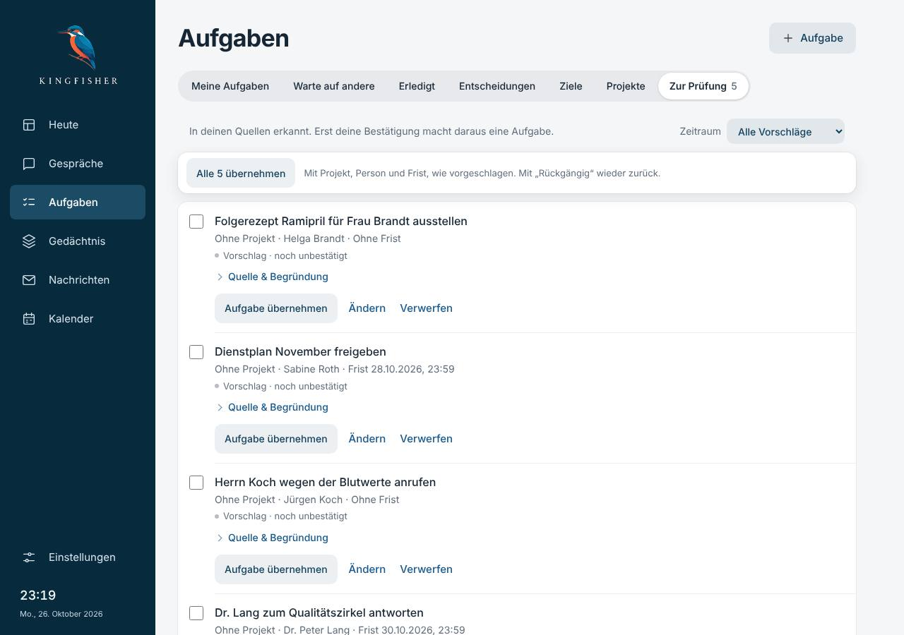
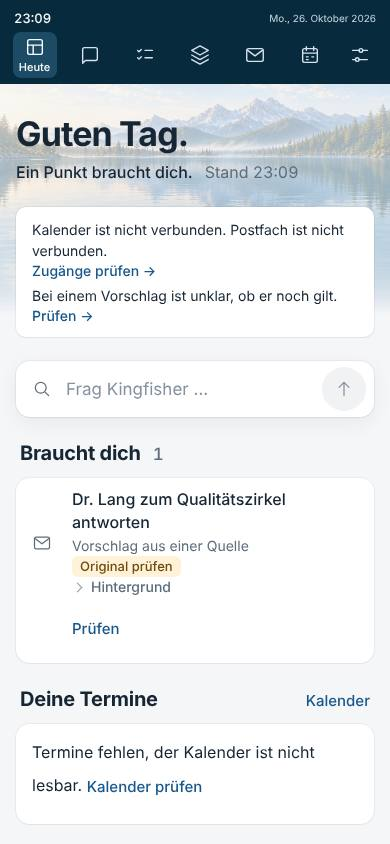 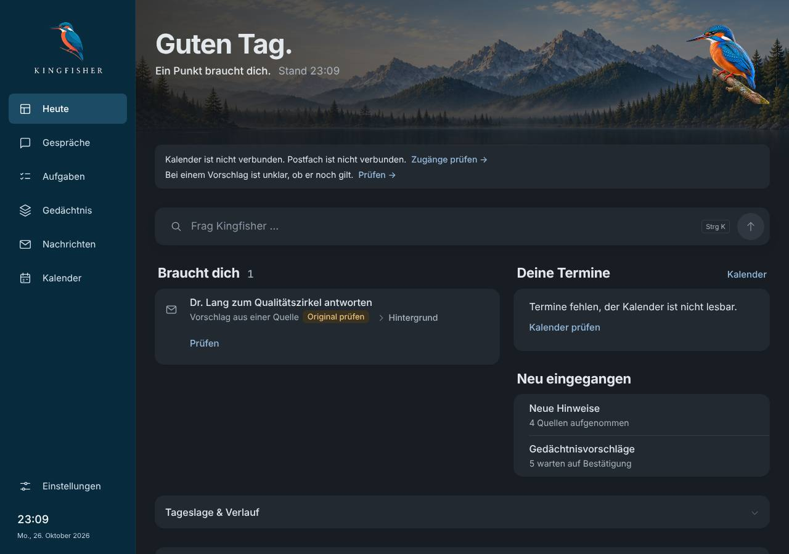

**Tests.** `test_bestand_zeitnah.py` (9): 1 bis 71 Stunden zeitnah, ab 73 Stunden zur Prüfung, Alterung nach sieben
Tagen, Zählung für Heute, Folgemail im Verlauf hält zur Prüfung. `heute-pruefen.test.mjs` (2).

## Geänderte Tests (Vertrag bewusst geändert)

`test_source_index.py` (kurze nicht eingeordnete Quelle wird Beleg), `test_mail_timeline.py` (vier Tage alte
Bestandsmail bleibt zur Prüfung, eine Stunde alte nicht). `test_pending_conflict_*` legen die Belegquelle des
Vorschlags als ausgenommen ab, damit sie weiter den Weg über bestätigtes Wissen prüfen; eingeordnet endet derselbe Fall
geschlossen über `working_conflict`. Abdeckungstests (`test_satzantwort.py`, `test_working_memory_flow.py`) nutzen
lange Quellen. Rückfall-Wortlaut: neun Testdateien, `messlatte/tests`, zwei Browserproben.

## Zahlen

- Neue Tests: 87 Backend, 2 Oberfläche. Oberfläche: `tsc` ohne Befund, 956/956 Tests, `vite build` grün.
- `probe_seiten_ui.py` hell und dunkel: 75 Breiten geprüft, 0 nicht in Ordnung.
- Volle Suite (`sidecar/tests` und `messlatte/tests`): siehe unten.

## Sabotageproben

Jede Zusicherung gebrochen, der passende Test wurde rot, danach zurückgesetzt:

| Bruch | roter Test |
|---|---|
| Beginn immer gleichwertig | `test_falsche_uhrzeit_oder_grenze_faellt_weiter[um 20 Uhr]` |
| Beginn auch bei „nur zwischen“ | `test_beginn_gilt_nicht_fuer_einen_eingeschraenkten_zeitraum` |
| „Nein“-Prüfung entfernt | `test_nein_dreht_einen_belegten_satz_nicht_um` |
| „halb sieben“ geraten | `test_uhrzeit_in_worten_nicht_geraten[…]` |
| Weitergeleitetes als Absender | `test_absender_spricht_nur_in_eigener_sache` |
| Antwortwort nicht erkannt | `test_antwortpartikel_ist_keine_behauptung[Ja]` |
| Rückfall mit alter Einleitung oder „· neueste Quelle“ | `test_rueckfall_ist_ein_lesbarer_satz_mit_dem_wortlaut` |
| keine Rohquelle | `test_frische_quelle_wird_als_rohquelle_kandidat` |
| Fingerabdruck egal | `test_rohverweis_gilt_nur_genau_so[aenderung2]` |
| zitierter Verlauf in der Rohquelle | `test_zitierter_verlauf_gehoert_nicht_zur_rohquelle` |
| ausgenommene Quelle als Rohquelle | `test_ausgenommene_quelle_wird_keine_rohquelle` |
| Längengrenze weg | `test_zu_lange_quelle_bleibt_gezaehlt_und_ohne_beleg` |
| kein Satz beim Einlesen | `test_nichts_gefunden_waehrend_des_einlesens_…` |
| Pause ignoriert | `test_lesestand_aus_postfach_und_einordnung` |
| Bestand immer / nie historisch, Fenster 7 Tage | `test_bitte_von_gestern_…[1]`, `test_aeltere_post_…[73]` |
| „Nichts Neues“ entfernt | `heute-pruefen.test.mjs` Test 2 |

## Grenzen

- Die Antwort aus einer Rohquelle kennt keine Einordnung (Bitte, Zusage, Änderung); die Auswahl sieht die Art
  `quelle`. Ein zitierter Verlauf wird nur an den starken Kopfzeilen erkannt (`mail_quote_history`); eine Antwort
  unter einem eingerückten Zitat fällt mit diesem weg. Quellen über 12.000 Zeichen warten auf die Einordnung.
- Eine Antwort aus einer Rohquelle wird nach der Einordnung als veraltet erkannt und bietet „neu beantworten“ an.
- „Viertel nach“, „Viertel vor“ und Uhrzeiten über zwölf in Worten kennt die Prüfung nicht; sie fallen weiter.
- Wer zusagt, ordnet nur die erste Person dem Absender zu; „wir“ in einer Rundmail ist davon nicht unterschieden.
- `probe_satzantwort_ui.py` und `probe_antwortzeit_ui.py` scheitern schon auf dem Ausgangsstand (`.satzantwort` erscheint
  nicht), unabhängig von diesem Paket; ihr Wortlaut ist angepasst, die Ursache ist nicht untersucht.
- Die Prüfwelt der Assistentin hat Browser- und Sidecaruhr nicht gleich; repariert wurde sie nicht (außerhalb des Repos).
