# Befunde der Persona-Prüfung: Paket A-II, Antworten (A3, A4, A6, A7, Widersprüche)

Stand 27.10.2026, Branch `fix/befunde-antworten-2` auf dem Integrationsstand `docs/persona-pruefung-20261026` (mit
Paket D und A-I). Befunde aus [der Persona-Prüfung](../2026-10-26-persona-pruefung/README.md), Abschnitt
„2. Verlässliche Antworten“. Nur synthetische Daten: die Welt der Assistentin (Messlatte-Welt „Lea Hartmann“ und 2.068
synthetische Quellen, Regel-Einordnung statt Modell), echter Sidecar, gebaute Oberfläche, Chromium. **Uhr stimmig:**
Anders als in der Persona-Prüfung (Welt am 29.09. eingefroren, Sidecar am 26.10.) sind alle Quellen um „jetzt minus
Stichtag“ verschoben, und die Uhr läuft echt; der Probe-Adapter des Mac-Kalenders meldet sich jede Minute. Vorher:
Ausgangsstand `da2a0f7` (eigener Worktree), nachher: dieser Branch, beide Welten gleich gebaut.

## A3 „Worauf warte ich noch?“ zum Teil falsch

**Vorher.** 35 Dinge, die jüngsten 12: die Freigabe von Herrn Maurer als offen, obwohl er im selben Verlauf „hiermit
erteile ich die Freigabe“ schrieb; die Einladung „Über eine Zusage würde ich mich sehr freuen“ als „Zusage“ von Alex
Winter; der Kernpunkt (Vertrag Rehaklinik Eichenberg, Frau Zimmermann) fehlte unter den ersten zwölf.
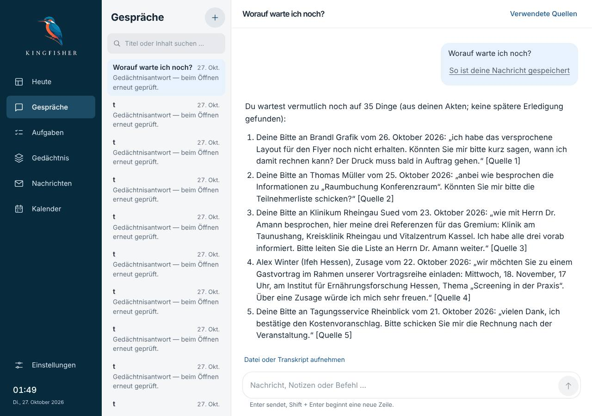

**Ursache.** (1) Erledigt galt nur über ein Erledigt-Wort in einer späteren, gleich eingeordneten Meldung; eine
Antwort im Mailverlauf zählte nicht. (2) Was als Zusage eingeordnet war, blieb Zusage, auch eine Einladung. (3) Sortiert
wurde nur nach Datum, jede Mail eine Zeile; viele neue Alltagsbitten verdrängten die Verläufe, bei denen schon
nachgefragt war. Die Karte „Worauf ich warte“ einer Person las nur Aufgaben.

**Behebung.** `antwort_im_verlauf.py` (genaue Kopfzeilen, ganzer Bestand): Deine Bitte ist beantwortet, sobald die
Gegenseite im selben Verlauf antwortet; eine Zusage an dich ist eingelöst, wenn der Zusagende etwas mitbringt
(„hiermit“, „anbei“). Automatische Mails (Abwesenheit) und bloße Verzögerungen („vertagt“, „noch nicht“) zählen nie.
In der Akte steht der Punkt dann unter „Vermutlich erledigt“ mit „Im selben Mailverlauf beantwortet“, dem ersten Satz
der Antwort und „Doch noch offen“. Eine Einladung (Text oder Betreff „Einladung: …“, auch „Zusagen | Absagen“) ist eine
Bitte an den Empfänger, außer der Text sagt selbst zu. **Wichtiges vorn** (`offene_punkte.sammeln`): Aufgaben „wartet
auf“, dann Verläufe, in denen du nachgefragt hast (eigene Mail nach der Zusage ohne neue Mail der Gegenseite
dazwischen; eine Verzögerung unterbricht nicht), dann verstrichene (bis 45 Tage) und bald fällige Fristen, dann der
Rest; ein Verlauf mit derselben Gegenseite ist eine Zeile. „Die wichtigsten 12 von N“.

**Nachher.** Brandl (Nachfrage) und Zimmermann (nachgefragt) vorn, Maurer und die Einladung fehlen.
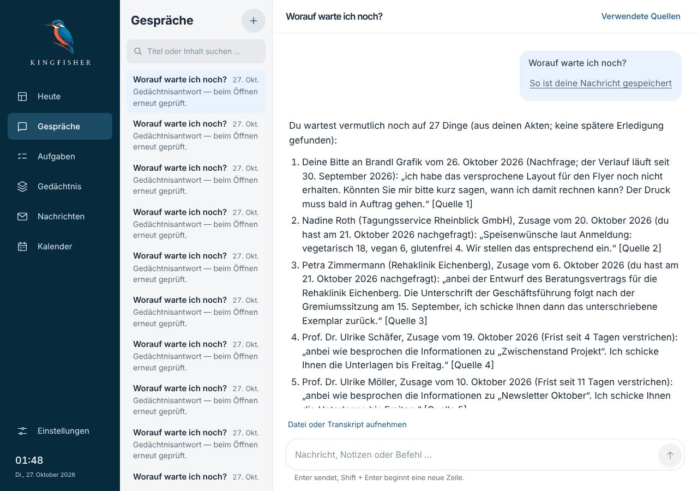 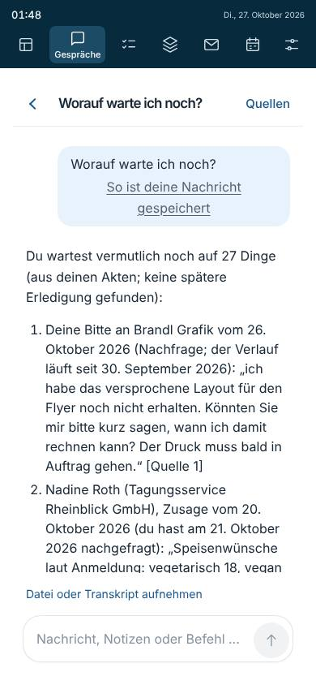 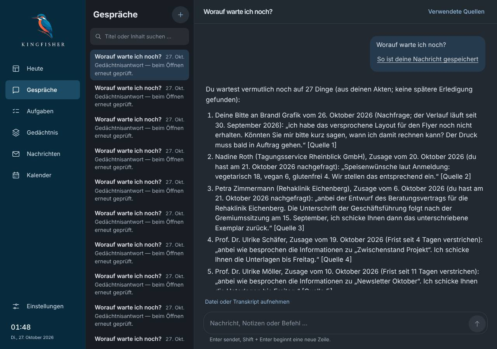

**Tests.** `test_worauf_warte_ich_verlauf.py` (23): Antwort beantwortet, automatische und verzögernde nicht, ohne
Kopfzeilen kein Verlauf, Lieferung löst Zusage ein, Absage oder Dritter nicht, „Doch noch offen“, Einladungen (7 Fälle
beider Richtungen, Betreff), Reihenfolge, ein Verlauf eine Zeile, die Lage der Messlatte („wartet-auf“) unter 14
neueren Alltagsbitten. Dazu `test_offene_punkte.py` (Antwort auf eine Absage ist keine Nachfrage).

## A4 Standardfragen langsam

**Messung ohne Last** (2.068 Quellen, 223 Akten, Mac-Kalender live; `messen.py`, Zeiten der API in Sekunden):

| | vorher | nachher |
|---|---|---|
| „Worauf warte ich noch?“ senden | 24,2–30,7 | 0,8–1,1 |
| „Was brauche ich morgen?“ senden | 38,3–40,1 | 1,5–1,8 |
| „Was habe ich zugesagt?“ senden | 23,6–24,5 | 0,6–1,0 |
| gespeichertes Gespräch öffnen | 11,5–19,9 | 0,00–0,06 |
| … direkt nach einer anderen Frage (Bestand geändert) | 11,0–19,5 | 0,6 (warten) / 1,1 (morgen) |
| Tageslage (`/api/v1/tag/briefing`) | 33,2–33,6 | sofort 0,7 (schnell), voll 4,1–4,6, danach 1,0 |

Die 28 s, 49 s, 64 s und 13,6 s der Persona entstanden also **nicht** durch die Last; ohne Last war es kaum schneller.
Einzige Ausnahme nachher: unmittelbar nach dem Start, solange die aktiven Akten vorgerechnet werden (etwa 10 s), kann
die erste Frage 6–9 s dauern.

**Ursachen** (cProfile, `profil.py`): (1) Jede der rund 130 gelesenen Akten berechnete die Namen aller Beteiligten
(bis 40 je Akte), jeder Name ein Durchgang über alle Quellen (21 von 29 s). (2) Je Akte wurden alle offenen Aufgaben
und die jüngsten 500 gelesen. (3) Senden rechnete die Antwort zwei- bis dreimal (Antwort, Wiedergabe), Öffnen noch
einmal. (4) Die Terminvorbereitung las je Teilnehmer und Hintergrund die ganze Akte mit allen Namen. (5) Kein Modell und
keine Sperre: Wartezeit war reine Rechenarbeit.

**Behebung.** `Akten.akte(nur_offen=True)` (nur Offenes und Fristen, Namen danach in einem Durchgang); ein Verzeichnis
aller Beteiligten je Stand der Datei (`EpisodeStore.participants_for_addresses`); Aufgaben einmal je Stand
(`akten_routes._aufgaben_gelesen`); Antworten, Fristen und Terminvorbereitungen einmal je Stand aller Grundlagen
(`akten_routes.nach_stand_gemerkt`: Episoden, Aufgaben, Wissen, Projekte; jeder Schreibvorgang macht ungültig); „Was
brauche ich morgen?“ bereitet nur die Teilnehmer vor; Mailadressen und Organisationsnamen gemerkt; beim Start die
aktiven Akten vorgerechnet. **Tageslage:** zuerst `?schnell=true` (Termine, Fristen, Post, Verlauf; ohne Akten der
Teilnehmer, Wege, Wetter, Welt) mit dem Satz „Vorbereitung der Termine, Wege und Wetter folgen gleich.“, dann die
volle Fassung; die schnelle zählt nie als Blick ins Logbuch. Nichts davon kürzt Prüfungen oder Belege.

**Bilder** (die volle Fassung für das Bild 4 s zurückgehalten): vorher nach 1 s leer, nachher sofort der fertige Teil.
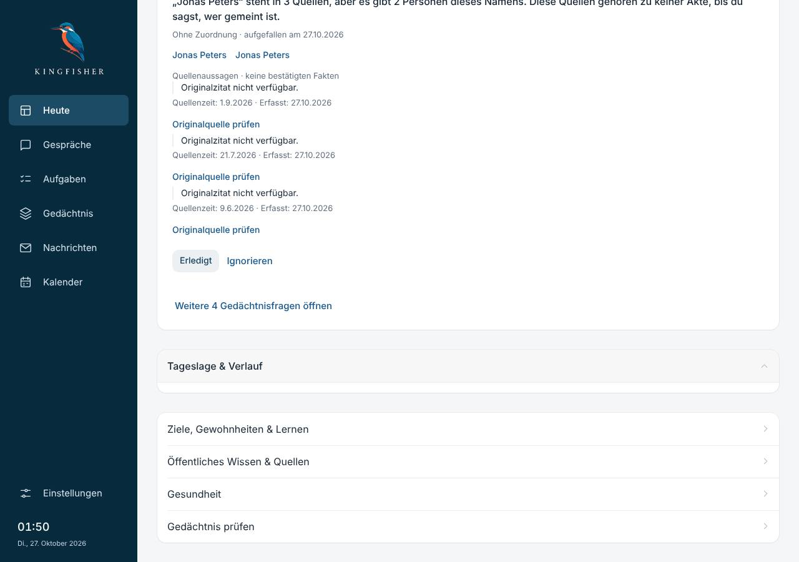 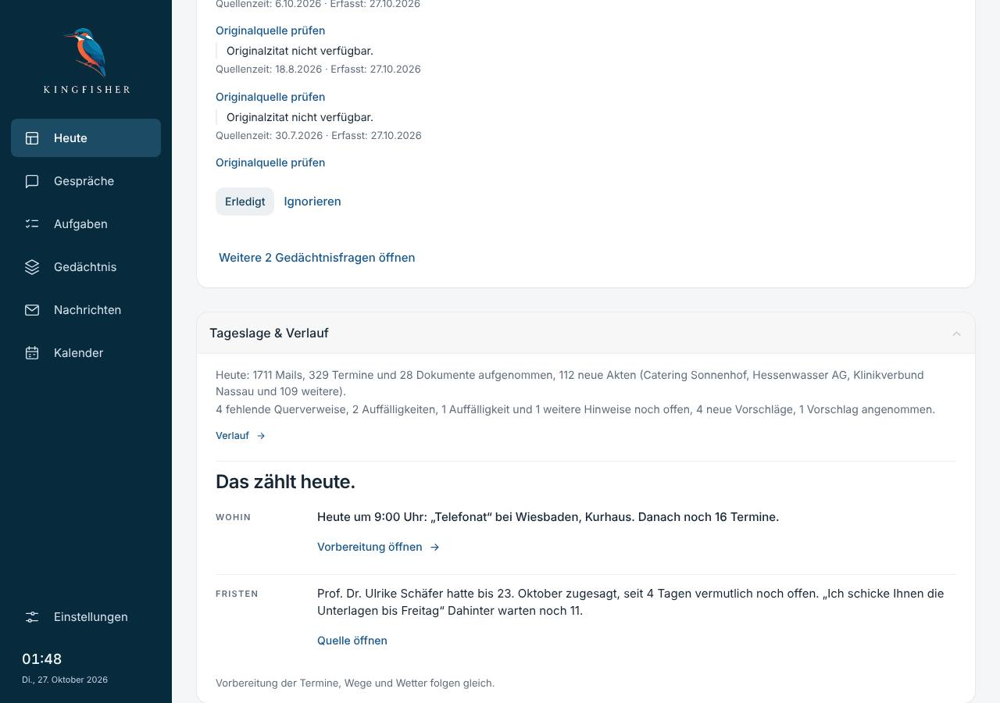
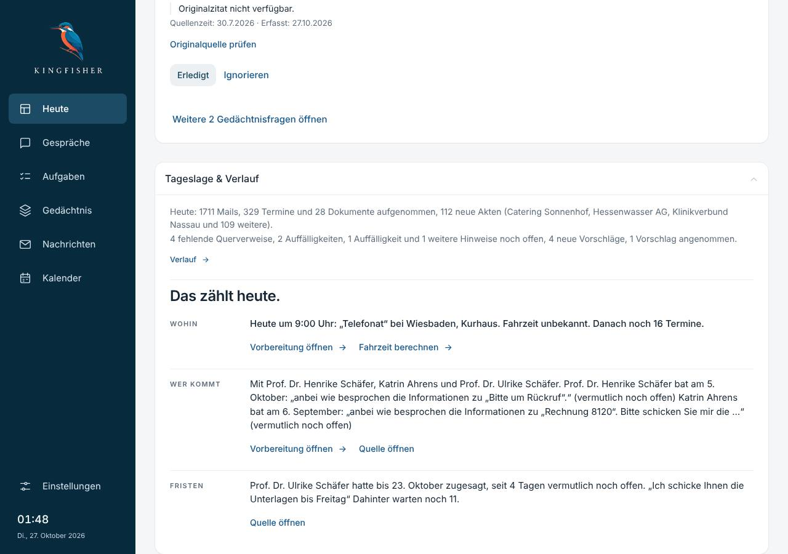 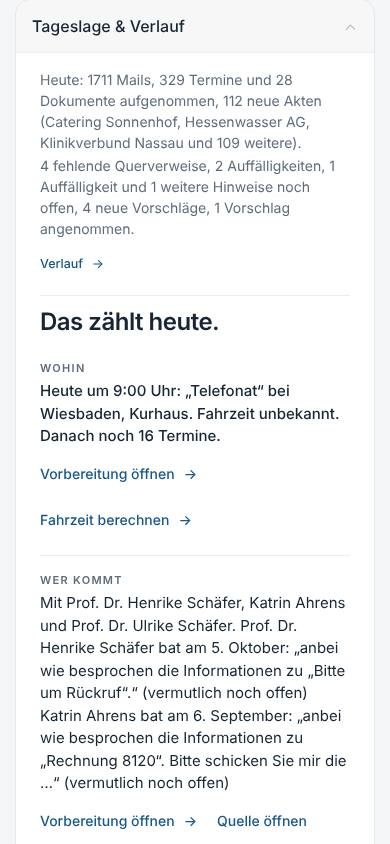

**Tests.** `test_tempo_standardfragen.py` (8): schlanke Akte gleich der vollen, Verzeichnis gleich der Einzelabfrage und
nur für den Stand, höchstens ein Durchgang der Beteiligten, gemerkte Antwort ändert sich nach Entscheidung, Aufgabe und
neuer Quelle, schnelles Briefing ohne langsame Teile und ohne Blick, Terminvorbereitung einmal je Stand und neu nach
neuer Mail, Vorrechnen beim Start. `tageslage-zwischenstand.test.mjs` (2).

## A6 Terminvorbereitung leer

**Vorher.** „Kein Projekt ausgewählt“, „Wähle ein Projekt oder eine Person“; die Karte nennt Adressen.
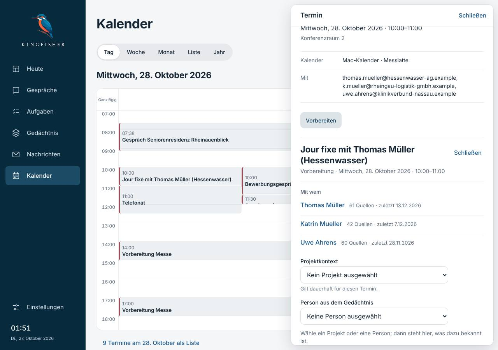

**Ursache.** Die Vorbereitung im Kalender (`CalendarPreparation`) zeigte nur ausdrücklich gewählten Kontext; die
automatische Vorbereitung aus den Akten (`terminvorbereitung.py`) gab es nur im Briefing für heute und morgen. Die
Terminkarte zeigte die Kalenderangabe (`attendees`) unverändert.

**Behebung.** `GET /api/v1/calendar/vorbereitung` bereitet jeden Termin aus den Akten seiner Teilnehmer vor (Bitten an
dich, deine Bitten, Zusagen, letzter Kontakt, Stand, Fristen, Hintergrund des Projekts oder der gemeinsamen
Organisation); Projekt und Person bleiben unter „Mehr Kontext“ aufklappbar. `GET /api/v1/calendar` liefert
`attendee_names`; unbekannte Adressen bleiben Adressen.

**Nachher.** 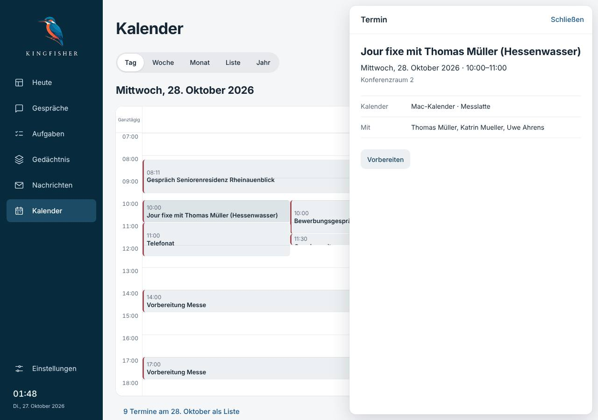 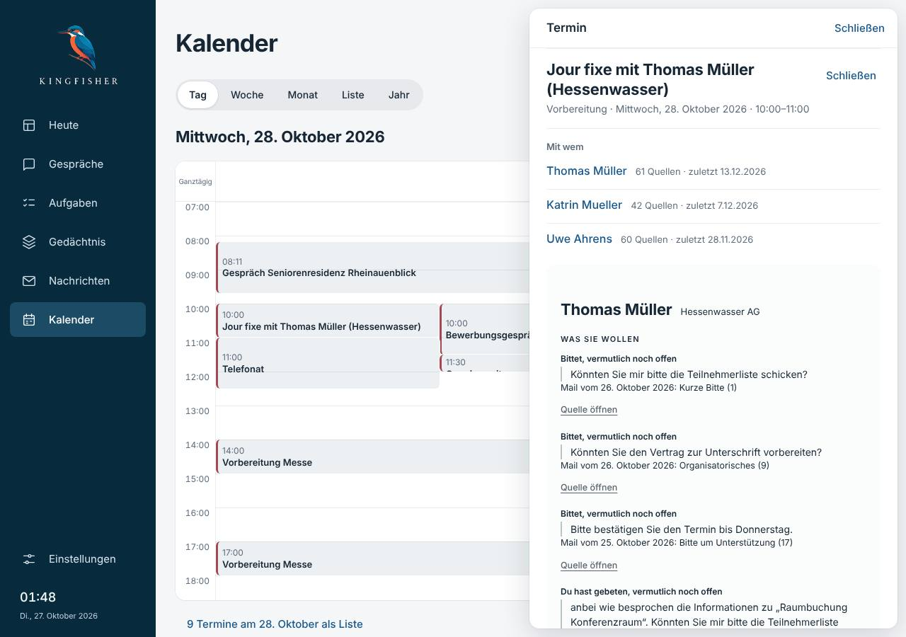
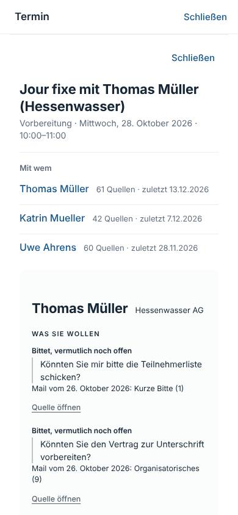 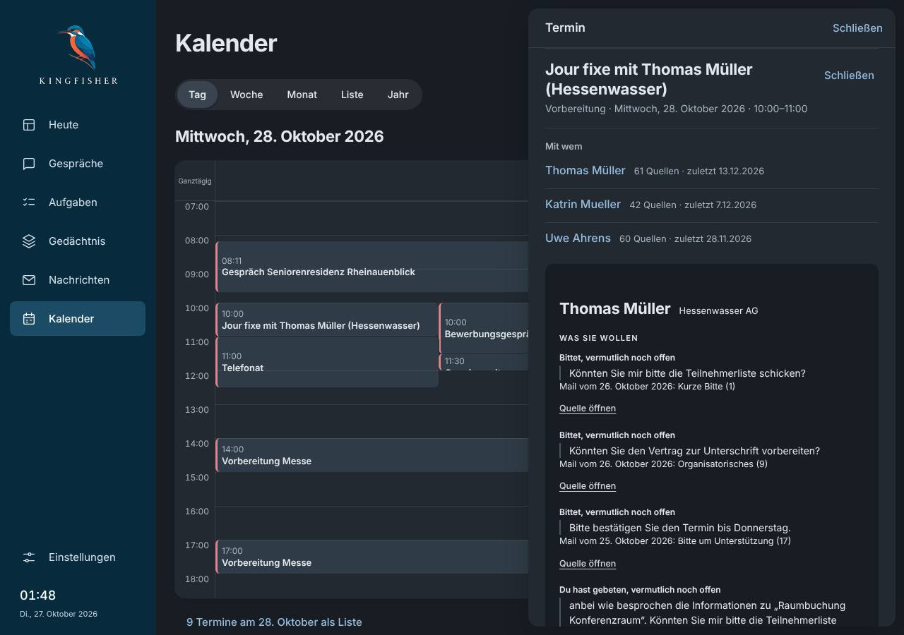

**Tests.** `test_terminvorbereitung_ohne_wahl.py` (3), `kalender-vorbereitung-ohne-wahl.test.mjs` (2).

## A7 Suche nach Personen, Widerspruch in der Akte

**Vorher.** „Müller“ fand Katrin Mueller nicht; oben „Noch keine Rückmeldung von dieser Person vorgemerkt“, darunter
„Du wartest auf …“. 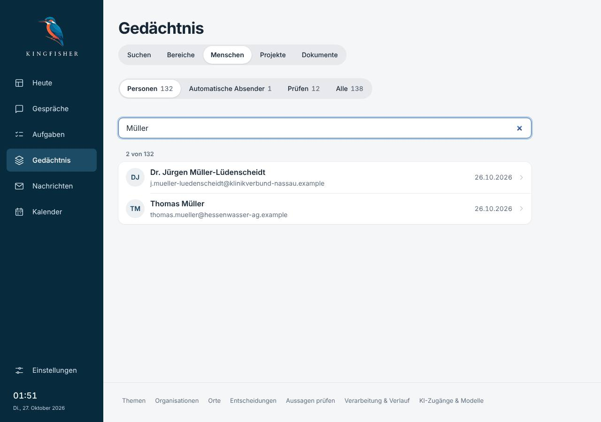 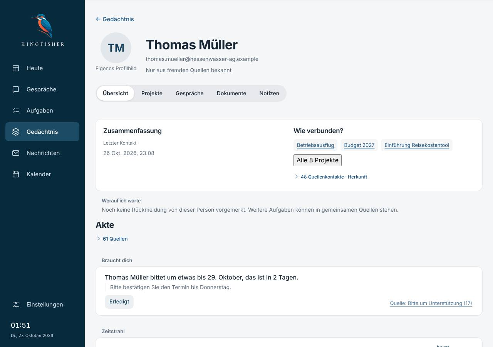

**Ursache.** Die Suchen verglichen Kleinbuchstaben ohne Umschrift (Oberfläche und `Bezuege.sachen`), Namen wurden
nur kleingeschrieben verglichen (`identitaet.name_schluessel`), Organisationen aus Text („Müller Bau“ → `müllerbau`)
und aus Domänen (`mueller-bau` → `muellerbau`) bekamen verschiedene Kennungen. Die Karte „Worauf ich warte“ las nur
Aufgaben „wartet auf“, die Akte darunter die offenen Punkte.

**Behebung.** `suchform.ts` (Gedächtnissuche, Menschen, Nachrichten) und `bezuege.suchformen`: ä/ae, ö/oe, ü/ue, ß/ss in
beide Richtungen, dazu die Form ohne Umlautpunkte. `name_schluessel` in Umschrift: „Thomas Mueller“ gehört zur Adresse
von „Thomas Müller“. Eine erwähnte Organisation gehört zur Domäne, wenn genau eine passt (`Register.organisation`, vom
Verzeichnis abhängig: kommt die Adresse später, wandert die Erwähnung). Kennungen bleiben, wie sie sind (keine
Migration). Die Karte liest `offene_punkte.sammeln(sache=…)`, dieselbe Regel wie die Frage; die Akte darunter
wiederholt „Du wartest auf“ nicht.

**Organisationsnamen.** Aus der Domäne kommt nur dann ein Name mit Umlauten, wenn eine Zeile einer Mail (Signatur,
Absendername) genau den Namen der Domäne trägt („Universität Gießen“, „Hessenwasser AG“); sonst bleibt „Mueller Bau“.
Erwähnungen im Text gehen der Domäne vor.

**Nachher.** 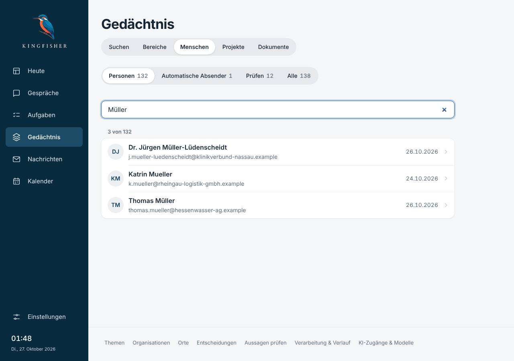 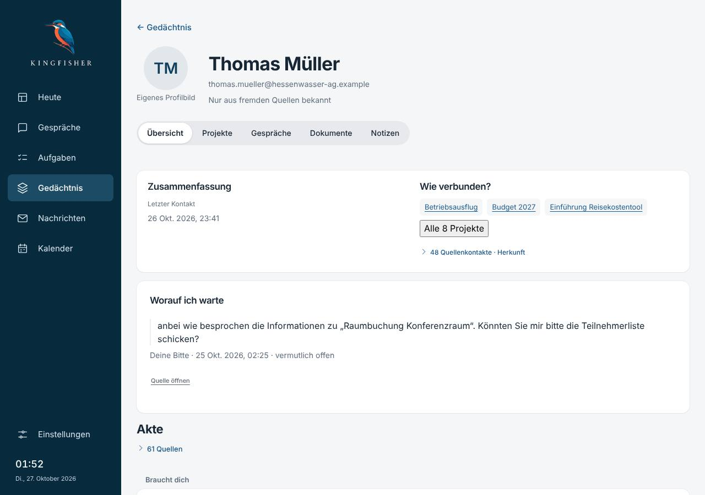 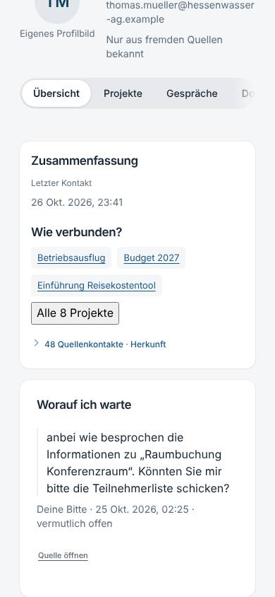

**Tests.** `test_umlaute_personen_organisationen.py` (14), `suchform.test.mjs` (2).

## Falsche Widersprüche

**Nachweis.** In der Welt der Assistentin meldete der Lint zwei „Widersprüche zwischen Akten“ für „Frist
„Informationen““: zwei verschiedene Mails („Freigabe Budget 962“, „Newsletter Oktober“), je „Ich schicke Ihnen die
Unterlagen bis Freitag.“; nach der ersten Behebung zeigte sich ein dritter („den Termin bestätigen“ in zwei Mails).
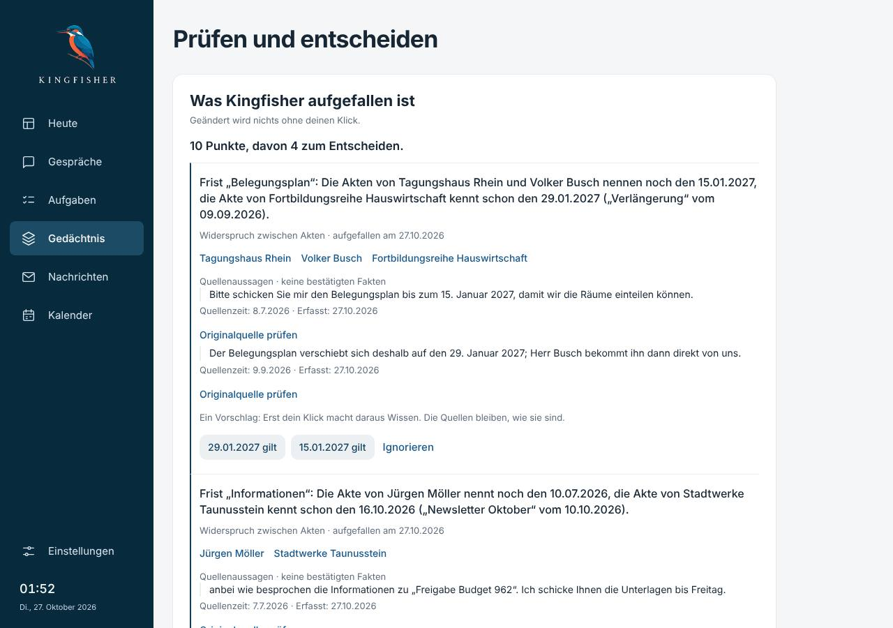

**Ursache** (`akten._fristen`): Der Satz um eine Frist endete nicht nach einem schließenden Anführungszeichen, so
zählte „anbei wie besprochen die Informationen zu …“ zum Gegenstand; und allgemeine Wörter („Unterlagen“, „den Termin
bestätigen“) machten Fristen verschiedener Mails zu einem Gegenstand.

**Behebung.** Satzende auch nach „“”»; allgemeine Wörter (`_ALLGEMEINE_GEGENSTAENDE`) tragen den gleichen Gegenstand
nur im selben Mailverlauf oder in derselben Quelle. Akte 12. **Nicht abgeschwächt:** Der echte Widerspruch
„Belegungsplan“ (15.01. gegen 29.01.2027) und die Anschrift der Druckerei Kranz bleiben. 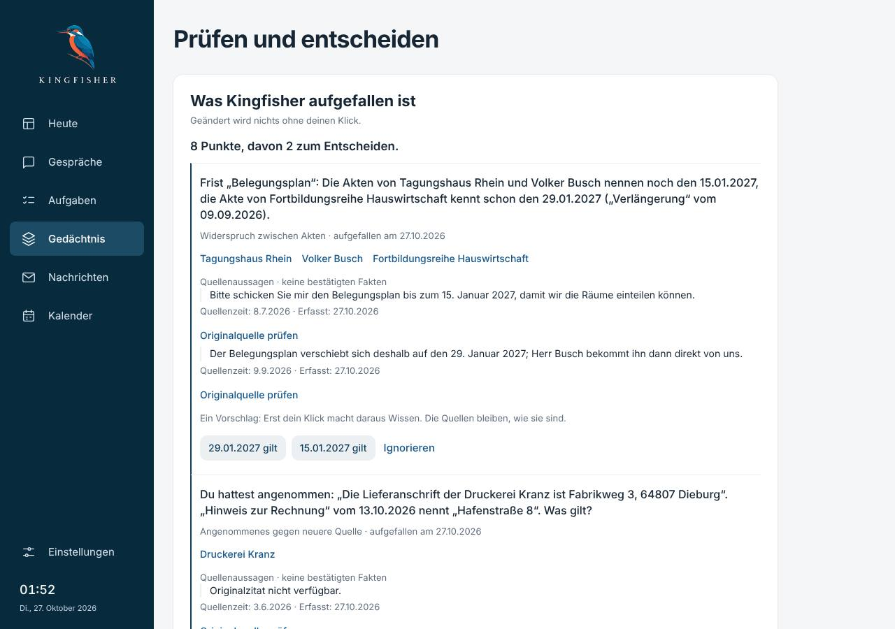

**Tests** in beide Richtungen: `test_keine_falschen_widersprueche.py` (7): Satzende, Floskel ersetzt nicht, zwei
Bitten ersetzen nicht, „den Termin bestätigen“ zweimal, im selben Verlauf ersetzt die neue Frist weiter, „Belegungsplan“
ersetzt über Mails hinweg und bleibt Widerspruch im Lint, die Floskel meldet keinen.

## Geänderte Tests (Vertrag bewusst geändert)

`test_tempo_zwischenspeicher.py::test_heute_schlaegt_die_teilnehmer_einmal_nach`: Der eine Durchgang über die
Beteiligten ist jetzt einer für alle Adressen (`None`), nicht einer für die gefragten.

## Zahlen

- Neue Tests: 55 Backend, 6 Oberfläche. Oberfläche: `tsc` ohne Befund, 962/962 Tests, `vite build` grün.
- `probe_seiten_ui.py` hell und dunkel: je 75 Breiten geprüft, 0 nicht in Ordnung.
- Volle Suite (`sidecar/tests` und `messlatte/tests`, `-n 4`): 8.598 bestanden, 3 übersprungen, 0 rot (13:27 min).

## Sabotageproben

Jede Zusicherung gebrochen, der passende Test wurde rot, danach zurückgesetzt (`sabotage.py`):

| Bruch | roter Test |
|---|---|
| automatische Antwort zählt | `test_automatische_oder_verzoegernde_antwort_beantwortet_nichts[Automatische…]` |
| Zusage ohne Lieferung eingelöst | `test_zusage_bleibt_offen_ohne_lieferung_des_zusagenden[…]`, 3 in `test_akten_entscheidungen.py` |
| Verzögerung zählt | `test_automatische_oder_verzoegernde_antwort_beantwortet_nichts[AW:…]` |
| keine Antwortprüfung | 4 in `test_worauf_warte_ich_verlauf.py` |
| Einladung als Zusage | `test_einladung_an_dich_ist_keine_zusage_sondern_eine_bitte`, `test_angenommene_einladung_…` |
| Annahme übersehen | `test_einladung_erkennen[Danke…]`, `[Vielen…]` |
| „Doch noch offen“ ohne Antwort | `test_doch_noch_offen_holt_einen_beantworteten_punkt_zurueck` |
| Nachfrage aus / trotz neuer Mail | `test_wichtiges_steht_vorn`, `test_messlatte_lage_…`; `test_offene_punkte::test_worauf_warte_ich_und_…` |
| alte Frist hebt nach vorn | `test_wichtiges_steht_vorn` |
| nur nach Datum | `test_wichtiges_steht_vorn`, `test_messlatte_lage_…` |
| Merken ohne Stand | `test_gemerkte_antwort_gilt_nur_bis_zur_naechsten_aenderung`, `test_merken_nach_stand_…` |
| Verzeichnis ohne Stand | `test_verzeichnis_der_beteiligten_wie_die_einzelabfrage_…` |
| schlanke Akte mit Namen | `test_schlanke_akte_…`, `test_viele_akten_lesen_…` |
| schnelles Briefing mit Vorbereitung / bucht Blick | `test_schnelles_briefing_zeigt_den_fertigen_teil_mit_zwischenstand` |
| Vorbereitung nicht gemerkt | `test_terminvorbereitung_einmal_je_stand_und_neu_nach_einer_neuen_mail` |
| Start ohne Vorrechnen | `test_beim_start_sind_die_aktiven_akten_vorgerechnet` |
| Vorbereitung ohne Nachführen | `test_vorbereitung_findet_die_offene_bitte_des_teilnehmers_ohne_wahl` |
| keine Namen im Kalender | `test_kalender_nennt_namen_statt_adressen` |
| Name ohne Umschrift | 4 Fälle `test_namen_gelten_in_umschrift_als_gleich` |
| Organisation ohne Umschrift / nicht abhängig | `test_erwaehnte_organisation_…`, `test_kommt_die_adresse_spaeter_…` |
| Signatur aus / Domäne vor Text | `test_name_der_organisation_aus_der_signatur_…`, `test_erwaehnte_organisation_…` |
| Suche ohne Formen | `test_suche_in_den_akten_findet_beide_schreibweisen` |
| Karte ohne gemeinsame Regel | `test_personenseite_sagt_dasselbe_wie_worauf_warte_ich` |
| Satzende ohne Anführungszeichen | `test_satz_endet_auch_nach_einem_schliessenden_anfuehrungszeichen` |
| allgemeine Wörter zählen / „Termin“ nicht allgemein | `test_gleiche_floskel_…`, `test_die_floskel_…`; `test_bestaetigen_sie_den_termin_…` |
| Verlauf ignoriert / Bestimmtes nur im Verlauf | `test_im_selben_verlauf_ersetzt_…`; `test_bestimmter_gegenstand_…`, `test_akten.py::test_verschobene_frist_…` |

## Grenzen

- Die Welt nutzt die Regel-Einordnung der Messlatte: „anbei wie besprochen die Informationen zu „Bitte um Rückruf““
  gilt dort als Bitte (Wort „Bitte“ im Betreff), und „Das Layout schicke ich Ihnen bis …“ nicht als Zusage. Das ist ein
  Prüfartefakt, kein Produktfehler; die Reihenfolge stützt sich deshalb auch auf den Mailverlauf selbst.
- „Beantwortet“ ist eine Vermutung wie jedes „erledigt“ der Akte: Eine Antwort ohne Inhalt („Danke, schaue ich mir an“)
  beantwortet deine Bitte; was sie neu zusagt, ist ein eigener Punkt. Ohne genaue Kopfzeilen gibt es keinen Verlauf.
- Öffnen direkt nach einer anderen Frage dauert für „Was brauche ich morgen?“ rund 1,1 s: Jede gespeicherte Frage
  schreibt in den Bestand und macht das Gemerkte ungültig. Die volle Tageslage braucht beim ersten Mal 4–5 s; bis
  dahin steht der fertige Teil mit Zwischenstand.
- „zuletzt 13.12.2026“ unter „Mit wem“ zählt künftige Termine mit (unverändert, nicht Teil des Befunds).
- Organisationen aus Text, zu denen keine Adresse passt, behalten ihre Kennung mit Umlauten; die Suche findet sie in
  beiden Schreibweisen. Bestehende Erwähnungen wandern zur Domäne, sobald sich das Verzeichnis ändert.
