# Befunde der Persona-Prüfung: Paket B, Barrierefreiheit (B1 bis B5)

Stand 27.10.2026, Branch `fix/befunde-barrierefrei` auf dem Integrationsstand `docs/persona-pruefung-20261026` (1.0.29
mit Paket D, A-I, A-II und Z). Befunde aus [der Persona-Prüfung](../2026-10-26-persona-pruefung/README.md), Abschnitt
„4. Barrierefreiheit“, Maßstab WCAG 2.2 AA. Nachgestellt mit der Messlatte-Welt („Lea Hartmann“) wie die Persona
„Tarik Aydin“ (Vorleser und Tastatur), für B5 auch am Handy (390 px). Nur synthetische Daten, Attrappen statt Postfach,
Kalender und Modell. Echter Sidecar, gebaute Oberfläche, Chromium mit Playwright: Tastatur-Durchgang (Tab, Umschalt+Tab,
Enter, Escape, Pfeile, Pos1/Ende, Bild auf/ab), Barrierefreiheitsbaum (`aria_snapshot`, CDP), Live-Regionen mitgeschnitten.
Vorher: der Ausgangsstand `f0aba6b`, nachher dieser Branch.

## B1 Die fertige Antwort wird nicht angesagt

**Vorher.** Frage auf der Startseite der Gespräche gestellt: Angesagt wurde nur „Formuliert …“ und „Kingfisher
antwortet …“, die Antwort erschien still; danach lag der Fokus auf `body`, der nächste Tab sprang auf „Heute“.
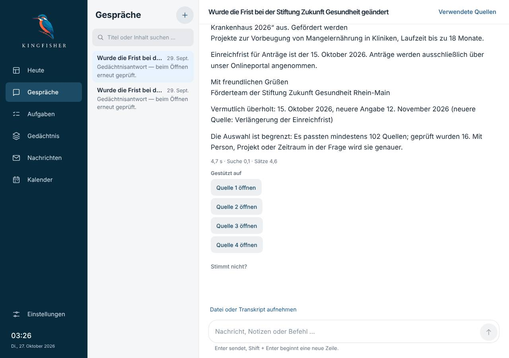

**Ursache.** Es gab keinen Ort, der die fertige Antwort ansagt; die Wartezeile verschwindet mit ihr. Die Startseite der
Gespräche stellt die Frage und wechselt dann in das Gespräch, eine neue Seite, deren Eingabefeld beim Laden noch gesperrt
ist; mit dem Sendeknopf abgeschickt, wird der Knopf gesperrt und verliert den Fokus.

**Behebung.** Ein Ort für höfliche Ansagen über allen Seiten (`grundlage/Ansage.tsx`, Modell `ansageOrt.ts`, einmal in
`main.tsx`), der den Wechsel ins Gespräch überlebt. Ist eine Antwort fertig (senden, neu beantworten, wiederholen, nach dem
Start aus der Liste), sagt er einmal „Kingfisher antwortet: …“ mit dem Anfang (ganze Sätze bis etwa 220 Zeichen, ohne
Markdown und Belegnummern, `antwortAnsage.ts`), bei einer Rückfrage „Kingfisher fragt zurück: …“. Den Zwischenstand sagt
weiter nur die Wartezeile in Schritten, die Nachrichtenliste ist keine Live-Region. Der Fokus bleibt im Eingabefeld: der
Sendeknopf gibt ihn dorthin, und kam die Frage von einer anderen Seite, geht er hinein, sobald es bereit ist.

**Nachher.** Ansagen der Reihe nach: „Formuliert …“, „Kingfisher antwortet …“, dann „Kingfisher antwortet: Eine kurze
Antwort ließ sich nicht sicher genug belegen. So steht es in deinen Quellen: …“; Fokus danach in allen drei Wegen
(Startseite, Enter im Gespräch, Sendeknopf) auf „Kingfisher fragen“. 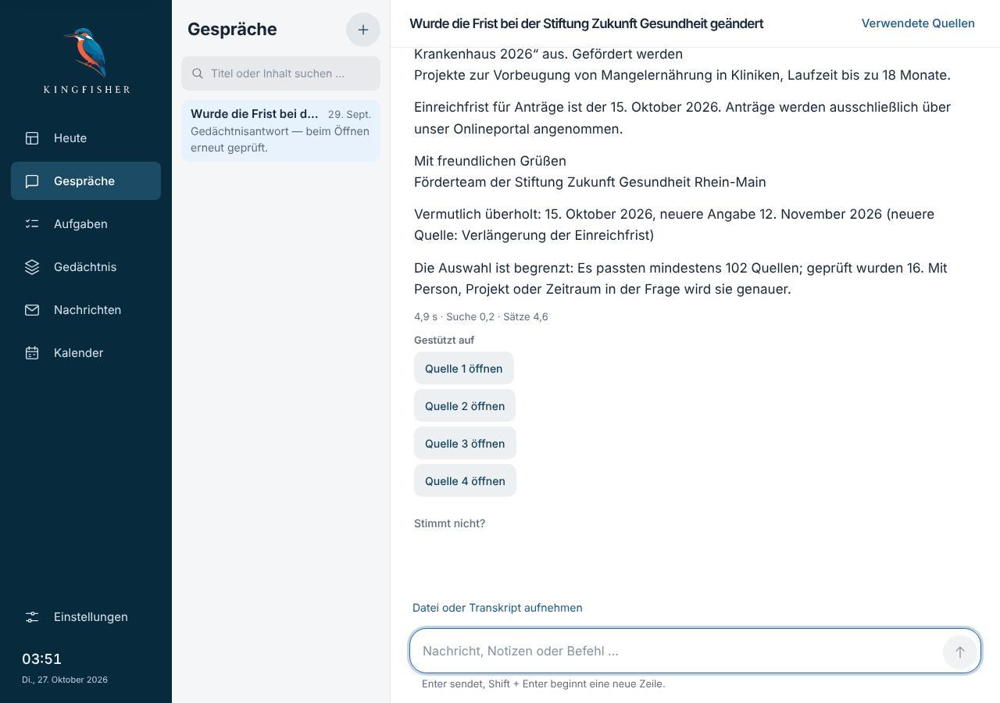

**Tests.** `antwort-ansage.test.mjs` (6).

## B2 Seitenwechsel ohne Titel, Fokus und Sprunglink

**Vorher.** Jede Seite hieß „Kingfisher“; nach Enter auf einem Eintrag der Navigation lag der Fokus auf `body`; kein
„Zum Inhalt springen“. Beim Laden von `/vorhaben` übersprang der erste Tab sogar die Navigation und landete in der Suche.

**Ursache.** Kein Ort setzte Titel oder Fokus: Jede Seite rendert ihre ganze Fläche neu, der fokussierte Knopf der alten
verschwindet. Der übersprungene Tab: Die Aufgabenseite rollte ihr gewähltes Segment mit `scrollIntoView` in den Blick, und
Chrome setzt damit den Ausgangspunkt für Tab auf das Segment.

**Behebung.** `grundlage/Seitenwechsel.tsx` (Modell `seitenwechselModell.ts`) setzt den Fenstertitel je Pfad
(„Aufgaben – Kingfisher“; ein Gespräch, eine Person oder Akte mit ihrem Namen davor, der Titel folgt der Überschrift,
wenn sie erst mit den Daten kommt) und stellt nach einem Wechsel, bei dem der Fokus verloren ging, den Fokus auf die
Hauptüberschrift (`tabindex=-1`); was die neue Seite selbst fokussiert, bleibt (B1). Erstes Laden und Wechsel von Ansicht
oder Filter (`?view=`) zählen nicht. „Zum Inhalt springen“ ist der erste Tab-Halt, sichtbar nur mit Fokus, und führt zur
Hauptüberschrift. Das Segment rollt ohne `scrollIntoView` in den Blick (`segmentInsBild`).

**Nachher.** Je Bereich: Titel „Gespräche – Kingfisher“ usw., Fokus nach Enter auf der Überschrift („Was beschäftigt
dich?“, „Aufgaben“, „Guten Morgen, Lea.“), der nächste Tab führt in den Inhalt. Gespräch: „Wurde die Frist bei der Stiftung
Zukunft Gesundheit geändert – Gespräche – Kingfisher“. Erster Tab auf jeder Seite: „Zum Inhalt springen“, Enter: Fokus
auf „Aufgaben“, Tab: „+ Aufgabe“. 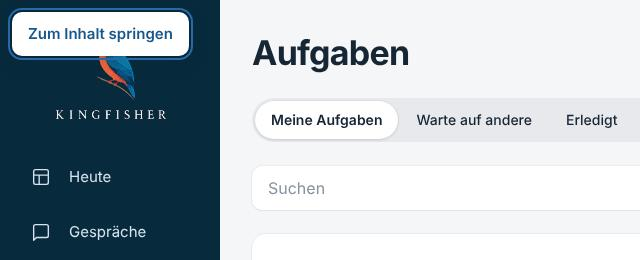

**Tests.** `seitenwechsel.test.mjs` (6), darunter: keine Route der App heißt nur „Kingfisher“.

## B3 Die Rückfrage ist kein Dialog

**Vorher.** „Quelle wirklich entfernen?“ stand in der Zeile; nach Enter lag der Fokus auf dem Abschnitt, Escape tat nichts,
der zweite Tab landete auf „Entfernen“. 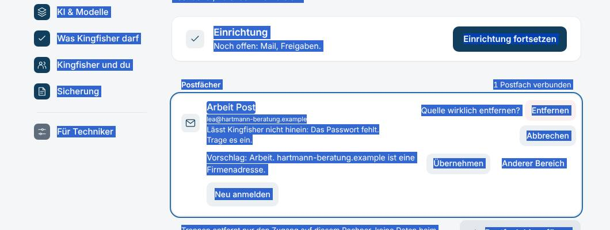

**Ursache.** Jede Stelle baute ihre Rückfrage selbst, als Satz mit zwei Knöpfen, und blendete den Auslöser dafür aus;
damit war der fokussierte Knopf weg.

**Behebung.** Ein Baustein für alle: `grundlage/Rueckfrage.tsx` (Modell `rueckfrageModell.ts`). Modaler `<dialog>` mit
`role=alertdialog`, `aria-modal`, beschriftet mit der Frage, beschrieben mit dem Satz; Fokus beim Öffnen auf „Abbrechen“
(beim Widerruf einer Aussage im Feld für den Grund, das allein nichts auslöst); Fokusfalle; Escape bricht ab; danach
Fokus zurück zum Auslöser, der jetzt stehen bleibt, oder, wenn er mit seiner Zeile verschwand, auf deren Liste (Regel
`fokusZiel` aus Z3). Während die Aktion läuft, bleiben die Knöpfe stehen und fokussiert (`aria-disabled`), ein Fehler
steht im Dialog statt dahinter. Gefunden und umgestellt, 13 Stellen: Postfach und Kalender entfernen (`KontoZeile`,
`Quellenformulare`), Sortierergebnis verwerfen, Frage nicht mehr/wieder verwenden, Quelle ausschließen/wieder zulassen
(`ProfileSource`), Entscheidung zurücknehmen, Zielangabe widerrufen, Zusammenführung aufheben, Gesundheitsangabe nicht mehr
verwenden, Quellenzuordnung lösen, Datei ausschließen, Dateivorschau verwerfen, Mitschriften-Ordner trennen, Modelle laden,
Aussage widerrufen. Nicht umgestellt: Einwilligungen (Cloud einschalten, Cloud je Aufgabe) sind Formulare mit Auswahl und
Zustimmung, keine Ja-Nein-Frage, ihr Auslöser bleibt stehen; Vorschauen vor dem Speichern (Ordner, Pin, Gruppe) sind der
Speicherweg selbst.

**Nachher (Tastatur, 1280 und 390 px hell, 1280 dunkel).** Enter auf „Arbeit Post entfernen“: `alertdialog „„Arbeit
Post“ wirklich entfernen?“`, modal, Fokus „Abbrechen“; Tab ×4: Entfernen, Abbrechen, Entfernen, Abbrechen; Escape: zu,
Fokus wieder auf „Arbeit Post entfernen“. Entfernen bestätigt: Zeile weg, Fokus auf der Gruppe „Noch kein Postfach
verbunden.“
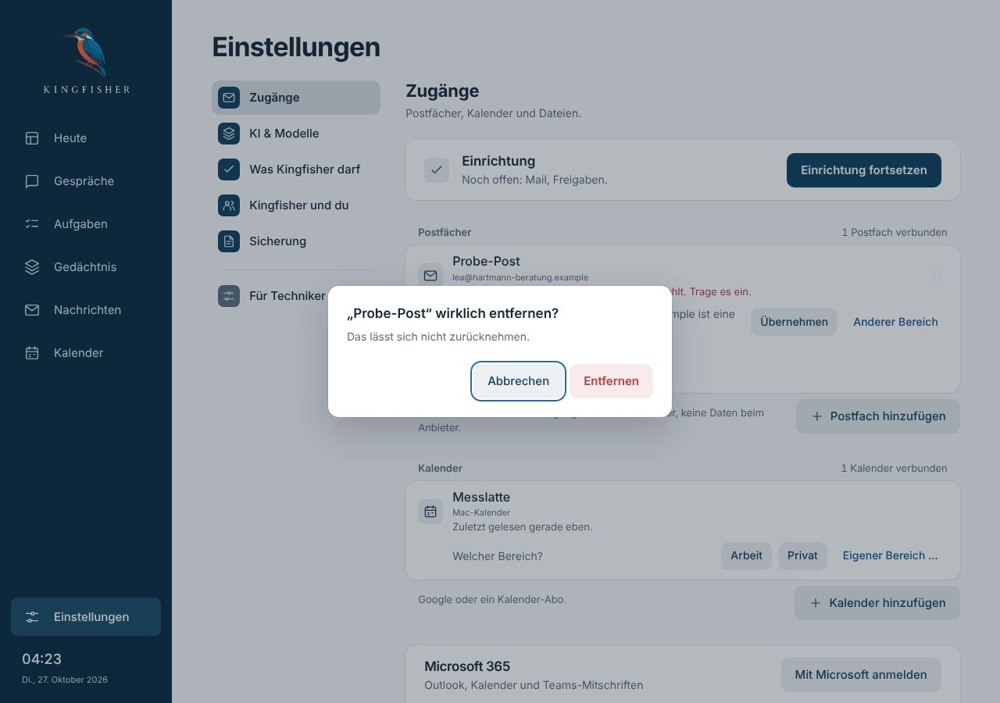 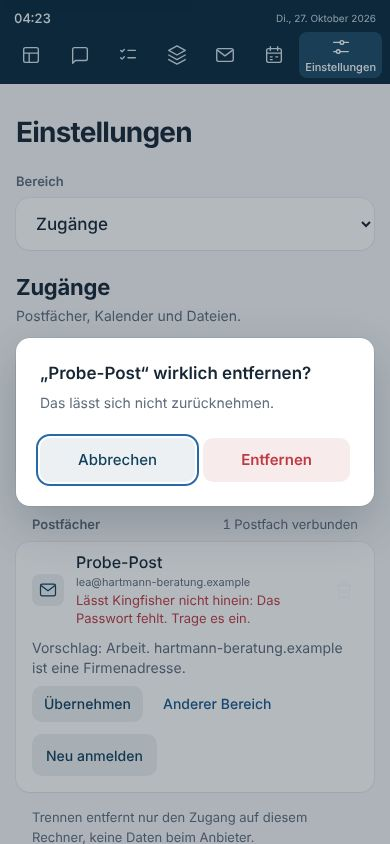 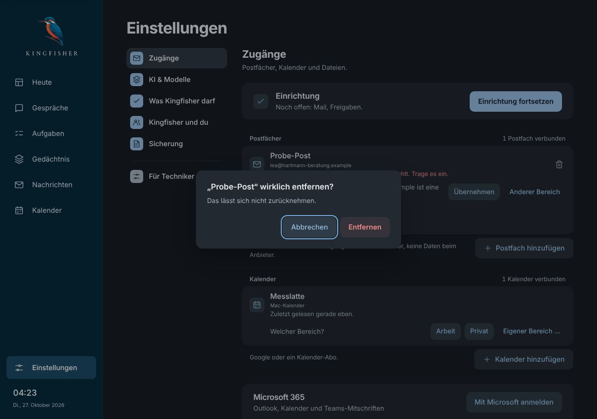

**Tests.** `rueckfrage.test.mjs` (7, auch: jede der 13 Stellen nutzt den Baustein; keine Zeilen-Rückfrage, kein eigenes
`alertdialog`, kein „wirklich …?“ außerhalb). Angepasst: `hinweis`, `gespraechsquelle`, `conversation-input`;
`scripts/probe_seiten_ui.py` (Befund 15 sucht den Dialog, prüft den Fokus auf „Abbrechen“), `scripts/probe_modellkarte_ui.py`.

## B4 Fokus unsichtbar, Platzhalter und Stand zu blass

**Vorher.** Suche und Projektwahl unter Aufgaben ohne sichtbaren Fokus (hell und dunkel); Platzhalter 2,62–3,92:1; „Stand
07:30“ auf dem Bergbild hell min. 3,24 / p10 3,64:1, dunkel 3,45 / 3,56:1.
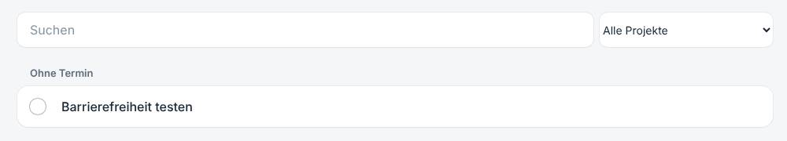 

**Ursache.** Der Feldfokus war ein Hauch (`box-shadow`) bei durchsichtiger Kontur; die Aufgabensuche setzt mit höherer
Spezifität ihren eigenen Schatten und keinen Rahmen, damit blieb nichts. Platzhalter: `--g-platzhalter #8592a0` und
mehrere eigene Farben. Der Stand stand in „Leise“ auf dem Bild.

**Behebung.** Feldfokus als `outline` von 2 px in der Auswahlkante (5,3–5,7:1 hell, 6,3–7,2:1 dunkel), der lokale
Schatten nicht überschreiben; Suche und Eingabe im Gespräch zeigen ihn am Rahmen. Platzhalter überall die eine Rolle,
`#5a6776` hell (4,79–5,77:1) und `#9aa6b2` dunkel (4,79–6,84:1). Stand in Tinte mit Strichstärke 400 (gedeckt über die
Strichstärke, nicht über eine Farbe). Dabei gefunden: die Zahl im Segment (4,43:1), jetzt Tinte zu 72 % (5,58:1).

**Nachher.** Persona-Kontrastprobe (alle Seiten, hell und dunkel): 0 Befunde (vorher 4). Stand hell min. 9,29 / p10
10,44:1, dunkel 5,88 / 6,0:1. Fokusprobe: keine Stelle ohne sichtbare Änderung außer Suche und Eingabe im Gespräch, deren
Rahmen ihn zeigt (`outline 2px solid`, gemessen am Rahmen).
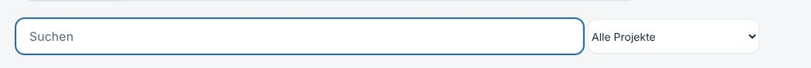 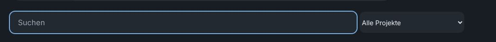
 

**Tests.** `fokus-kontrast.test.mjs` (7, rechnet die Kontraste aus den Rollen nach).

## B5 Kalendermonat und Überschriften

**Vorher.** Im Oktober 39 Tab-Halte im Monat (jeder Tag und jeder Termin), Pfeiltasten ohne Wirkung, Tage als
„1.10.2026, 0 Termine im geladenen Zeitraum“; ein Termin 134 × 23 px. Nachrichten mit zwei h1, Aufgabenlisten (Warten,
Erledigt, Entscheidungen) und Bereiche ohne Überschrift unter dem Titel.
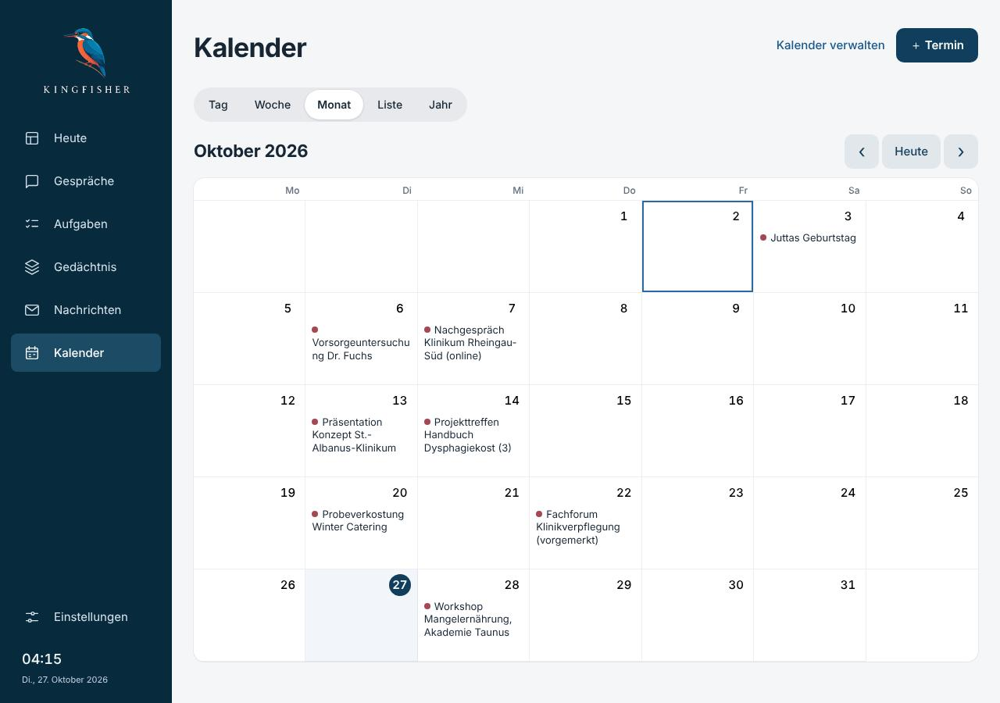 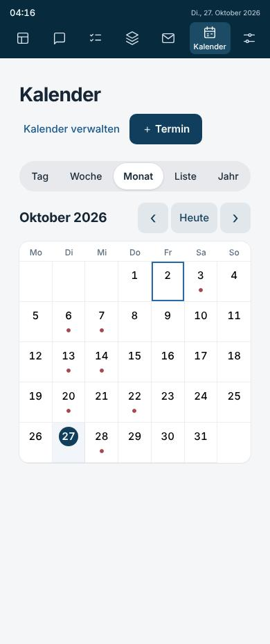

**Ursache.** Der Monat war eine Fläche aus Knöpfen ohne Rastermodell; am Handy blieben die Punkte Tab-Halte. Der Betreff
der Mail war ein h1; die Listen bekamen ihren Namen nur als `aria-label`.

**Behebung.** `role=grid` mit Wochen als `role=row` (CSS `subgrid`, das Aussehen bleibt), Wochentage als Spaltenköpfe,
Tage als `gridcell` mit `aria-selected`; ein Tab-Halt (roving tabindex) auf dem gewählten Tag; Pfeile, Pos1/Ende, Bild
auf/ab (`calendarGrid.ts`); Enter öffnet die Termine des Tages in der Liste und fokussiert den ersten. Beschriftung
„Mittwoch, 28. Oktober, 1 Termin“, heute mit „, heute“ und `aria-current=date`. Termine im Tag ohne Tab-Halt, mindestens
24 px; am Handy ist der ganze Tag (mindestens 47 × 68 px) das Ziel, die Punkte sind Zeichen. Paket H kann die Darstellung am
Handy ändern: Raster, Tasten und Beschriftung hängen nicht an der Breite. Überschriften: Betreff als h2, `Gruppe` mit
`stufe`, Aufgabenlisten und „Entscheidungen“ mit h2 (sichtbar steht der Name im Segment), Gruppen darunter h3,
Gedächtnis „Bereiche“ mit h2, Menschen und Projekte „Menschen: 72 Einträge“.

**Nachher.** 1 Tab-Halt im Monat (1280 und 390, hell und dunkel), 0 Ziele unter 24 px; Pfeile: „Mittwoch, 28. Oktober,
1 Termin“, ↓ „Mittwoch, 4. November“, Pos1 „Montag, 2. November“, Bild ab „Dienstag, 8. Dezember“; Enter auf dem 28.:
Fokus auf „Workshop Mangelernährung …“ in der Liste. `aria_snapshot`: `grid "Oktober 2026"` → `row` → `columnheader
"Montag"` …, `gridcell "Mittwoch, 28. Oktober, 1 Termin" [selected]`. Überschriftenproben über 35 Ansichten (Seiten, Reiter, Kalenderansichten, Gespräch, Person,
Projekt): je ein h1, keine Sprünge, keine doppelten h1/h2. 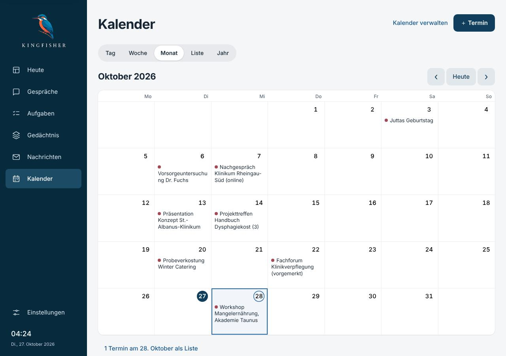 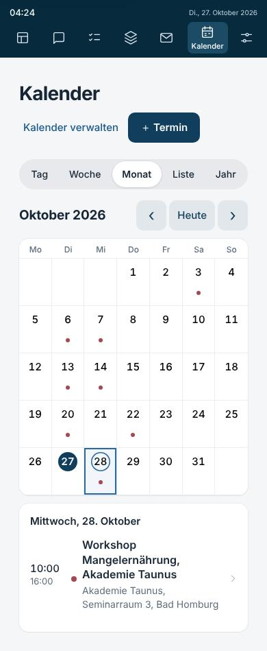
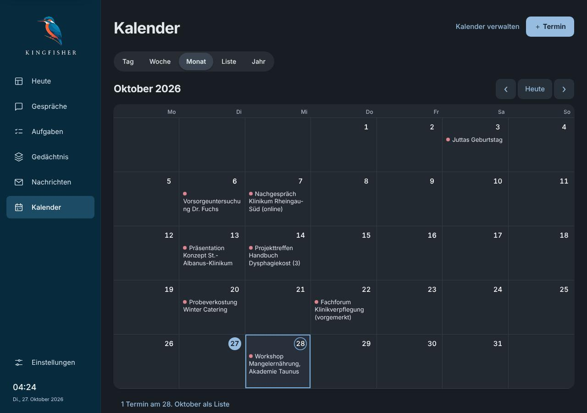 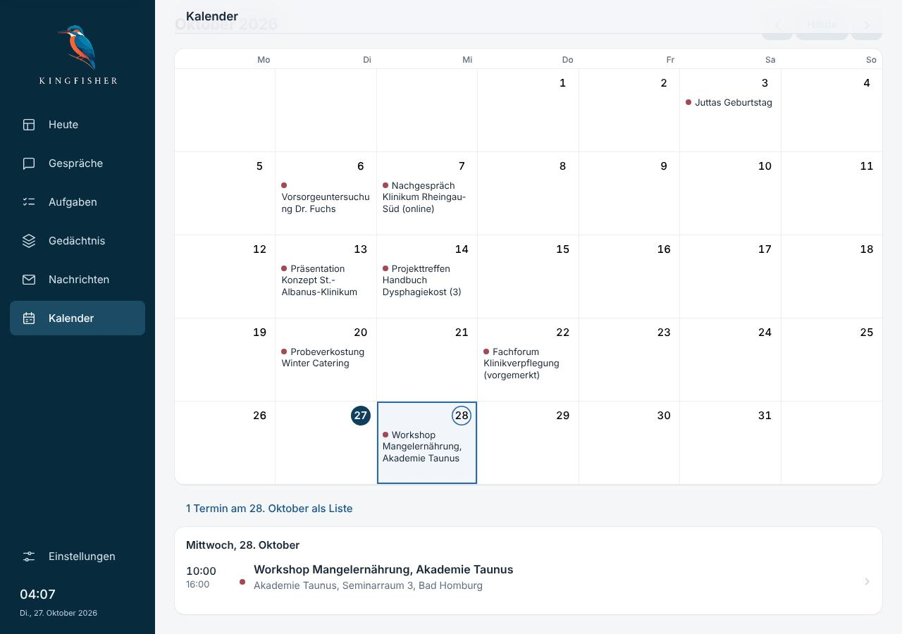

**Tests.** `kalender-raster.test.mjs` (6). Angepasst: `calendar-workspace` (findet den Tag an seinem neuen Namen).

## Zahlen

- Oberfläche: `tsc` ohne Befund, 1010 Tests grün (+32), `vite build` ok.
- Backend unverändert; gezielt die 14 Testdateien, die Oberfläche, Bausteine oder Skripte lesen: 193 bestanden,
  2 übersprungen.
- `scripts/probe_seiten_ui.py` hell und dunkel: je 75 Breiten, 0 nicht in Ordnung, ok.
- `scripts/probe_modellkarte_ui.py` bricht auf dem Ausgangsstand wie hier vor dem geänderten Schritt ab (Zeile 105,
  `.model-rec-total` verborgen); mit diesem Paket hat das nichts zu tun.

## Sabotageproben (alle rot, danach zurückgesetzt)

| Probe | rot wird |
|---|---|
| Fokusfalle lässt am Ende hinaus | `rueckfrage` 1 |
| Escape bricht nicht ab | `rueckfrage` 4 |
| Fokus beginnt auf der Aktion | `rueckfrage` 2 |
| ohne `aria-modal` | `rueckfrage` 2 |
| kein Fokus zurück zum Auslöser | `rueckfrage` 4 |
| Knöpfe `disabled` statt `aria-disabled` | `rueckfrage` 3 |
| Postfach wieder als Zeilen-Rückfrage | `rueckfrage` 6 |
| Entscheidung ohne Frage im Dialog | `rueckfrage` 5, `hinweis` |
| Aufgaben ohne Fenstertitel | `seitenwechsel` 1, 2 |
| Fokus auch, wenn die Seite ihn gesetzt hat | `seitenwechsel` 3 |
| Sprunglink hinter der App | `seitenwechsel` 5 |
| Segment wieder mit `scrollIntoView` | `seitenwechsel` 6 |
| keine Ansage nach dem Senden | `antwort-ansage` 5 |
| Ansage ohne Leeren (gleicher Satz still) | `antwort-ansage` 4 |
| Markdown vorgelesen | `antwort-ansage` 1 |
| Sendeknopf behält den Fokus | `antwort-ansage` 6 |
| Start der Gespräche ohne Merker | `antwort-ansage` 5 |
| Platzhalter wieder `#8592a0` / dunkel `#8a96a3` | `fokus-kontrast` 1 |
| eigene Platzhalterfarbe | `fokus-kontrast` 2 |
| Feldfokus wieder durchsichtig | `fokus-kontrast` 3 |
| Gesprächseingabe nur mit Hauch | `fokus-kontrast` 3, 4 |
| Stand wieder leise | `fokus-kontrast` 5 |
| Segmentzahl wieder leise | `fokus-kontrast` 7 |
| ↓ nur ein Tag / Bild ab ohne Monatsende | `kalender-raster` 2 |
| jeder Tag ein Tab-Halt / Termine wieder Tab-Halte / ohne `grid` | `kalender-raster` 4 |
| Beschriftung ohne Wochentag | `kalender-raster` 3 |
| Termin wieder 23 px | `kalender-raster` 5 |
| Betreff wieder h1 / Gruppen wieder h2 / Aufgabenliste ohne h2 | `kalender-raster` 6 |

## Grenzen

- Kein echter Vorleser (VoiceOver), kein echtes iOS; Ansagen aus den Live-Regionen und dem Barrierefreiheitsbaum von
  Chromium abgeleitet. Ob VoiceOver die Ansage nach dem Fokuswechsel ins Eingabefeld vollständig liest, ist nicht gemessen.
- Die Wochen nutzen CSS `subgrid` (Safari ab 16, Chrome ab 117); ältere WebViews zeigen den Monat dann einspaltig.
- Die Mail im Lesebereich: Betreff h2, „Auf einen Blick“ und „Verlauf“ stehen als h2 daneben statt darunter.
- Heute zeigt zwei Klärungen beide als „Gedächtnis klären“ (h3, Titel aus `morning.py`); das ist Inhalt, keine Gliederung,
  und gehört zu „Sprache“.
- `16-gestaltung.md` nennt „Welt-Meldung abbestellen“ und „Mitschrift zuordnen oder lösen“ als Stellen mit Rückfrage; im
  Code fragen beide nicht nach. Nicht geändert (keine neue Rückfrage ohne Entscheidung), hier vermerkt.
- Skripte, Messwerte und alle Bilder liegen im Arbeitsordner der Sitzung (`befunde/barrierefrei/`), hier eine Auswahl.
