# Befunde der Persona-Prüfung: Paket H, Handy (H1 bis H3)

Stand 27.10.2026, Branch `fix/befunde-handy` auf dem Integrationsstand `docs/persona-pruefung-20261026` (1.0.29 mit
Paket D, A-I, A-II, Z und B). Befunde aus [der Persona-Prüfung](../2026-10-26-persona-pruefung/README.md), Abschnitt
„5. Handy“. Nachgestellt wie die Persona „Leon Krüger“: Messlatte-Welt („Lea Hartmann“), zwei Postfächer, ein
Kalender-Abo, zwei Aufgaben, die Kingfisher selbst angelegt hat; Uhr 29.09.2026, 07:35. Nur synthetische Daten,
Attrappen statt Postfach, Kalender und Modell. Echter Sidecar, gebaute Oberfläche, Chromium mit Playwright bei 390 × 844
mit Touch (`is_mobile`, `has_touch`, `pointer: coarse`), hell und dunkel, dazu 1280 px und 1024 px mit Zoom 200 %
(512 × 384 CSS-px). Vorher: der Ausgangsstand `d97943c` (gebaut aus einem eigenen Worktree), nachher dieser Branch.

## H1 Kalender am Handy

**Vorher.** Vorgabe Monat (nur Punkte). Woche: sichtbar Montag bis Donnerstag, `calendar-time-scroll` 576 statt 334 px
breit, Freitag bis Sonntag rechts versteckt; Titel „Gespräc|h“, „Senioren|residenz“, in der Liste „Ganztä|gig“. Monat
bei 1024 px mit Zoom 200 %: die Woche des 29.9. bei 718–787 px, das Fenster 384 hoch; bei 1280 × 800 ebenso darunter
(746–864). 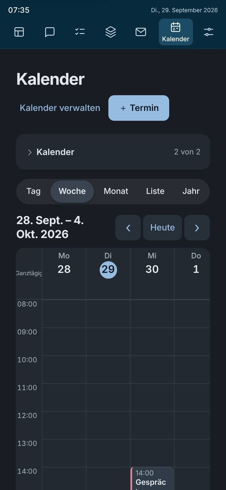 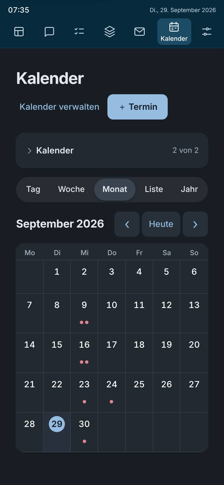
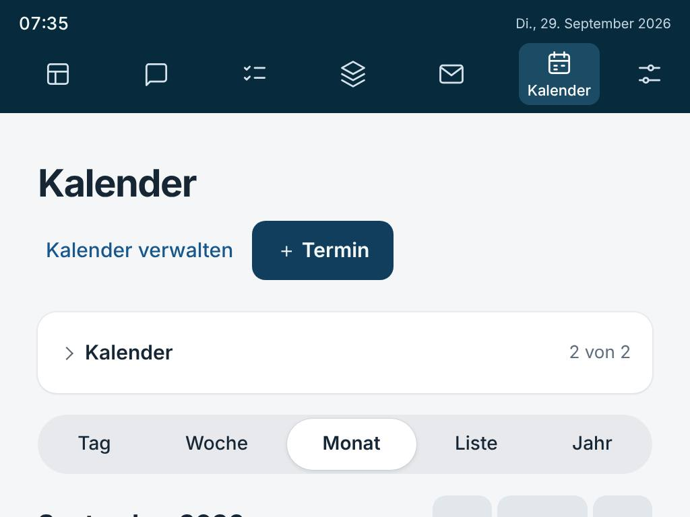

**Ursache.** Die Woche hatte schmal je Tag mindestens 76 px (`--g-kal-tag-schmal`), sieben Tage passen bei 390 nicht.
Die Vorgabe war fest „Monat“, und die Seite schrieb jede Ansicht beim Öffnen zurück in den Speicher, auch die Vorgabe
(`useEffect` auf `view`): Wahl und Vorgabe waren nicht zu unterscheiden. Der Monat begann immer oben. Im Linux-Chromium
der Prüfung gibt es keine Trennwörterbücher, `hyphens: auto` wirkt dort nicht; geteilt wurden die Wörter von
`overflow-wrap` in zu engen Spalten.

**Behebung.** `kalenderAnsicht.ts`: Vorgabe am Handy (bis 700 px) ist die **Liste**: die nächsten sieben Tage ab heute,
jeder Termin mit Uhrzeit, ganzem Titel und Ort, ohne seitliches Rollen; breit bleibt der Monat. Begründung nach „Ist die
Vorgabe die richtige?“: Am Handy will man wissen, was als Nächstes kommt; die Liste zeigt das ohne Tippen, drei Tage im
Zeitraster würden Titel weiter kürzen, der Monat zeigt nur Punkte. Es ist eine Ansicht im bestehenden Umschalter, keine
neue. Gemerkt wird nur eine Wahl im Umschalter (eigener Schlüssel); der alte gilt weiter, außer er sagt „Monat“ am Handy
(das war die alte Vorgabe). Ohne eigene Wahl folgt die Ansicht der Breite. Woche schmal: sieben Spalten `minmax(0,1fr)`,
Zeitspalte 34 px, Rand 16 px, je Tag 45 px; Titel `overflow-wrap: normal` und `hyphens: auto` (zerschnitten wird kein
Wort, getrennt wird mit Strich, wo der Browser es kann). Liste und Details: `break-word` statt `anywhere`, mit
`hyphens: auto`; „Ganztägig“ in 13 px in einer 64-px-Spalte. Monat: beim Öffnen (einmal je Zeitraum und Tag) rollt die
Seite die Woche des gewählten Tages gerade so weit ins Bild, dass sie über der Leiste steht (`rollenFuerZeile`,
`window.scrollBy`, kein `scrollIntoView` wegen B2).

**Nachher.** Vorgabe „Liste“, Woche mit allen sieben Tagen, kein Element rollt seitlich, 0 Wortbrüche ohne Strich (hell
und dunkel). Zoom 200 %: Woche bei 243–312 von 384 px; 1280 × 800: 670–788 von 800. Monat gewählt, neu geladen: Monat.
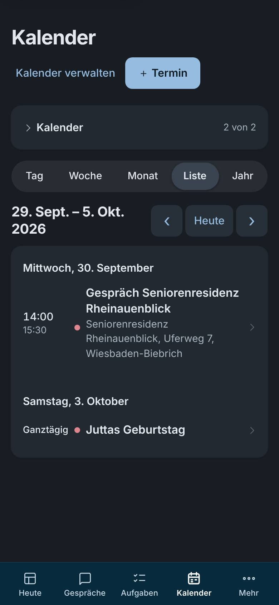 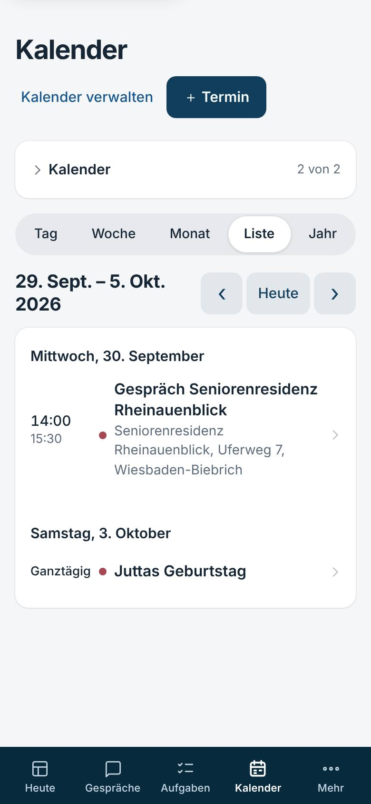
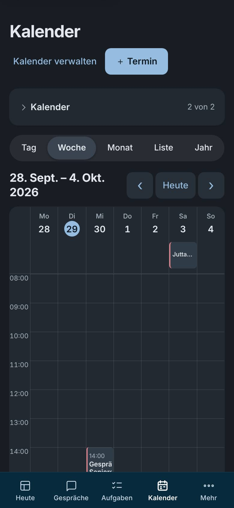 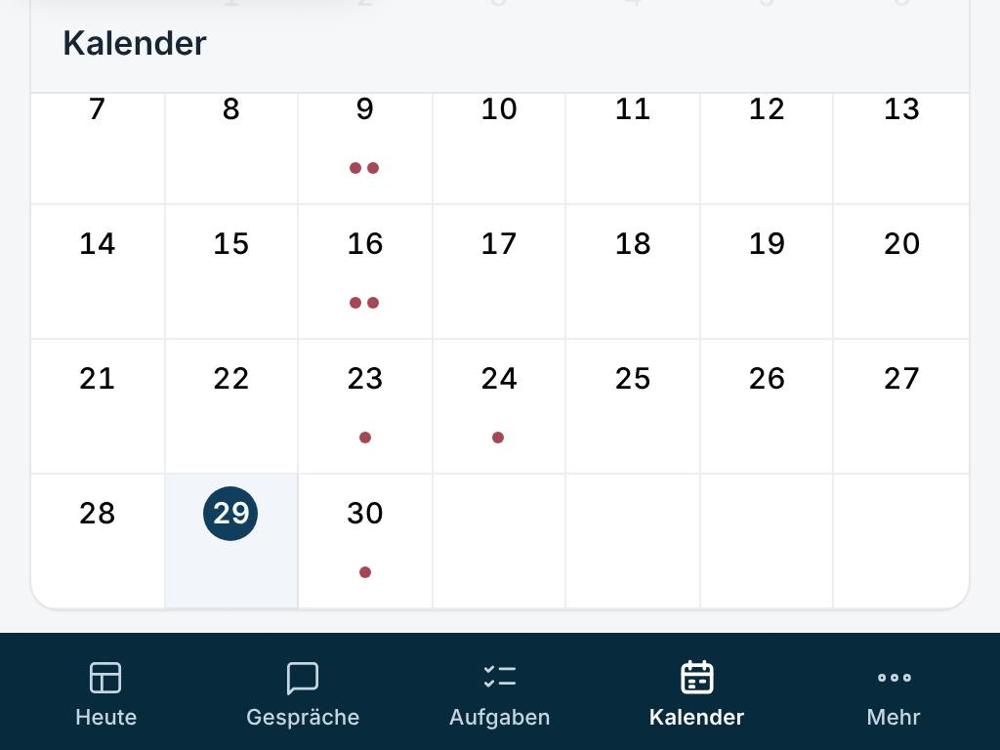
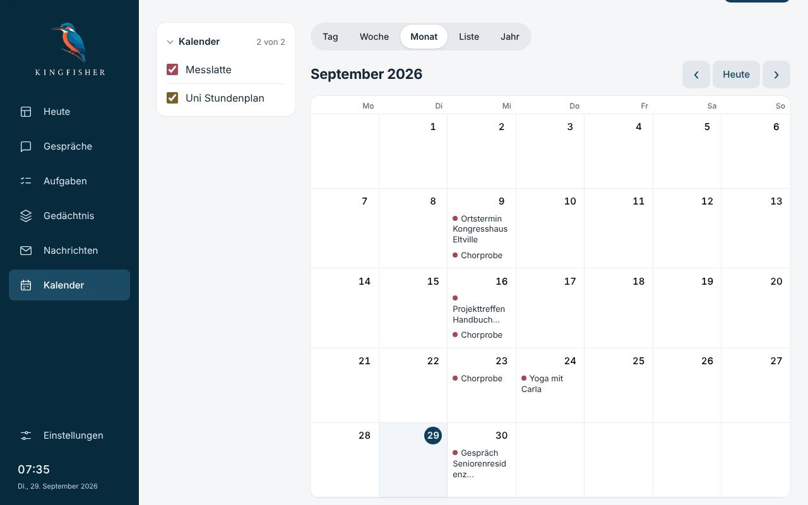

**Tests.** `handy-kalender.test.mjs` (5). Angepasst: keine; `calendar-workspace`, `kalender-raster` (B) grün.

## H2 Navigation am Handy

**Vorher.** Sieben Zeichen ohne Namen in einem Streifen oben (nur der aktive Bereich mit Namen), nach 1200 px Rollen
weg. Projekte zweimal: „Gedächtnis → Projekte“ und „Aufgaben → Projekte“. 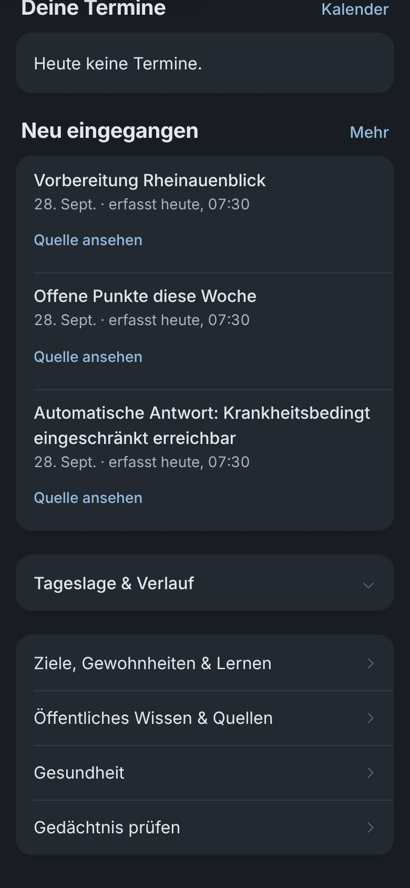

**Ursache.** Unter 700 px wurde die Seitenleiste zum Streifen `position: static` über der Seite, die Namen waren bewusst
versteckt (Fremdprobe 2, Befund 25). Projekte: Beide Orte zeigen dieselben Einträge (`workspace.projects`, dieselbe
Kennung; der Graph baut `project:<id>` daraus, Aufgaben verlinkte schon „Im Gedächtnis öffnen“). Es ist dasselbe.

**Behebung.** `HandyLeiste.tsx`/`handyZiele.ts`: eine feste Leiste unten, über `safe-area-inset-bottom`
(`viewport-fit=cover`), vier Ziele mit Zeichen und Namen (Heute, Gespräche, Aufgaben, Kalender) und „Mehr“ mit
Nachrichten, Gedächtnis („Menschen, Dokumente und Suche“) und Einstellungen, je mit einem Satz. Begründung der vier:
Unterwegs entscheidet man, was dran ist, fragt, hakt ab und sieht nach, wann und wo; Post hat das Handy selbst, das
Wichtige daraus steht auf Heute. „Mehr“ ist ein Aufklapper (`aria-expanded`), Escape oder ein Tipp daneben klappt zu,
der Fokus kehrt zurück; steht die Seite darunter, trägt „Mehr“ die Markierung („Mehr, gerade Gedächtnis“). Die Seite hat
unten Platz (`--g-unten`), Gespräche füllen das Fenster darüber, Detailpaneel und Auswahl unter „Zur Prüfung“ stehen
darüber. Breit unverändert (eine Gestalt je Breite, die andere `display: none`). **Hinweis aus Z:** fester Platz direkt
über der Leiste; lag dort Bedienbares, rückt die Seite um diesen Platz nach oben (`freiRuecken`). **Projekte:** ein Ort,
Aufgaben → Projekte (anlegen, Status, Aufgaben, Board; `?view=projects`), jedes mit „Akte öffnen“; im Gedächtnis kein
Segment mehr, sondern „Projekte unter Aufgaben“ in der leisen Zeile; `/memory?tab=projects` führt dorthin, der Rückweg
aus der Akte heißt dann „← Projekte“ (`projekteOrt.ts`).

**Nachher.** Leiste nach dem Rollen und am Seitenende sichtbar, verdeckt am Ende nichts; Eingabe der Gespräche 16 px über
ihr. Hinweis nach „erledigt“ in einer dichten Liste: 8 px über der Leiste, Seite 73 px gerückt, nichts Bedienbares
verdeckt, „Rückgängig“ wirkt. Tastatur (B) bei 390 und 1280: erster Tab „Zum Inhalt springen“, Enter auf die
Überschrift, Monat ein Tab-Halt mit Pfeilen, Titel „Kalender – Kingfisher“; „Mehr“ mit Enter, Tab, Escape. Desktop 1280:
Heute, Aufgaben, Einstellungen pixelgleich mit vorher (hell und dunkel), im Gedächtnis fehlt nur das Segment „Projekte“.
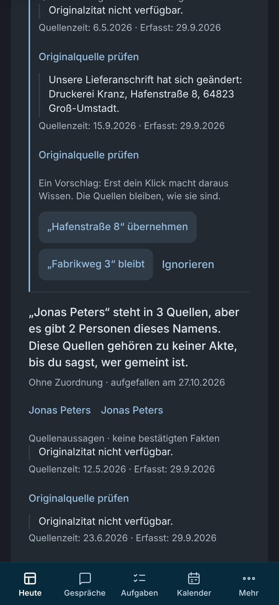 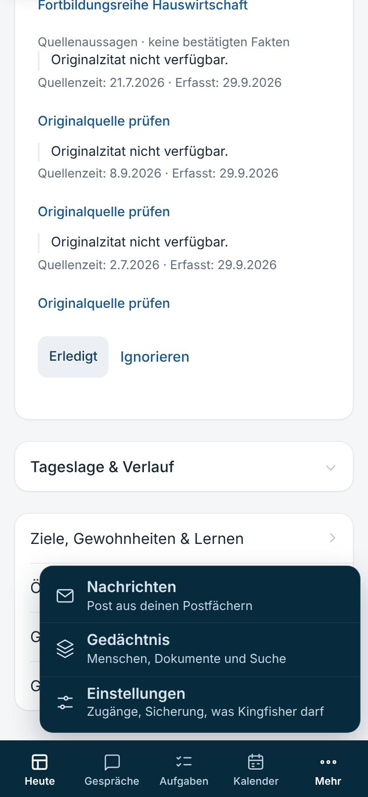
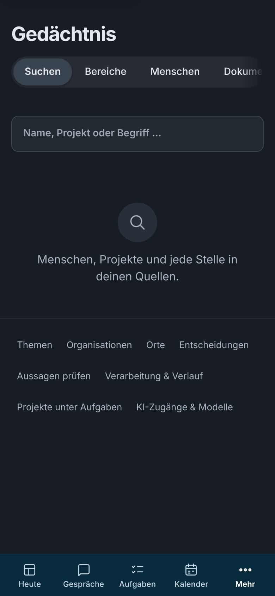 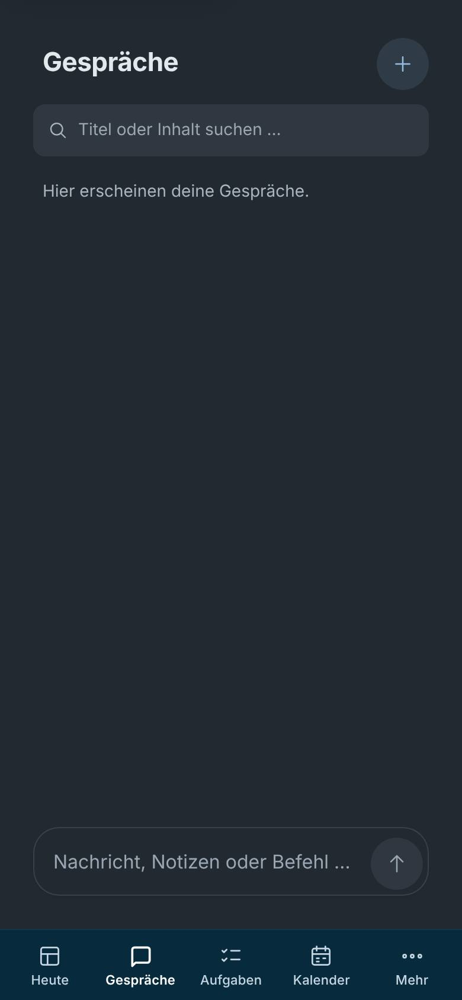
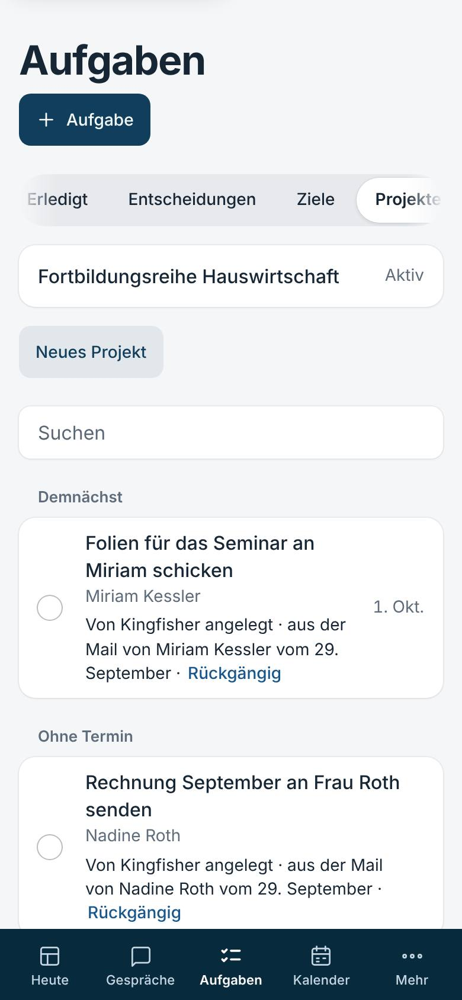 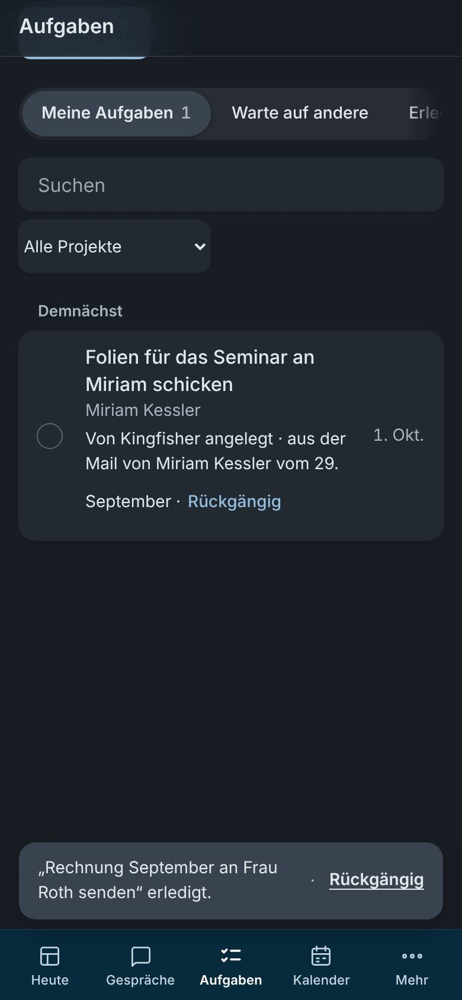
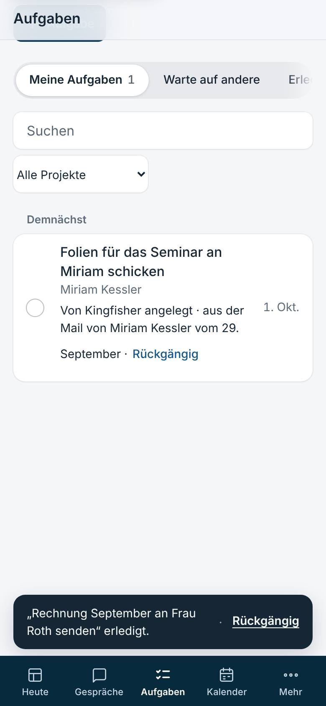 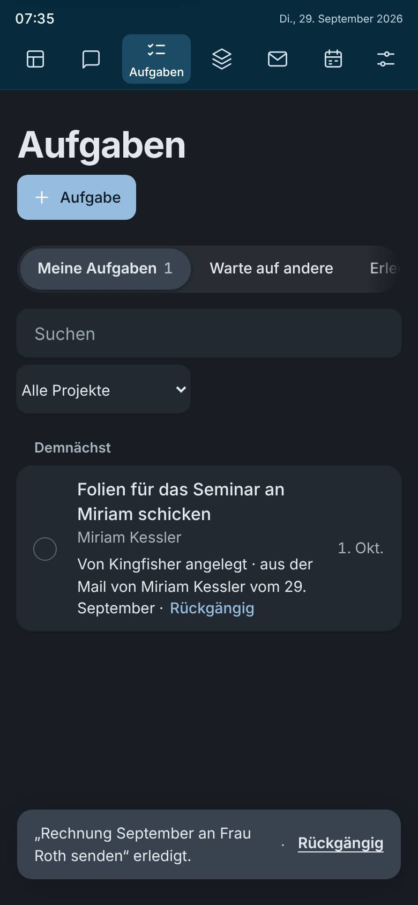

**Tests.** `handy-leiste.test.mjs` (5). Angepasst: `seitenbreite.test.mjs` (statt „nur Symbole“ die feste Leiste);
`scripts/probe_seiten_ui.py` misst die feste Leiste am Ende der Seite (auch einer, die in sich rollt).

## H3 Tippziele

**Vorher.** `scripts/probe_tippziele_ui.py` (neu) auf 29 Seiten und Zuständen, dunkel: **253** Ziele unter 44 px, etwa
„Rückgängig“ 84 × 22, „Ansehen“ 59 × 18, Segmente 38, kompakte Knöpfe 36, Aufklapper 26–42, Kontoname 22, Tage der
Woche 39 breit, Punkte im Zeitstrahl 15 × 24, Belegnummern 22.

**Ursache.** Kompakte Maße für die Maus (36, 38, 32), leise Knöpfe ohne eigene Höhe, Verweise im Satz, dichte Punkte.

**Behebung.** Unter `@media (pointer: coarse)` (`Seitenbreite.css`): leise Knöpfe, Verweise, Segmente, Belegnummern
und Tage bekommen eine unsichtbare Fläche (`::after`, mittig, `max(100%, 44px)`), das Bild bleibt gleich; Belegnummern
nebeneinander 22 px Abstand; getönte Knöpfe, Felder und Aufklapper 44 hoch. Zeitstrahl der Akte: am Finger ist die Spur
das Ziel, ein Tipp wählt den nächsten Punkt bis 22 px daneben (`tippFlaeche.ts`), die Punkte bleiben für Tastatur Knöpfe.
Die Probe misst die wirksame Fläche (`elementFromPoint` von der Mitte aus, `scripts/tippziele.js`), nicht den Kasten.
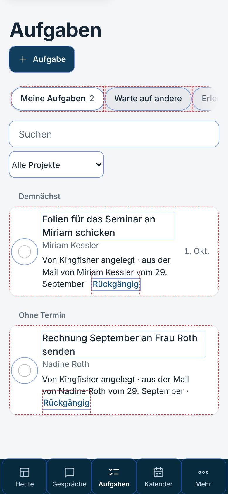 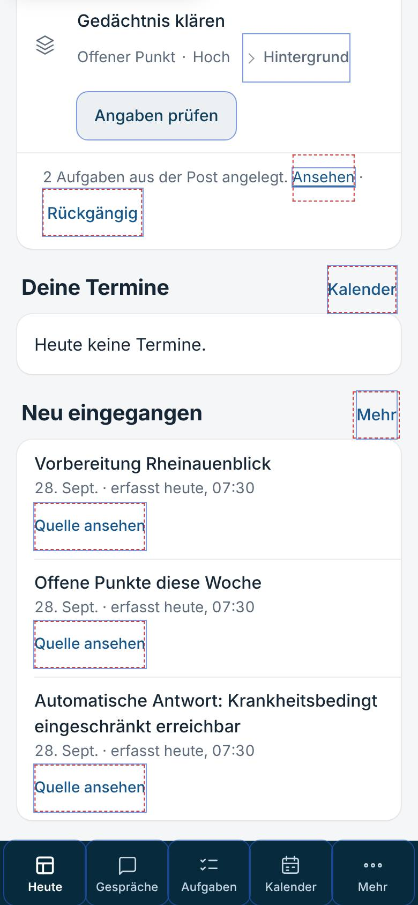

**Nachher.** 0 von 1173 (Persona-Welt) bzw. 0 von 1066 (Welt der Probe), hell und dunkel.

**Tests.** `handy-tippziele.test.mjs` (5) und die Probe selbst (Rückgabe 1 bei jedem Ziel unter 44 px).

## Zahlen

- Oberfläche: `tsc` ohne Befund, **1025 Tests** grün (+15), `vite build` ok.
- `scripts/probe_seiten_ui.py` hell und dunkel: je 72 Breiten (vorher 75; das Segment „Projekte“ im Gedächtnis entfällt),
  0 nicht in Ordnung, ok. `scripts/probe_tippziele_ui.py` hell und dunkel: 0 unter 44 px.
- Backend nicht berührt; gezielt die fünf Testdateien, die Oberfläche oder Skripte lesen: 79 bestanden.

## Sabotageproben (alle rot, danach zurückgesetzt)

| Probe | rot wird |
|---|---|
| Vorgabe am Handy wieder Monat | `handy-kalender` 1, 2 |
| altes „Monat“ zählt am Handy als Wahl / alter Schlüssel bleibt | `handy-kalender` 2 |
| Woche zu weit ins Bild gerollt | `handy-kalender` 3 |
| Seite speichert jede Ansicht wieder | `handy-kalender` 4 |
| Woche wieder 76 px je Tag / Listentitel `anywhere` | `handy-kalender` 5 |
| sechs Ziele in der Leiste | `handy-leiste` 1, 2 |
| Namen nur für Vorleser / Escape klappt nicht zu | `handy-leiste` 2 |
| Seite ohne Platz für die Leiste / Hinweis am Rand | `handy-leiste` 3; im Browser `ende_verdeckt` „Gedächtnis prüfen“ |
| Hinweis rückt nichts heraus | `handy-leiste` 4 |
| „Projekte“ wieder im Gedächtnis / ohne Weiterleitung | `handy-leiste` 5 |
| keine unsichtbare Fläche | `handy-tippziele` 1; im Browser 16 Ziele unter 44 auf 4 Seiten |
| Belegnummern ohne Abstand | `handy-tippziele` 1 |
| Punkte im Zeitstrahl wieder Ziele / Spur wählt weit daneben | `handy-tippziele` 2, 3 |
| Zeitspalte der Woche wieder 44 px | `handy-tippziele` 4 |

## Grenzen

- Kein echtes iOS, kein WebKit: `hyphens: auto` trennt im Linux-Chromium der Prüfung nicht (keine Wörterbücher). Dort
  wird in der engen Woche ein zu langes Wort am Rand abgeschnitten statt zerteilt; Safari und Chrome am Mac trennen mit
  Strich. Gemessen: keine Wortbrüche ohne Strich; die Trennung selbst ist nicht gemessen.
- `safe-area-inset-bottom` ist in der Emulation 0; die Regel ist da (`viewport-fit=cover`), ihre Wirkung am iPhone nicht
  gemessen.
- Zwei gleichzeitige Termine in der engen Woche teilen sich die Spalte und sind dann schmaler als 44 px; die Welt hatte
  keine.
- Zwischen 701 und 900 px bleibt der Streifen oben (Tablet hochkant), jetzt mit Namen wie zuvor.
- Skripte, Messwerte und alle Bilder im Arbeitsordner der Sitzung (`befunde/handy/`), hier eine Auswahl.
