# Befunde der Persona-Prüfung: Paket P, Person und Sicherung (D7)

Stand 27.10.2026, Branch `fix/befunde-person` auf dem Integrationsstand `docs/persona-pruefung-20261026` (1.0.29 mit
den Paketen D, A-I, A-II, Z, B, H, S). Befund D7 aus [der Persona-Prüfung](../2026-10-26-persona-pruefung/README.md),
Persona „Dr. Siebert“ (Anwalt). Nachgestellt mit seinem Startskript (Messlatte-Welt „Lea Hartmann“, Dora Lind,
Attrappen für Postfach, Cloud und Netz), echter Sidecar, gebaute Oberfläche, Chromium mit Playwright, Tastatur. Nur
synthetische Daten. Vorher: Ausgangsstand `b3fa650`, nachher dieser Branch.

## D7 Kein Löschen und kein Export je Person, keine Wiederherstellung in der Oberfläche

**Vorher.** Die Personenakte von Dora Lind hatte keinen Weg, „alles zu ihr“ auszugeben oder zu löschen; das
Auskunftsrecht (Art. 15 DSGVO) und die Löschung (Art. 17) waren nicht bedienbar. Unter Einstellungen → Sicherung
stand „Verschlüsselt sichern und bei Bedarf wiederherstellen“, aber nur „Sicherung öffnen“ (verschlüsselt
herunterladen). 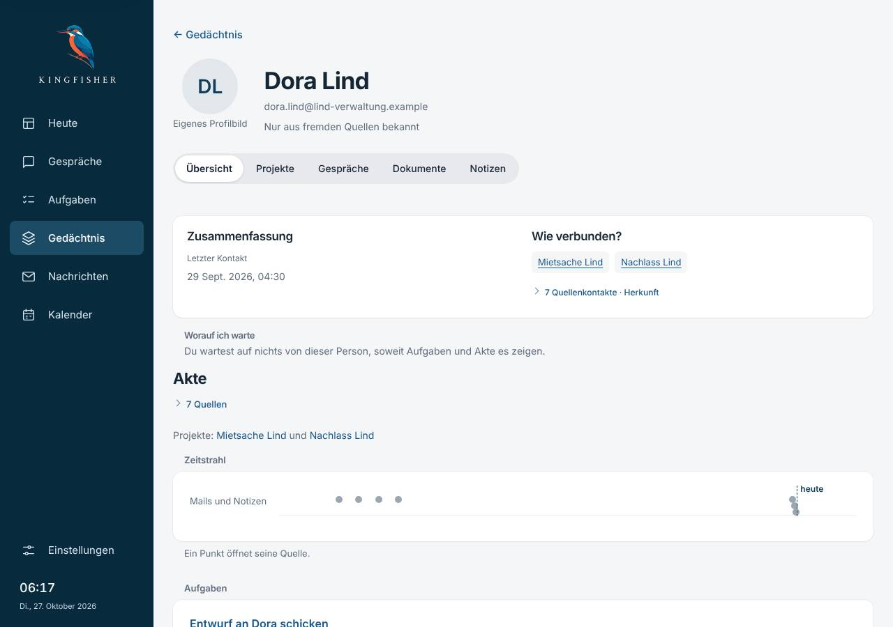 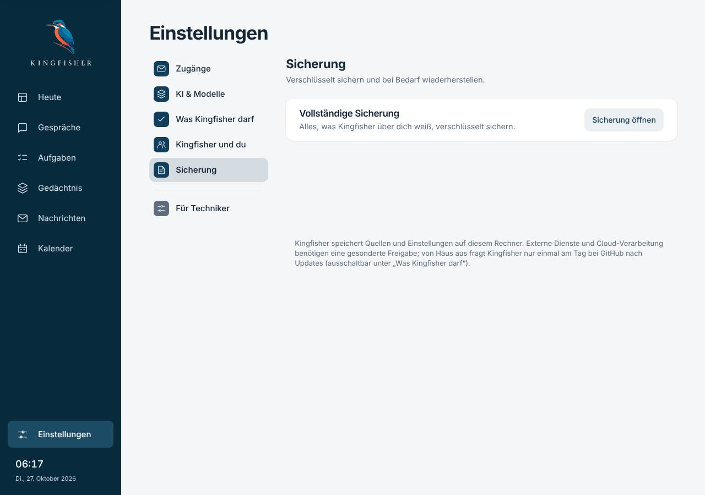

**Ursache.** Menschen sind in Kingfisher abgeleitet (`personen.py`: aus Beteiligten der Quellen), ihr Wissen liegt in
sieben Ablagen; es gab keine Stelle, die sagt, was alles zu einer Person gehört, und Rohquellen galten als
unlöschbar. Ohne Sperre hätte das nächste Einlesen sie sofort wieder angelegt. Die Sicherung entstand zwar alle vier
Stunden (`sicherungen/`), der einzige Rückweg (`/backups/restore`) war für Updates gebaut: Name tippen, danach
Prüfmodus, weil eine alte Sicherung widerrufene Freigaben zurückbringen könnte.

**Behebung.**

1. *Was gehört zu ihr* an einer Stelle (`person_daten.umfang`); Auskunft, Rückfrage und Löschen benutzen dieselbe.
2. *Alles exportieren* (Personenakte → „Mehr“): ein ZIP mit `Auskunft.html` und `Auskunft.json`, als Download nur auf
   diesen Rechner. **Ein ZIP statt zwei Knöpfen**: Wer Auskunft gibt, braucht beides; ein Knopf ist eine Entscheidung
   weniger. Aus geteilten Quellen nur die Zeilen, die sie nennen, fremde Adressen unkenntlich, weitere Beteiligte nur
   gezählt; Cloud ehrlich (das Protokoll kennt keinen Inhalt).
3. *Alles löschen*: Rückfrage über `Rueckfrage` (Fokus „Abbrechen“, Aktion rot) mit „Gelöscht wird“ (Anzahlen) und
   „Bleibt“ (mit Grund). **Was löschen bei geteilten Quellen heißt:** Quellen nur mit ihr verschwinden aus Kingfisher
   (nicht aus Postfach oder Kalender), geteilte bleiben ohne sie als Beteiligte und mit unverändertem Text, denn der
   gehört auch den anderen. Wissen, Vorschläge, Aufgaben samt Verlauf, Zusammenführungen, Schreibweisen, Bezüge,
   Kreis, Akte, Logbuch-Vermerke, Befunde, Zusammenfassungen fallen weg; Volltextindex (auch die geteilte Quelle wird
   neu eingelesen), Bedeutungssuche, Zwischenspeicher (Akten, Verzeichnis, Teilnehmer) und Rohquellen als Beleg
   liefern nichts mehr. Bleiben: deine Gespräche (gezählt), Projekte, das Aktionsprotokoll (ohne Namen, dass gelöscht
   wurde), ältere Sicherungen. Zuerst entsteht der **Sperrvermerk** (`person_sperre.py`, Migration 26: Prüfsummen und
   Anzeigename), der an einer Stelle jedes Einlesen filtert; aufhebbar unter „Kingfisher und du“, mit Rückgängig.
   Löschen schreibt keinen Fakt; die Regel des Gedächtnisses bleibt.
4. *Stand wiederherstellen* (Einstellungen → Sicherung): Auswahl aus der Liste, Rückfrage in einem Satz, vorher eine
   Sicherung des jetzigen Stands (Rückgängig), Austausch mit Merkzettel (alles oder nichts, auch nach Absturz), dann
   Neuladen und Hinweis „Wiederhergestellt: Jetzt gilt der Stand vom …“ mit „Rückgängig“. Nur das Gedächtnis kommt
   zurück; Einstellungen, Schlüssel, Freigaben, Protokolle bleiben heutig. **Darum ohne Prüfmodus**: Eine alte
   Sicherung kann so keine widerrufene Freigabe zurückbringen. Der Update-Rückweg bleibt mit Prüfmodus.

Einzelheiten: [30-akten.md](../../30-akten.md#alles-zu-einer-person-auskunft-und-löschen-paket-p-27102026),
[47-einstellungen.md](../../47-einstellungen.md#sicherung-wiederherstellen-und-gelöschte-personen-paket-p-27102026).

**Nachher (1280 hell, Tastatur).**

* Export: „Gespeichert: „Auskunft-Dora-Lind-….zip“, meist im Ordner „Downloads“ …“; ZIP mit 7 Quellen, 1 Aufgabe,
  2 Projekten; keine Adresse von Anna, Ben, Lea, Mia, Tom darin. 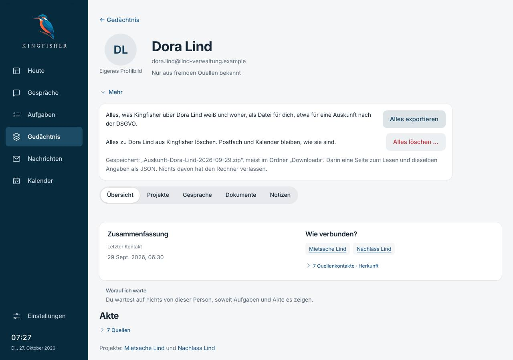
  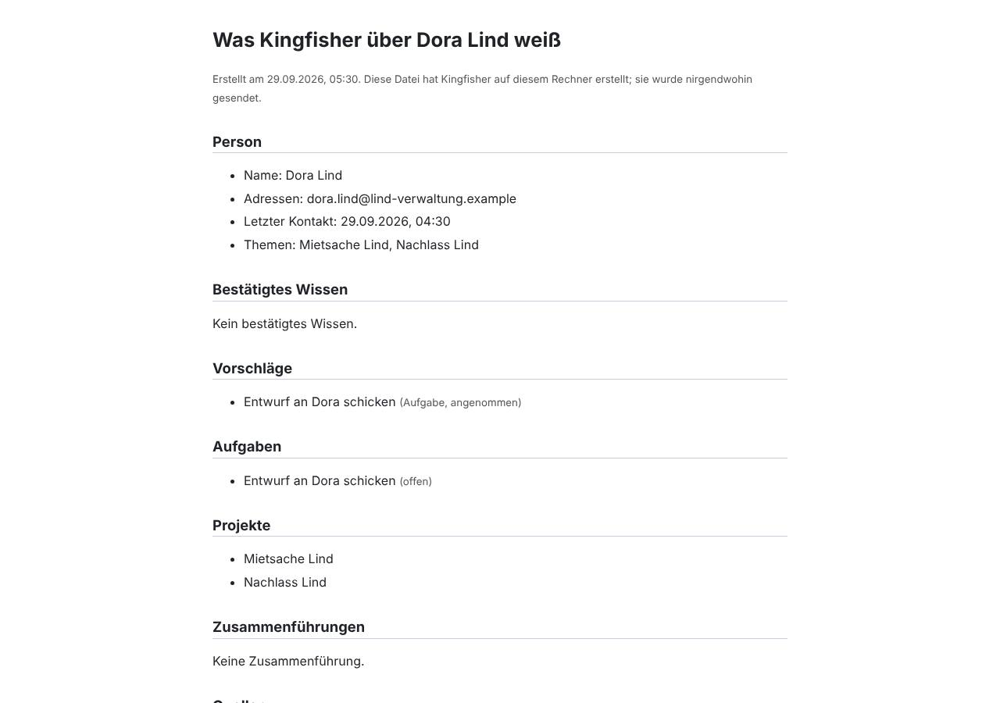
* Löschen: Enter auf „Alles löschen …“ → `alertdialog`, modal, „Alles zu Dora Lind löschen?“, Fokus „Abbrechen“;
  Tab ×4: Endgültig löschen, Abbrechen, Endgültig löschen, Abbrechen; Escape: zu, Fokus wieder auf „Alles löschen …“.
  Bestätigt: Gedächtnis → Menschen, Hinweis „Alles zu Dora Lind gelöscht …“, Dora nicht mehr in `/people`.
  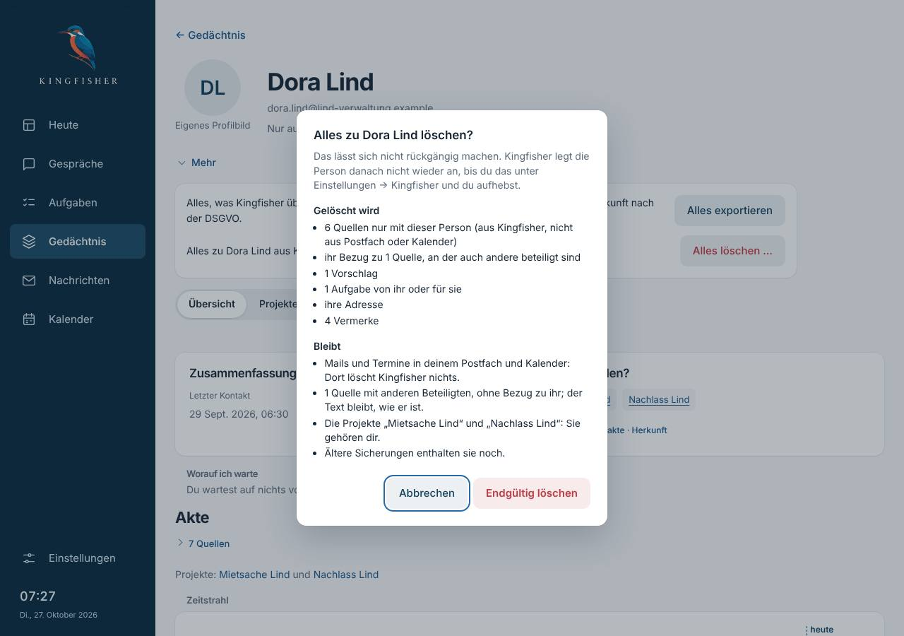 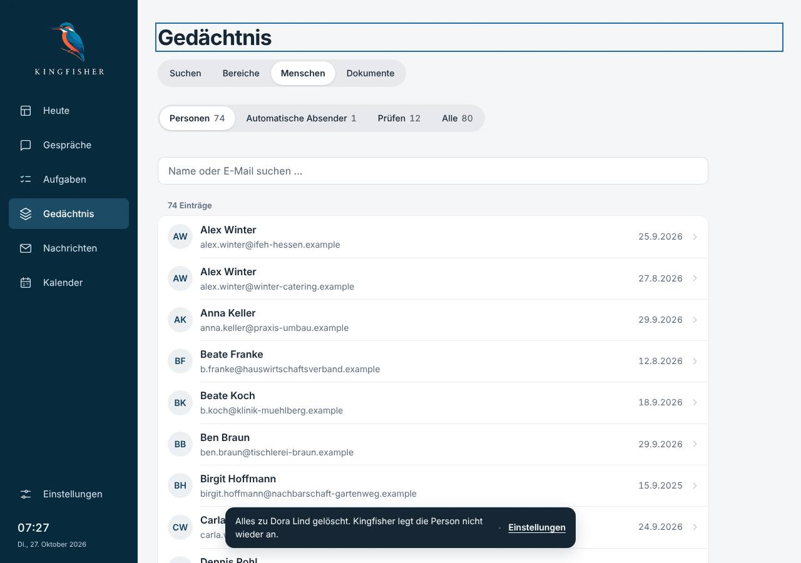
  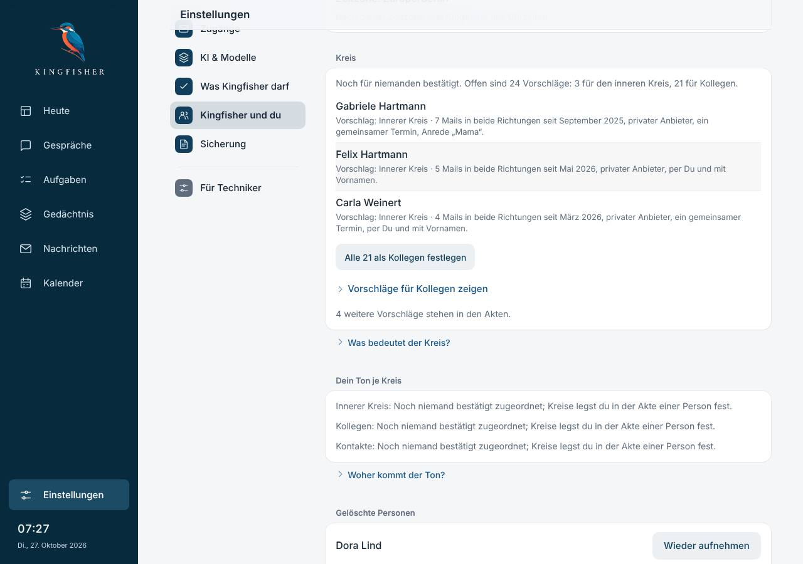
* Wiederherstellen: Tab von der Auswahl auf „Wiederherstellen …“, Enter → „Stand vom 29. September, 07:30
  wiederherstellen?“, Fokus „Abbrechen“; bestätigt: Neuladen, Hinweis mit Rückgängig, Dora wieder da (Stand vor dem
  Löschen); „Rückgängig“: Neuladen, „Der Stand von vorher … gilt wieder“, Dora wieder weg. Konsole leer.
  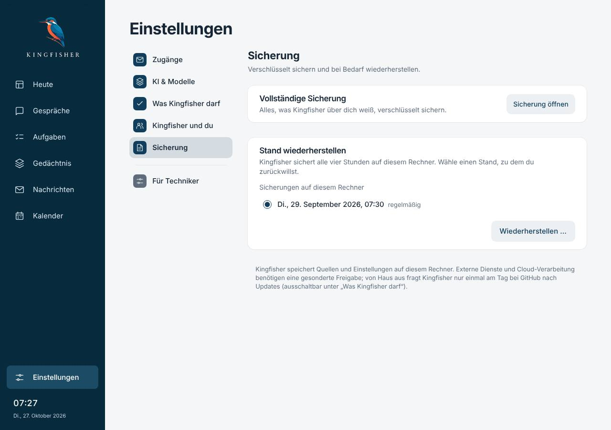 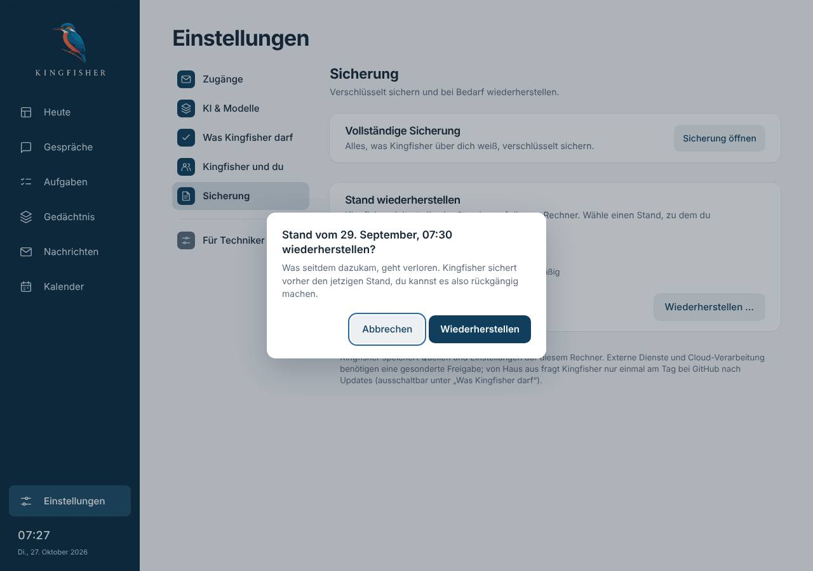
  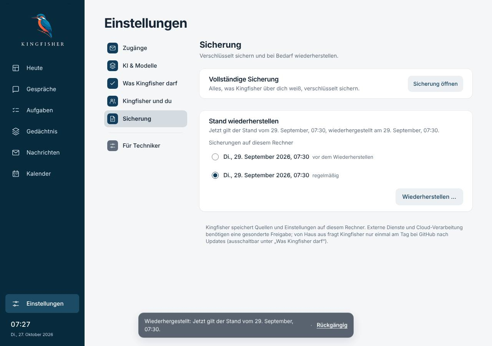 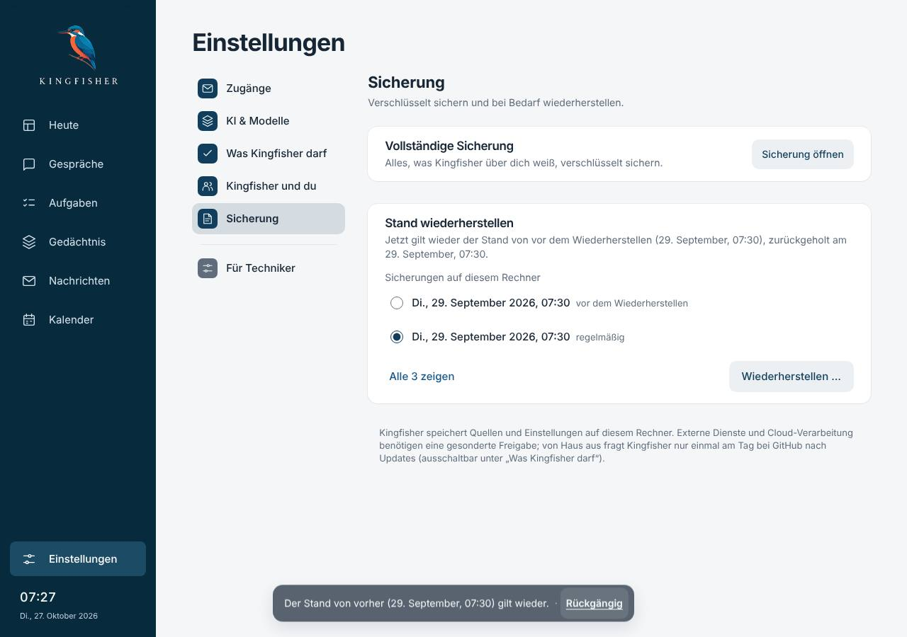
* 390 px hell und dunkel: 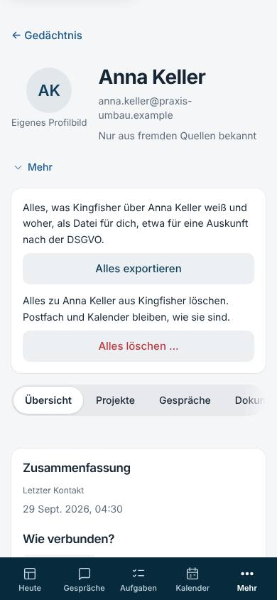 
  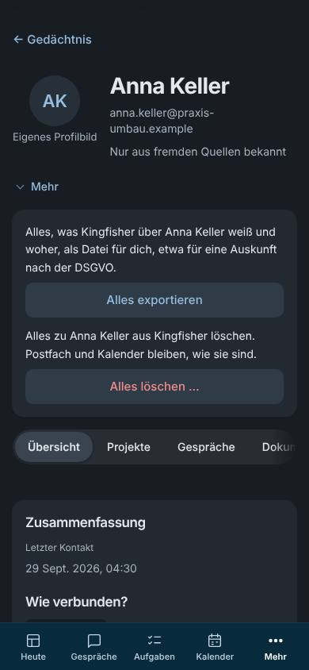 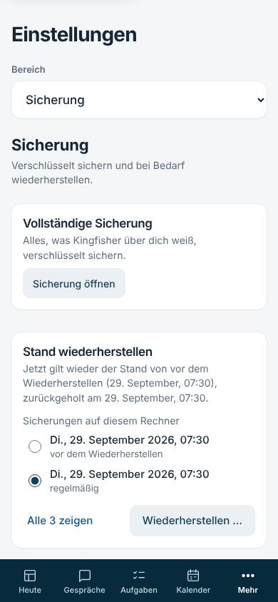
   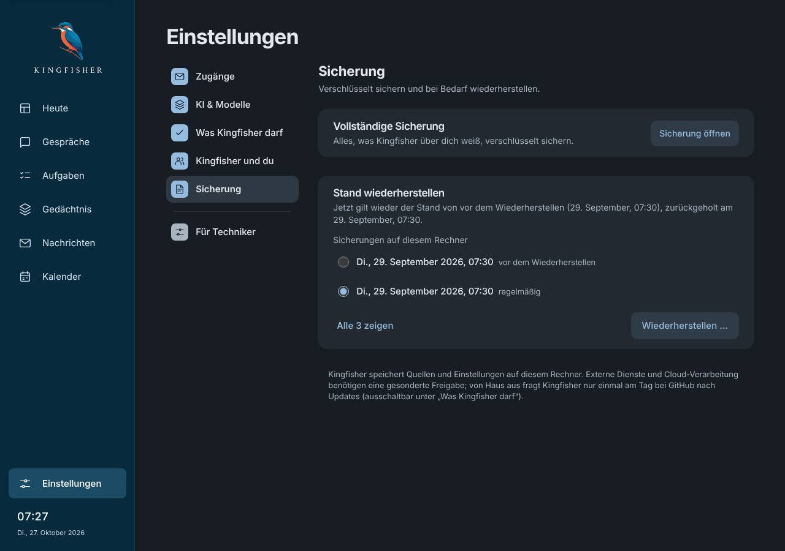

**Tests.** `test_person_daten.py` (15), `test_sicherung_zurueck.py` (17), `person-daten.test.mjs` (8); angepasst:
Schemafassung 25 → 26 und Rückbau-Hilfen ohne `personen_sperre` in 14 bestehenden Testdateien.

## Prüfungen

| Prüfung | Ergebnis |
|---|---|
| Backend, volle Suite (`-n 4`) | 8377 bestanden, 3 übersprungen, 1 Fund: der Titel eines neuen Oberflächentests enthielt das verbotene Anführungsmuster (`test_pruefe_anfuehrungszeichen`); umbenannt, die Prüfung allein danach grün (34) |
| Oberflächentests (`node --test tests/*.test.mjs`) | 1047 bestanden, 0 fehlgeschlagen |
| `tsc --noEmit`, `vite build` | ohne Fehler |
| `probe_seiten_ui.py` hell / dunkel | je 72 Breiten, 0 nicht in Ordnung, Konsole leer |
| `probe_tippziele_ui.py` hell / dunkel (neu: „akte-mehr“, Sicherungsliste) | je 30 Seiten, 1098 Ziele, 0 unter 44 px |

## Sabotageproben

Jede Zusicherung gebrochen, der passende Test wurde rot, zurückgesetzt (Skript im eigenen Ordner). Die ersten beiden
fingen zunächst nichts: Die Testquellen waren nie geltende Fassung und standen darum gar nicht im Index. Die Testhilfe
macht sie jetzt wie die Mailaufnahme zur geltenden Fassung und prüft die Vorbedingung.

| Bruch | gefangen von |
|---|---|
| Löschen lässt die Quelle im Volltextindex | `test_loeschen_laesst_keine_spur_in_suche_und_akten` |
| geteilte Quelle nicht neu indiziert (Adresse suchbar) | dito |
| kein Sperrvermerk, nächstes Einlesen legt sie an | `test_naechstes_einlesen_legt_sie_nicht_wieder_an` |
| Sperre filtert beim Einlesen nicht | dito |
| Erwähnung im Text wird trotz Sperre Akte | `test_erwaehnung_im_text_wird_keine_akte` |
| Logbuch-Vermerke bleiben | `test_logbuch_vermerke_zu_ihr_fallen_weg_und_der_schutz_bleibt` |
| Schutz des Aufgabenverlaufs kommt nicht zurück | `test_verlaeufe_bleiben_nach_dem_loeschen_geschuetzt` |
| Vektoren der Bedeutungssuche bleiben | `test_bedeutungssuche_liefert_nichts_mehr_und_vergisst_die_vektoren` |
| Export enthält geteilte Quelle ganz (Daten anderer) | `test_auskunft_ist_zip_mit_html_und_json_nur_zu_ihr` |
| Export nennt fremde Adressen | dito |
| Export ohne HTML-Maskierung | `test_auskunft_maskiert_html` |
| Wiederherstellung nicht atomar | `test_abbruch_mittendrin_laesst_den_alten_stand` |
| kein Zurückhängen beim Start nach Absturz | `test_absturz_mittendrin_wird_beim_start_zurueckgenommen` |
| Pfad außerhalb des Sicherungsordners angenommen | `test_kein_pfad_von_aussen` |
| Verweis (Symlink) angenommen | `test_verweis_nach_aussen_wird_nicht_angenommen` |
| Einstellungen kommen aus der alten Sicherung | `test_wiederherstellen_gilt_sofort_und_bleibt_bedienbar` |
| keine Sicherung vorher (kein Rückgängig) | `test_rueckgaengig_bringt_den_stand_von_vorher` |
| Rückfrage verschweigt ältere Sicherungen | `person-daten.test.mjs` |

## Grenzen

- Der Text geteilter Quellen bleibt unverändert, auch wo er sie nennt; nur der Bezug fällt weg. Aus der Auskunft:
  Eine Zeile, die sie und andere nennt, steht ganz drin (fremde Adressen unkenntlich).
- Gespräche mit Kingfisher, Rückmeldungen und das Selbstmodell bleiben; Gespräche werden in der Rückfrage gezählt.
- Ältere Sicherungen enthalten sie noch (steht in der Rückfrage); wer einen älteren Stand wiederherstellt, holt sie
  samt fehlendem Sperrvermerk zurück, im Bild gezeigt.
- Der Sperrvermerk hält Prüfsummen ohne Salz: Wer eine Adresse schon kennt, kann prüfen, ob sie gesperrt ist; die
  Adresse selbst steht nirgends.
- Welche Cloud-Anfrage ihre Quellen enthielt, weiß Kingfisher nicht (das Protokoll kennt keinen Inhalt); die Auskunft
  sagt das so.
- Zeiten in der Auskunftsdatei folgen der Uhr des Sidecars, nicht der eingestellten Zeitzone.
- Merkzettel und Neuladen sind gegen Abbruch geprüft; ein Austausch über mehrere Dateien ist ohne Merkzettel nicht
  atomar, deshalb räumt der nächste Start auf.
