# Befunde der Persona-Prüfung: Paket S, Sprache und Kleinigkeiten

Stand 27.10.2026, Branch `fix/befunde-sprache` auf dem Integrationsstand `docs/persona-pruefung-20261026` (1.0.29 mit
D, A-I, A-II, Z, B und H). Befunde aus [der Persona-Prüfung](../2026-10-26-persona-pruefung/README.md), Abschnitt
„6. Sprache und Kleinigkeiten“, dazu die offenen Reste der vorigen Pakete. Nachgestellt mit einer Kopie der
Berater-Persona (Messlatte-Welt „Lea Hartmann“, drei Postfächer: Firma, privates Gmail, Gmail eines Großkunden; dazu ein
Kalender-Abo, das 403 antwortet, und ein Gespräch mit gemessenen Zeiten). Vorher: Ausgangsstand `a3c8f02` aus eigenem
Worktree gebaut, nachher dieser Branch; beide mit echtem Sidecar und gebauter Oberfläche, Chromium mit Playwright bei
1280 und 390 px (Touch), hell, dazu dunkel. Nur synthetische Daten, Attrappen statt Postfach, Kalender, Modell und Cloud.

## 1 Fachwörter

**Vorher.** „Sprachmodell“ (Einrichtung, Heute, Fertig-Seite), „Quellenzeit: … · Erfasst: …“ (Befunde), „Lokal speichern“
(neue Aufgabe, Quellen), „Nachricht, Notizen oder Befehl …“ (Eingabefeld), „Bereit: qwen3.5:4b“ (KI & Modelle),
„Endpunkt: https://…“, „API-Schlüssel“, „Continue with ChatGPT“, „iCalendar-Abo nicht erreichbar: 403 Forbidden“.
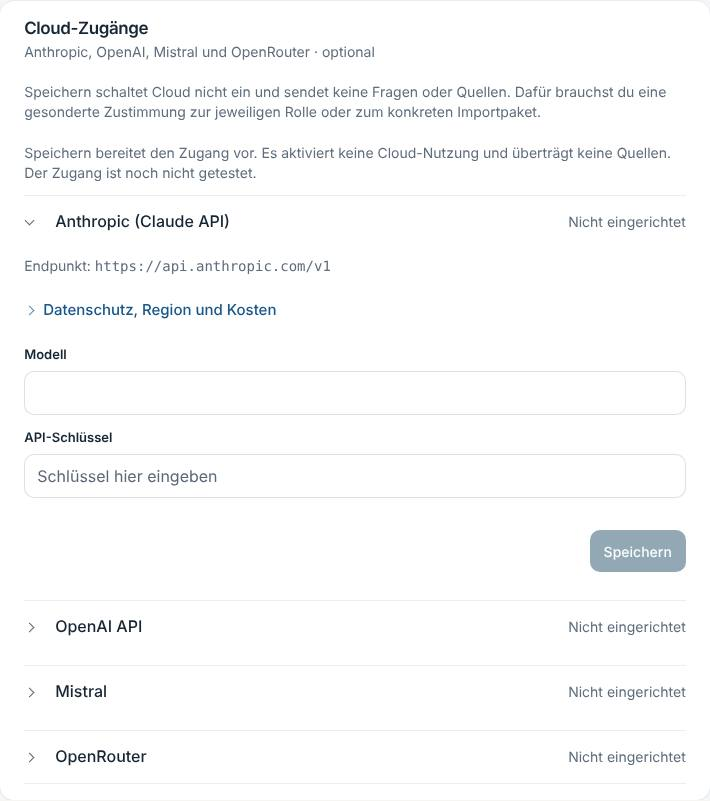 

**Ursache.** Die Wortliste vorne (`gliederung.FACHWOERTER`) prüfte nur Einstellungsdateien; die übrigen Stellen und der
Sidecar (Fehlersatz des Abos, `lokale_ki.py`) standen außerhalb.

**Behebung.** „die KI (auf diesem Rechner)“, „Vom 10.6.2026 · aufgenommen am …“, „Speichern“, „Frage, Notiz oder Bitte …“,
„Bereit auf diesem Rechner“ (Kennung nur hinter „Modell verwalten“), „Zugangsschlüssel vom Anbieter (dort
„API-Schlüssel“ oder „API key“)“, Adresse des Anbieters unter „Für Techniker“, „Mit ChatGPT anmelden“ (Marke bleibt). Das
Abo sagt je Fall einen Satz mit Ausweg (`abo_fehler_satz`): 401/403 „Der Kalender lässt sich nicht abrufen: Die Adresse
ist nicht mehr freigegeben. Teile ihn im Kalenderprogramm neu und füge die neue Adresse ein.“, 404/410, 5xx, keine
Verbindung; das Technische steht im Protokoll des Sidecars. Die Wortliste kennt jetzt auch „Sprachmodell“, „Quellenzeit“,
„Endpunkt“, „API-Schlüssel“, „Befehl“, „Forbidden“ und prüft 13 weitere Dateien; „Ollama“ in der Einrichtung ist eine
begründete Ausnahme (der Name des Programms, das man laden muss). Unter Cloud-Zugänge stand ein Hinweis doppelt
(Befund 6): Der Satz des Sidecars fällt weg.

**Nachher.** 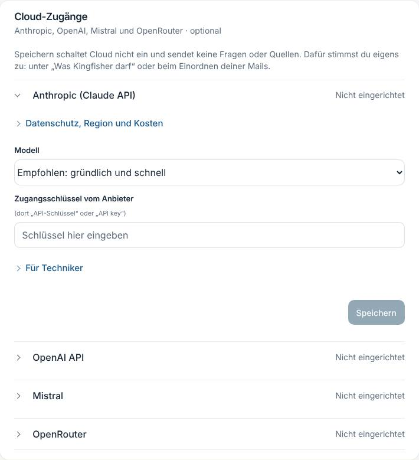 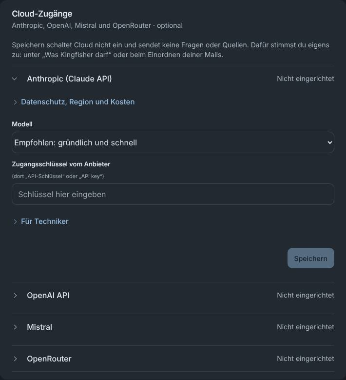
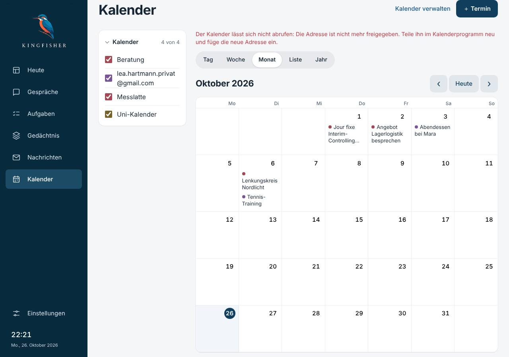

**Tests.** `test_abo_ohne_freigabe_…`, `test_lokale_ki.py` (präzisiert), `einstellungen-gliederung.test.mjs` (Wortliste),
`sprache-paket-s.test.mjs` (Cloud), angepasst: `memory-questions`, `lernt`, `rechner`, `technik`, `verarbeitung`,
`aufgaben-ruhig`, `settings-disclosure`, `memory-semantic-progress`, Probe `probe_fremdprobe*_ui.py`.

## 2 Technikzeilen unter Antworten

**Vorher.** „10 s · Suche 0,2 · Auswahl 4,0 · Sätze 6,0“ samt Ursachensatz offen unter der Antwort; „Kalender:
127.0.0.1: Privat“. 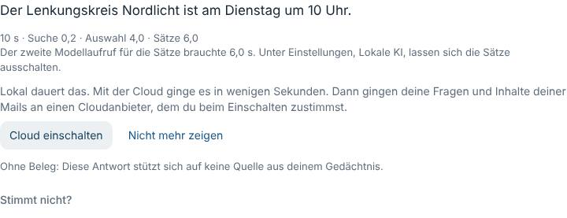

**Ursache.** Die Zeitzeile war als Nebeninformation gedacht, stand aber ohne Aufklapper da. Der Kalendername entstand beim
Anmelden aus dem Server (`f"{wer}: {name}"`, `wer` = Hostname bei eigener Domain) und stand so in Zugänge, im Kalender,
in „Was brauche ich morgen?“ und im Text der Terminquelle.

**Behebung.** `AntwortZeile` liegt hinter einem zugeklappten „Details“ (am Finger 44 px). Gefundene Kalender heißen nach
ihrem Namen, bei bekanntem Anbieter „GMX: Privat“, doppelt mit Adresse dahinter (`kalender_anmeldung.kalender_name`).
Bestehende Namen bleiben (Umbenennen geht mit einem Klick, Befund 8); der Text alter Terminquellen wird nicht neu
geschrieben, sonst entstünde für jeden Termin eine neue Fassung.

**Nachher.** 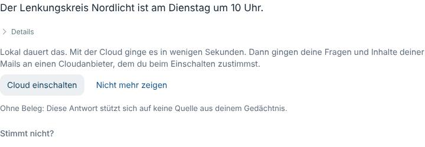 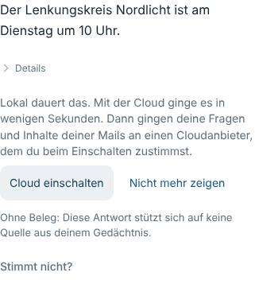

**Tests.** `sprache-paket-s` („Details“, zu), `test_ein_gefundener_kalender_heisst_…`, `test_kalender_anmeldung.py`
(präzisiert), Probe `probe_antwortzeit_ui.py` klappt jetzt auf.

## 3 Falscher Bereichsvorschlag

**Vorher.** `lea.hartmann.nordlicht@gmail.com` (nur Mails von Nordlicht Werke): „Vorschlag: Privat. gmail.com ist ein
privater Anbieter.“; „Alle Vorschläge übernehmen“ sortierte es so ein. 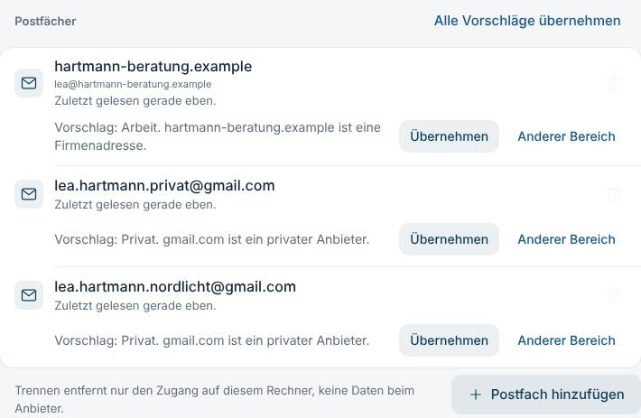

**Ursache.** `vorschlag_postfach` entschied nur an der Domäne.

**Behebung.** Ein privater Anbieter allein entscheidet nichts mehr; gezählt werden die jüngsten 200 Mails des Postfachs
(`inhalt_des_postfachs`, `mail_einschaetzen`, ohne Modell, nur Zahlen). Beruflich ist ein Mensch bei einer Firma mit
einem zweiten Zeichen (Projekt, das nicht Kingfisher angelegt hat; eigene Antwort an die Domäne; förmliche Anrede; Firma
in der Signatur) oder eine Gmail-Adresse mit Firmensignatur. Rollenadressen, Rechnungen, Verträge, Newsletter an
Privatkunden und Einladungen ohne zweites Zeichen zählen nicht. Mindestens zwei berufliche und doppelt so viele wie
private → Arbeit („Die Mails darin kommen vor allem von Geschäftspartnern, etwa von nordlicht-werke.example.“); nichts
Berufliches → Privat; gemischt oder noch nichts gelesen → kein Vorschlag, die Zeile fragt „Welcher Bereich?“. Der
Kalender derselben Adresse folgt demselben Inhalt. Grenze: Ein neu verbundenes Gmail-Konto fragt jetzt einmal, bis Mails
gelesen sind (lieber eine Frage als ein falscher Bereich).

**Nachher.** 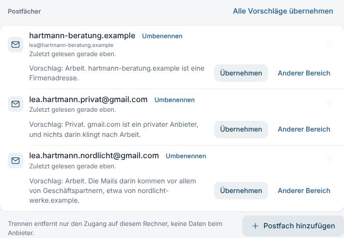 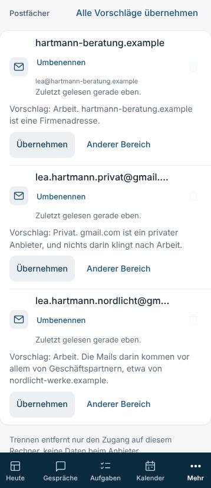
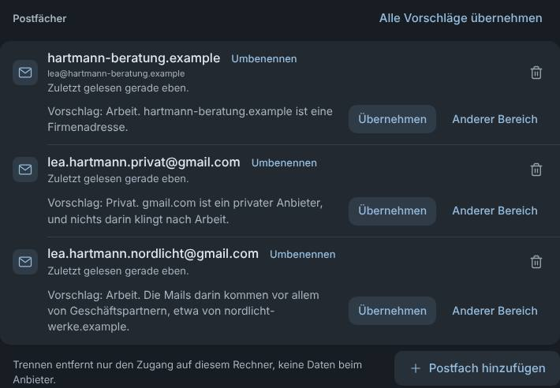

**Tests.** Sieben in `test_sprache_paket_s.py` (Großkunde Arbeit, Freunde/Einladung/Stadtwerke nicht, gemischt fragt,
„Alle übernehmen“, eigene Antworten, Kalender), `test_konten_bereiche.py` präzisiert, Probe `probe_konten_ui.py` angepasst.

## 4 Doppeltes Postfach

**Vorher.** Erkannt erst nach dem App-Passwort, Meldung im roten Rahmen. 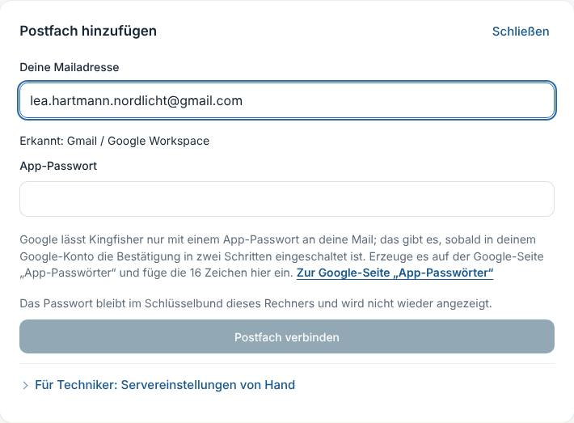

**Behebung.** Die Karte kennt die verbundenen Postfächer (`GET /api/v1/konten`) und sagt es gleich nach der Adresse
ruhig („Dieses Postfach ist schon verbunden: … Kingfisher liest es bereits. Zum Postfach“, der Knopf setzt den Fokus auf
die Zeile; im Assistenten „Du findest es unter Einstellungen → Zugänge.“). Kein Passwortfeld, keine Anfrage an die
Domain. Meldet der Sidecar beim Speichern 409, steht derselbe ruhige Satz da.

**Nachher.** 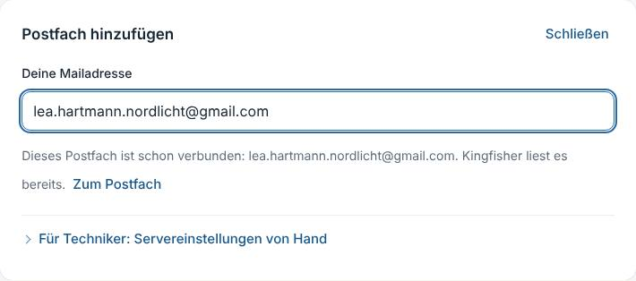 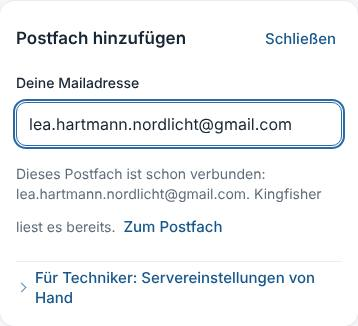

## 5 Cloud einschalten ohne Modellnamen

**Behebung.** `cloud_access_routes.MODELLE`: je Anbieter eine Liste mit Titeln in Worten, die erste vorbelegt
(„Empfohlen: gründlich und schnell“); „Anderes Modell (für Techniker) …“ öffnet das Namensfeld. Die Einwilligung aus D
(Anbieter, Land, Inhalte) ist unberührt. Der Satz unter dem Cloud-Schalter sagt „ein passendes Modell ist dort schon
gewählt“. Grenze: Die Kennungen sind datierte Angaben (27.10.2026); bei Mistral und OpenRouter ungeprüft gegen den
echten Dienst.

## 6 Texte

- **Gruß:** `morning.gruss` (4–12 Morgen, 12–18 Tag, sonst Abend); Heute fragt mit der Zeitzone des Geräts, wie die Uhr
  in der Seitenleiste (`api.morning`). 19:47 in Berlin ergibt „Guten Abend“ (Test).
- **„Anhalten kannst du beides“** nur bei zwei Häkchen (`pausierenSatz`).
- **„Privat gehört jetzt zu Privat.“** → „„Privat“ gehört jetzt zum Bereich Privat.“
- **Doppelter Hinweis:** unter Cloud-Zugänge (siehe 1).
- **„0 Mails gelesen“ nach „Mails gelesen 5“:** Zwei Zählungen derselben Sache. Zeigt „Kingfisher lernt gerade“ die
  gelesenen Mails, fehlt die Kachel (`schonDaZahlen(mailImLernen)`, gemeldet über `beiAenderung`).
- **Zwei „Gedächtnis klären“:** Titel aus dem Merkmal aus einer festen Liste („Angabe klären: Anschrift“), gleiche Titel
  durchgezählt. Bewusst **kein Name und kein freies Merkmal**: Beides stammt aus fremden Quellen, und
  `test_kingfisher.py` sichert zu, dass das Dashboard davon nichts trägt (Heute wird auch vorgelesen).

## 7 Aufgabensuche, „Neu eingegangen → Mehr“

**Vorher.** „Nordlicht“ fand keine Aufgabe des Projekts. 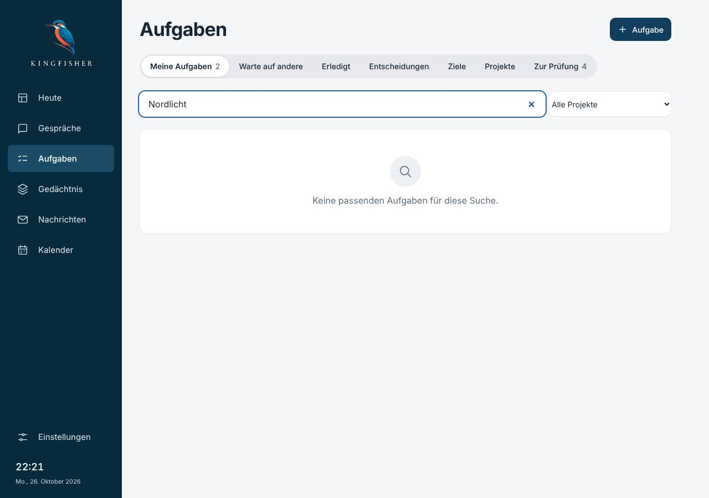
**Behebung.** `query_page(projekte=)`: ein Suchwort trifft auch den Projektnamen (und die Person); `neu_mehr` führt zu
den Nachrichten, wenn es mehr neue Mails gibt, sonst ins Gedächtnis. 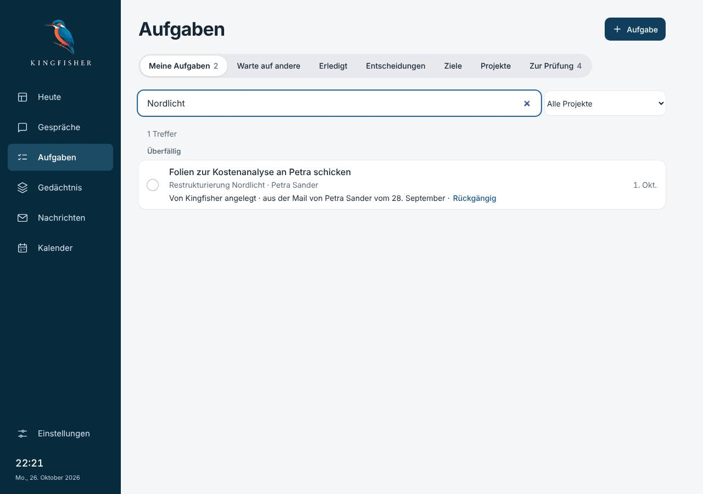

## 8 Sonst noch

- **Kalender vorbelegt:** zuerst ein Postfach, dessen Anbieter den Kalender mit demselben Passwort hat (eigene Domain,
  GMX), Gmail danach (`vorbelegteAdresse`). Bei der Ärztin stand die Gmail-Adresse da, die Praxisadresse musste sie tippen.
- **Umbenennen** steht sichtbar neben dem Namen; der Name selbst ist kein Knopf mehr (die Rentnerin landete beim Öffnen
  im Eingabefeld). Bilder unter 3.
- **Passwort „Anzeigen“**: `grundlage/PasswortFeld.tsx` in Postfach, Kalender und „Neu anmelden“.

## Offene Reste der vorigen Pakete

- **D, öffentliche Quellen:** Schalter „Eingetragene öffentliche Seiten abrufen“ unter „Was Kingfisher darf“, Satz wie bei
  der Update-Prüfung (IP-Adresse, „Aus: nur noch auf deinen Klick“), Zahl der Seiten darunter. Vorgabe an: Es gibt sie nur,
  wenn jemand eine Seite eingetragen hat; ohne Eintrag geht nichts hinaus. Aus hält der Zeitplan vor jeder Quelle an.
  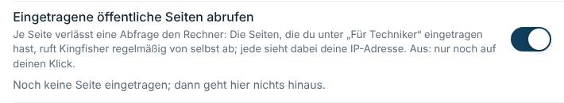 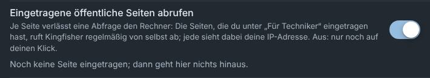
- **A-I, Viertelstunden:** „Viertel nach sieben (abends)“ = 7:15/19:15, „Viertel vor acht“ = 7:45/19:45, ohne Tageszeit
  nur mit eindeutigem Beleg. Dabei gefunden: „nach sieben“ galt als Zeitrahmen und verlangte wörtliche Belege; der
  Zeitrahmen schließt „Viertel nach/vor“ jetzt aus. Falsche Viertelstunden fallen weiter (6 Gegenfälle).
- **A-II, „zuletzt“:** Künftige Quellen zählen nicht (`episodes._kuenftig`); der Zwischenspeicher trägt die Stunde.
- **Z, „Zurück zur Prüfung“:** Das beim Übernehmen neu angelegte Projekt (Kennung aus dem Vorschlag) geht mit, wenn nichts
  anderes daran hängt; sonst bleibt es, und der Satz sagt es. Rückgängig legt es wieder an.
- **B, Rückfragen:** Entschieden nach Prüffrage 5. Abbestellen und Mitschrift zuordnen/lösen hatten weder Rückfrage noch
  Weg zurück. Beide bekamen einen vollständigen Weg zurück (`/welt/abbestellen/rueckgaengig` stellt auch die Meldung des
  Tages wieder her; `/transkripte/{id}/zuordnung/rueckgaengig` genau den Stand von vorher samt Sperre), deshalb keine
  Rückfrage, sondern den Hinweis mit „Rückgängig“. `16-gestaltung.md` sagt jetzt dasselbe.
- **H, Seitenrand:** `.shell main:is(…)` statt `main :is(…)`, nur `padding-inline: 16px`. Gemessen bei 390/768/1280:
  Aufgaben, Einstellungen, Nachrichten, Gedächtnis unverändert (ihre Grundlage-Regeln sind stärker), die Profilseiten von
  Person und Projekt unter 900 px 28 → 16 px; kein seitliches Rollen. 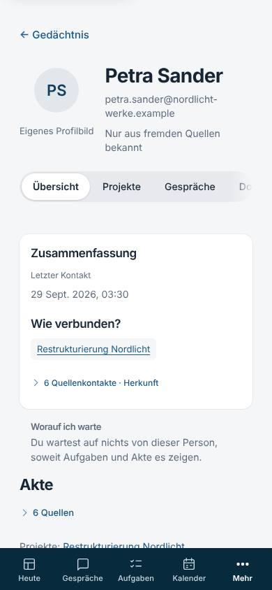
  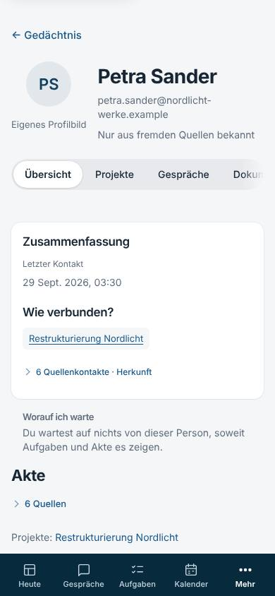

## Zahlen

- Neu: `sidecar/tests/test_sprache_paket_s.py` (24 Tests, 35 mit Parametern), `app/kingfisher/tests/sprache-paket-s.test.mjs`
  (14). Präzisiert oder angepasst: `test_konten_bereiche.py`, `test_lokale_ki.py`, `test_kalender_anmeldung.py`,
  `test_modelle_laden.py`, `test_kingfisher.py` (Klärungstitel, weiter ohne Namen), elf Oberflächentests.
- Volle Suite Sidecar: 8346 bestanden, 3 übersprungen, 0 fehlgeschlagen (14:52 min, `-n 4`).
- Oberfläche: `node --test` 1039 bestanden (vorher 1025), `tsc --noEmit` sauber, `vite build` sauber.
- `probe_seiten_ui.py` hell und dunkel: je 72 Breiten, 0 nicht in Ordnung, Konsole leer. `probe_tippziele_ui.py` hell
  und dunkel: 29 Seiten, 1067 Ziele, 0 unter 44 px. `probe_konten_ui.py` angepasst und grün. `probe_antwortzeit_ui.py` ist angepasst (klappt „Details“ auf), bricht aber schon auf dem Ausgangsstand `a3c8f02` vorher ab (wartet vergeblich auf `.satzantwort`); nicht Teil dieses Pakets, die Zeile hinter „Details“ ist mit der eigenen Nachstellung im Browser belegt (Bilder unter 2).

## Sabotageproben

29 Proben (`befunde/sprache/skripte/sabotage.py`), je Zusicherung gebrochen, der passende Test rot, danach grün:
Gmail ohne Inhalt wieder „Privat“ · Firma an Privatkunden zählt als Arbeit · doppeltes Postfach nicht erkannt ·
Passwort ohne „Anzeigen“ · Cloud-Modell nicht vorbelegt · Mistral ohne Modellwahl · Abo wieder „403 Forbidden“ · Stand
der KI mit Modellkennung · Zeiten offen · Kalender nach dem Server benannt · „Guten Tag“ am Abend · „beides“ unter
einem Häkchen · „Privat gehört jetzt zu Privat.“ · Mails doppelt gezählt · Klärung mit freiem Merkmal · gleiche
Klärungstitel · Suche ohne Projektnamen · „Mehr“ ins Gedächtnis · Zeitplan trotz „aus“ · „Viertel nach“ als Zeitrahmen ·
„Viertel vor“ als :15 · „zuletzt“ mit Künftigem · Projekt bleibt immer · Projekt geht auch mit Inhalt ·
Abbestellen-Rückgängig ohne Meldung · Mitschrift-Rückgängig mit Sperre · Seitenrand ohne Wirkung · neues Fachwort vorne ·
Heute ohne Gerätezone. Eine Probe fing zuerst nichts (gleiche Klärungstitel: der vierte Eintrag fiel unter die drei
sichtbaren); der Test ist geschärft, jetzt rot.

## Grenzen

- Der Inhaltsvorschlag für Bereiche ist eine Regel ohne Modell; eine Privatperson mit vielen förmlichen Mails einzelner
  Sachbearbeiter (ohne Kundennummer) kann als gemischt gelten und wird dann gefragt.
- Bestehende Kalendernamen mit Server bleiben, bis man umbenennt.
- Das Rückgängig nach dem Zuordnen einer Mitschrift gilt in dieser Sitzung (im Speicher), das nach dem Abbestellen bleibt
  bis zum nächsten Abbestellen gespeichert.
- Gruß-Bild am Abend fehlt: Die Uhr lief real (morgens); belegt durch Tests.
- Linux-Chromium statt Mac-App; Mail, Kalender, Modell und Cloud als Attrappen.
