# Befunde der Persona-Prüfung: Paket Z, stimmige Zahlen und ein Rückweg (Z1 bis Z4)

Stand 27.10.2026, Branch `fix/befunde-zahlen` auf dem Integrationsstand `docs/persona-pruefung-20261026` (1.0.29 mit
Paket D, A-I und A-II). Befunde aus [der Persona-Prüfung](../2026-10-26-persona-pruefung/README.md), Abschnitt
„3. Stimmige Zahlen und ein Rückweg“. Nachgestellt mit einer Kopie der Berater-Welt (Messlatte-Welt „Lea Hartmann“,
drei Postfächer, zwei Kalender-Abos und ein Mac-Kalender, Bereiche Arbeit/Privat, sieben überfällige und eine heute
fällige Aufgabe, eine wartende, Vorschläge und zwei von Kingfisher angelegte Aufgaben). Nur synthetische Daten,
Attrappen statt Postfach, Kalender und Modell. Echter Sidecar, gebaute Oberfläche, Chromium; vorher der Ausgangsstand
`d5b0326` (eigener Worktree), nachher dieser Branch. Uhr der Welt: 29.09.2026, 07:35.

## Z1 Eine Zahl

**Vorher.** Heute „2 Punkte brauchen dich.“, Aufgaben „8 Aufgaben brauchen dich heute.“. Projekt „Restrukturierung
Nordlicht“ mit Filter „Privat“: „Meine Aufgaben 2“ und Kachel „2 Offen“ über „Keine offenen Aufgaben für dich.“ Zugänge:
„2 Kalender verbunden“ über drei Zeilen. Kalender mit „Privat“ und ausgeblendetem Privatkalender: „In diesem Zeitraum gibt
es keine Termine im Bereich Privat.“ (es gab drei).

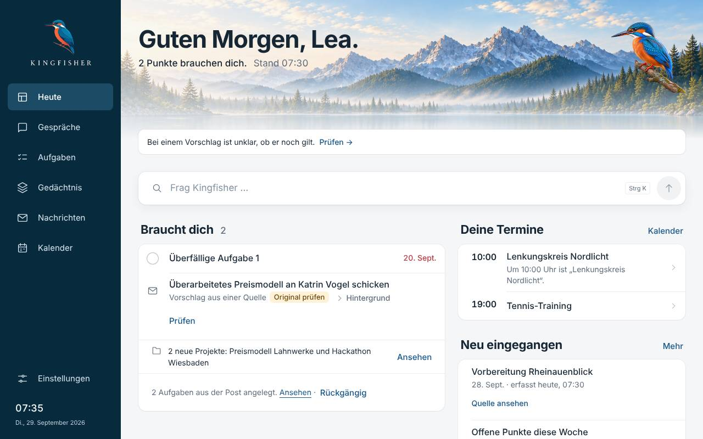 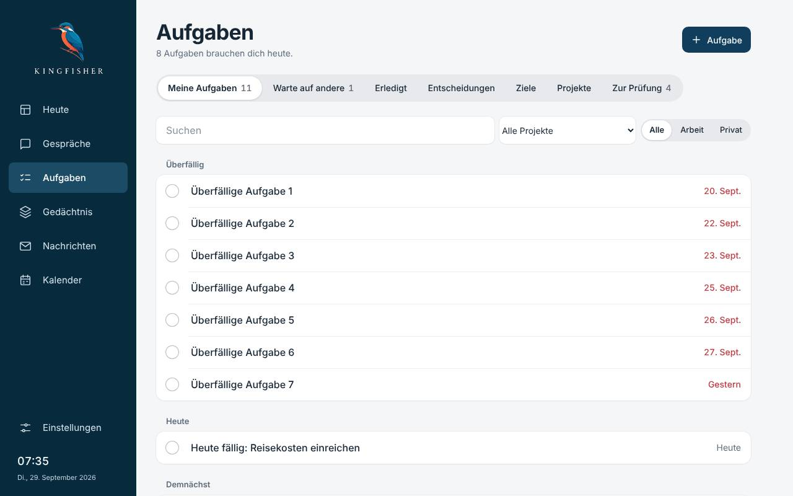
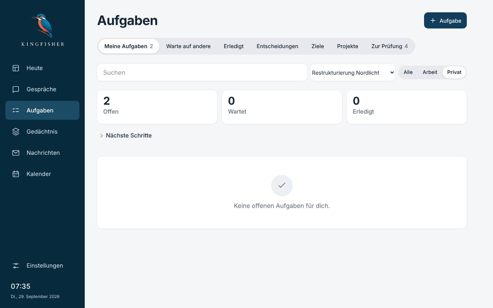 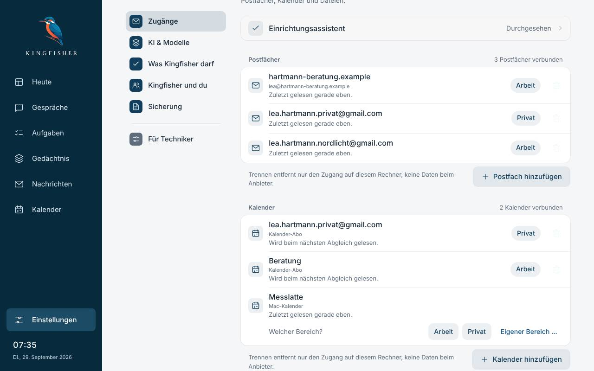
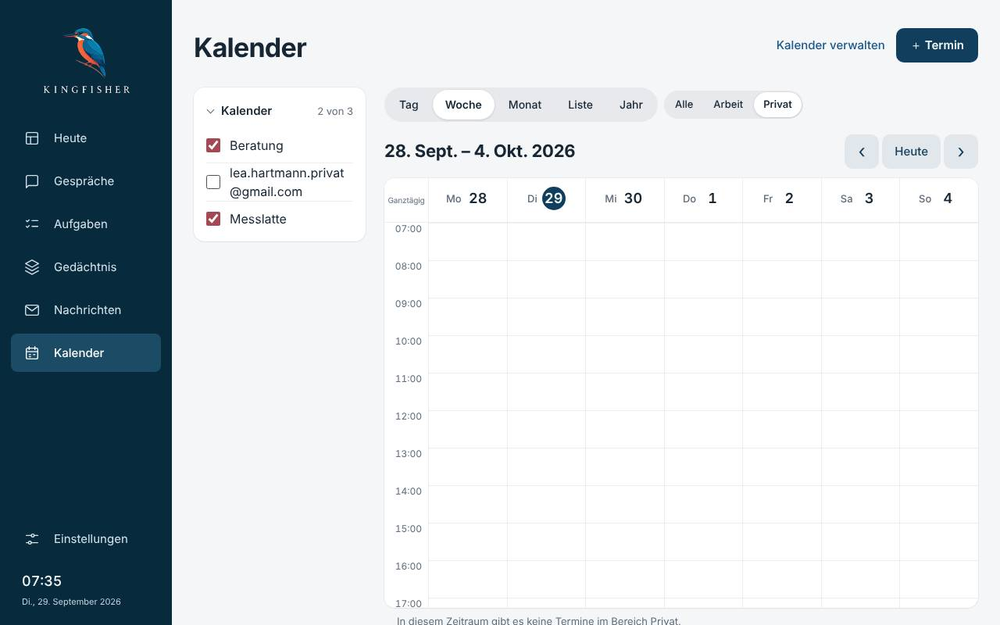

**Ursache.** Jede Stelle zählte mit eigener Regel: Heute die sichtbaren Zeilen (höchstens drei, ein Termin am Termin
abgezogen); das Briefing „überfällig“ nach Uhrzeit, auch Wartendes; Aufgaben die geladenen Zeilen der Seite
(„Mehr als 50“); die Segmente und der Projektüberblick ohne Bereich, die Liste filterte die Seite im Browser; Zugänge
`calendar_sources.length` ohne Mac-Kalender; der Kalender nahm „ausgeblendet“ und „Bereich“ als Entweder-oder.

**Behebung.** `zaehlung.py` ist die eine Regel je Begriff. „Braucht dich heute“ (`heute_dran`): offen, bei dir, fällig
heute oder früher nach dem Kalendertag in der eingestellten Zeitzone. Das Briefing teilt damit in überfällig/heute und
zählt **vor** dem Kürzen auf drei (`Briefing.zaehlung`, `Punkt.anzahl`, auf Heute `braucht_dich`). Heute und Aufgaben
setzen die Zahl in denselben Satz (`zahlen.brauchtDichSatz`): „8 Aufgaben brauchen dich heute.“ bzw. auf Heute
„8 Aufgaben und 3 weitere Punkte brauchen dich heute.“; neben „Braucht dich“ „3 von 11“ und darunter „Hier steht das
Wichtigste, 3 von 11. Alle 8 Aufgaben ansehen“. `/api/v1/tasks` nennt `heute_dran` für die ganze Auswahl. Der
Bereichsfilter filtert im Sidecar vor Zählen und Blättern (`?bereich=`, auch im Projektüberblick; ein Cursor gilt nur in
seiner Auswahl). Zugänge zählt die Zeilen (`kalenderZeilen`). Der Kalender sagt „3 Termine in diesem Zeitraum liegen in
einem ausgeblendeten Kalender: lea.hartmann.privat@gmail.com.“ mit „Einblenden“ (`ausgeblendetLage`).

**Nachher.**
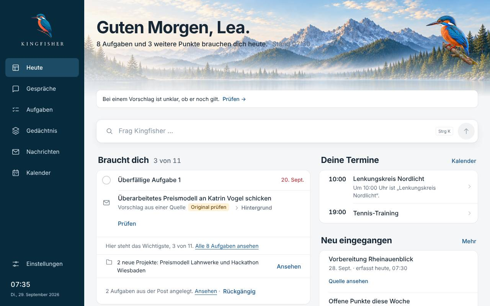 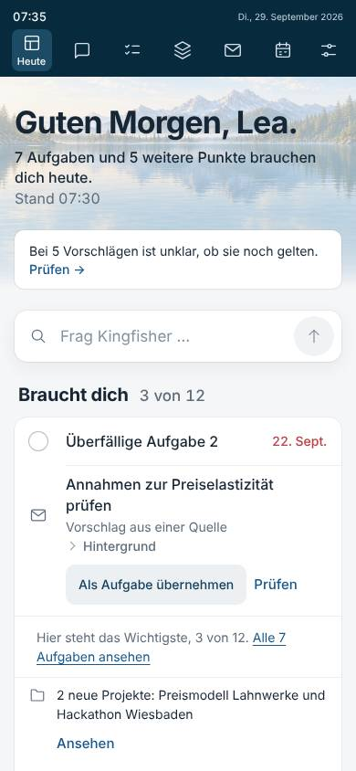 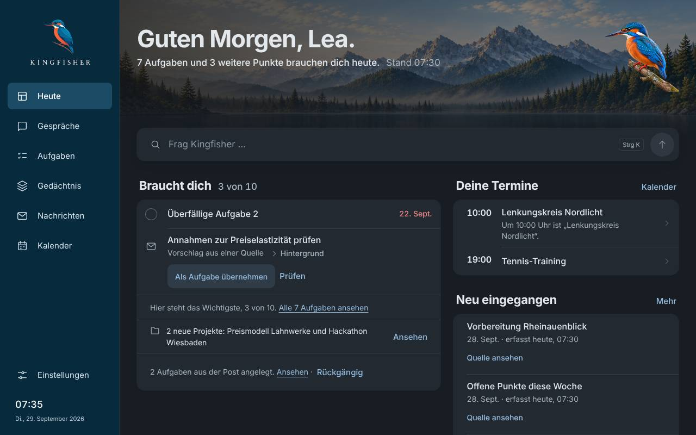
  
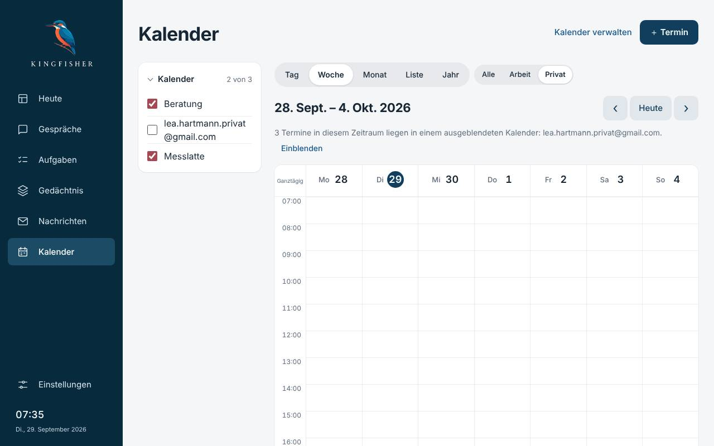 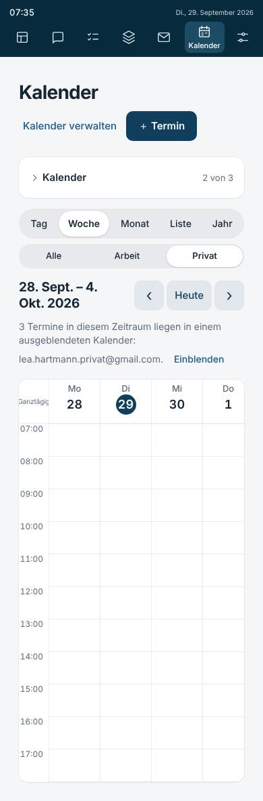

**Tests.** `test_eine_zahl.py` (10): Regel, Briefing zählt hinter den drei Punkten, Wartendes in keinem Punkt, „Heute
sind 2 fällig“ zählt zwei, Verlaufsprüfung nicht doppelt, Heute und `/tasks` gleich und gleich der Liste, `heute_dran`
für die Auswahl, Bereich: `total == len(tasks)` für alle Bereiche, Ansichten und Projekte, Überblick wie Liste,
Blättern mit Bereich. `eine-zahl.test.mjs` (6). Angepasst: `viel-bestand`, `aufgaben-ruhig`, `manual-task-handlers`
(die Seite zählt nicht mehr selbst).

## Z2 Rückgängig nur 6 Sekunden

**Vorher.** Hinweis nach 6,1 s weg; danach für eine zurückgenommene automatische Aufgabe und für „Alle übernehmen“ kein
Weg zurück. Am Handy hielt ein Finger auf dem Hinweis ihn nicht.

**Ursache.** Der Hinweis war der einzige Rückweg; die Gegenrouten gab es, aber keine Stelle, die sie später anbot.
`halten` kannte nur Maus und Fokus.

**Behebung.** Mindestens 10 s, bei langem Satz länger (`hinweisDauer`), Fehler 15 s; ein gedrückter Finger hält ihn,
danach beginnt die Zeit von vorn. Dauerhafte Wege ohne neue Seite: „Erledigt → Zurückgenommen“ mit „Wiederherstellen“
(`GET /api/v1/aufgaben-von-selbst/zurueckgenommen`); in einer übernommenen Aufgabe „Aus einem Vorschlag übernommen am
… · Zurück zur Prüfung“ und bei „Alle übernehmen“ „Alle dieser Übernahme zurück“
(`POST /api/v1/task-candidates/aufgabe/{id}/zurueck`; Erledigtes und von Hand Angelegtes bleiben, 409).

**Nachher.** Hinweis 10,0 s; Finger 16 s darauf: steht; losgelassen: 10,0 s. Nach Ablauf wiederhergestellt bzw. zur
Prüfung zurück (4 → 0 → 1 Vorschlag).
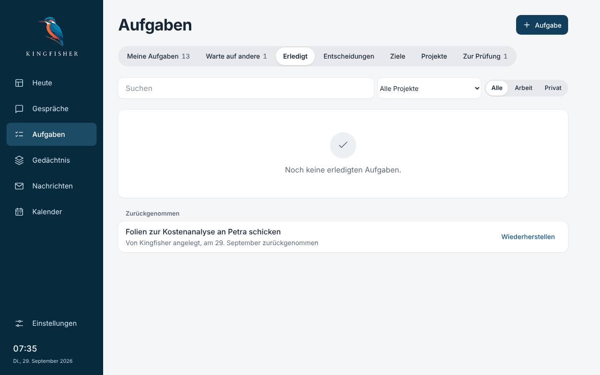 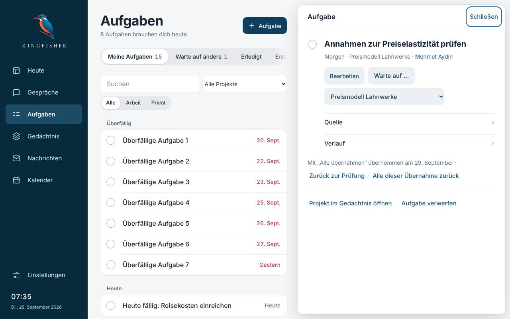
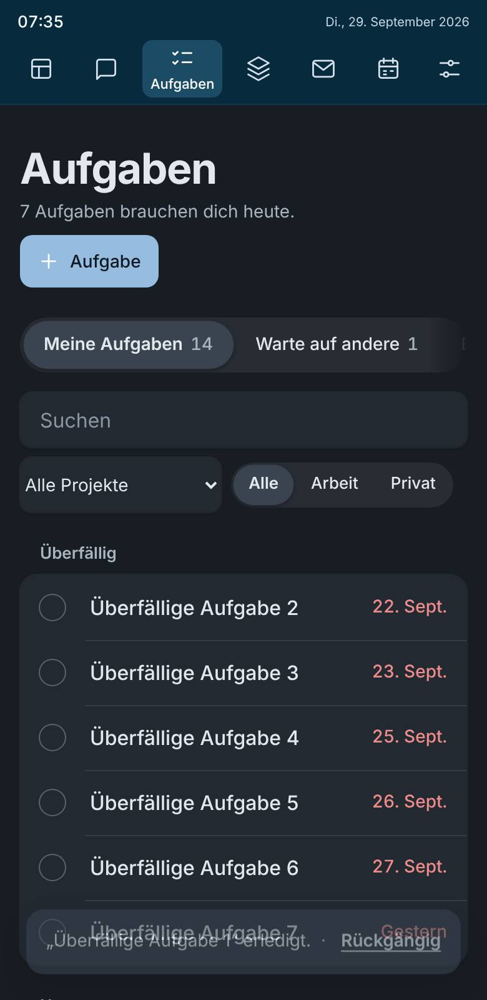

**Tests.** `test_rueckweg.py` (6), `rueckweg.test.mjs` (Dauer, Finger, Gruppe, Aufgabe); `hinweis.test.mjs` angepasst.

## Z3 Fokus und Enter

**Vorher.** Umbenennen mit Enter: Fokus auf „Rückgängig“ im Hinweis; ein zweites Enter: „Rückgängig gemacht.“, der
alte Name stand wieder da. Am Handy stand der Hinweis 31,7 s (der Fokus hielt ihn) über „entfernen“ der Zeile darunter.
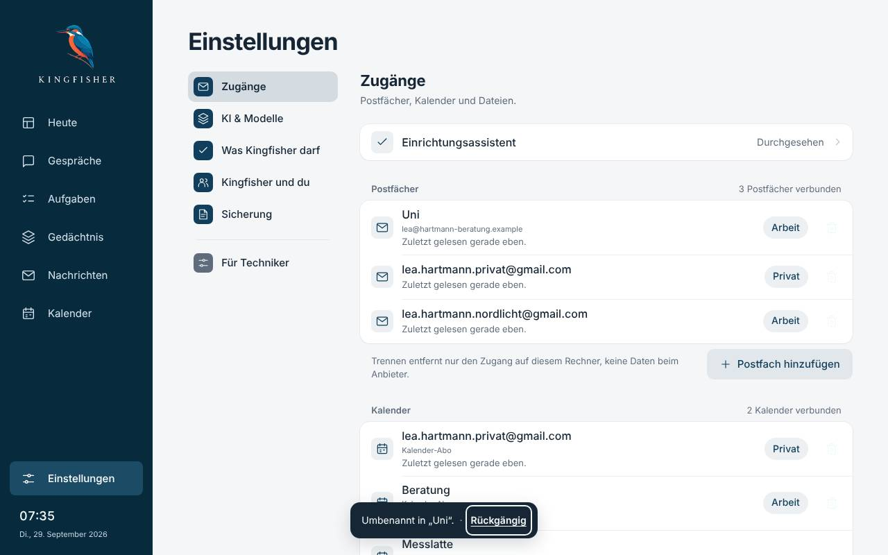 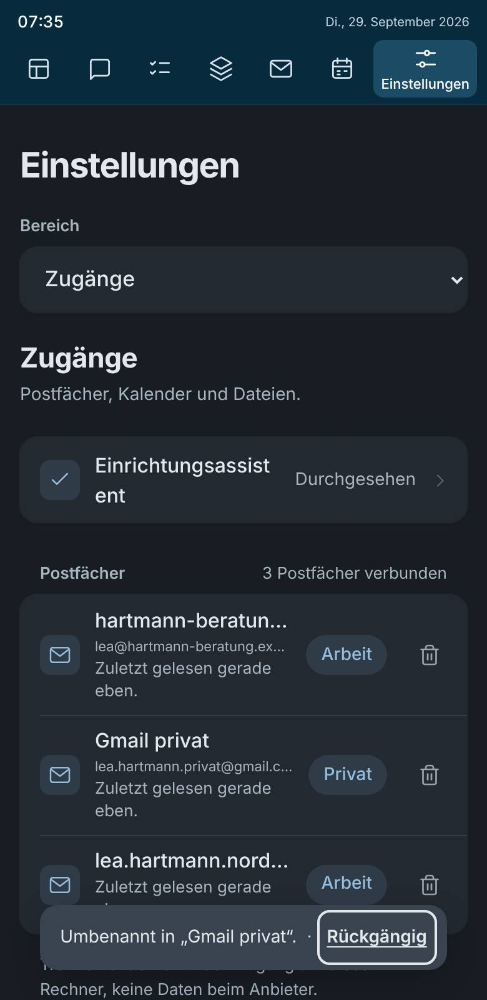

**Ursache.** `Hinweis.tsx` setzte den Fokus auf „Rückgängig“, sobald der Auslöser beim Erscheinen des Hinweises nicht
mehr verbunden war; beim Umbenennen ist das das Eingabefeld, obwohl der Name den Fokus schon zurückhatte.

**Behebung und Begründung.** Der Fokus springt nie in den Hinweis (`fokusZiel.ts`): Er bleibt am Auslöser (Umbenennen:
auf dem Namen), wartet, solange der Auslöser gesperrt ist, und geht sonst auf die Liste oder den Abschnitt, in dem die
verschwundene Zeile stand (`tabindex=-1`). Das ist für Tastatur und Vorleser ein Ort, den man kennt, und ein zweites
Enter löst dort nichts aus; Tab führt zur nächsten Zeile. Ein Fokus auf die nächste Zeile hätte das zweite Enter auf den
nächsten Vorschlag gelenkt. Der Hinweis wird als Status angesagt, mit „Zurücknehmen mit Steuerung Z.“ (nur Vorleser),
und ist mit Strg+Z/⌘Z oder Tab erreichbar. Am Handy (bis 700 px) steht er oben, wenn er unten Bedienbares verdecken
würde und oben nicht; die Seite bekommt unten Platz, und das Bediente rückt heraus.

**Nachher (Tastatur-Durchgang).** Vorschlag mit Tab erreicht, Enter: Fokus auf „Erkannte Aufgaben und Zusagen“, kein
Vollbild; zweites Enter: nichts zurückgenommen (12 offene); Strg+Z: zurück zur Prüfung (11 offene, 4 Vorschläge).
Umbenennen: Fokus auf „Uni umbenennen“, zweites Enter öffnet nur das Feld wieder, der Name bleibt. Handy: 9,9 s.
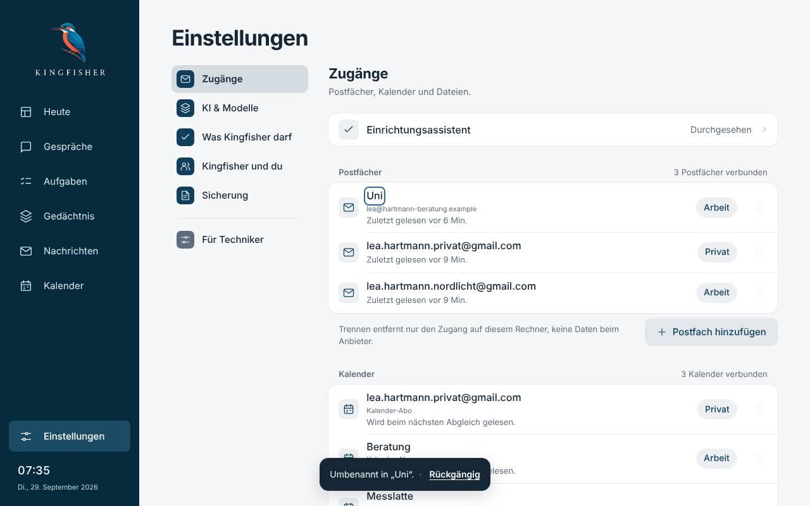 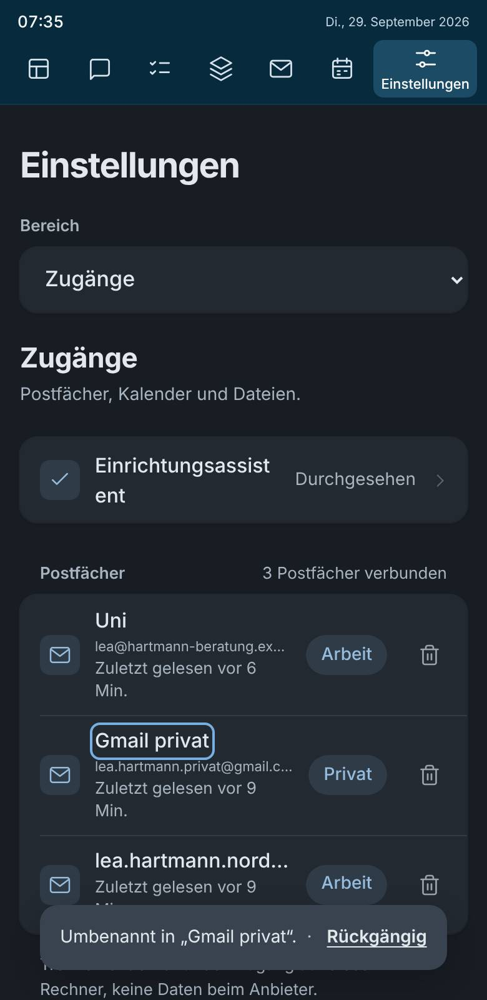

**Tests.** `rueckweg.test.mjs`: Liste statt Knopf, Auslöser bleibt, gesperrt wartet, nie im Hinweis, Kürzel angesagt,
Platz und Lage am Handy.

## Z4 Vollbild ohne Hinweis

**Vorher.** Einen Vorschlag übernehmen öffnete die Aufgabe im Vollbild, ohne Hinweis, die Prüfliste war weg; ebenso
„Alle übernehmen“ und „+ Aufgabe“.
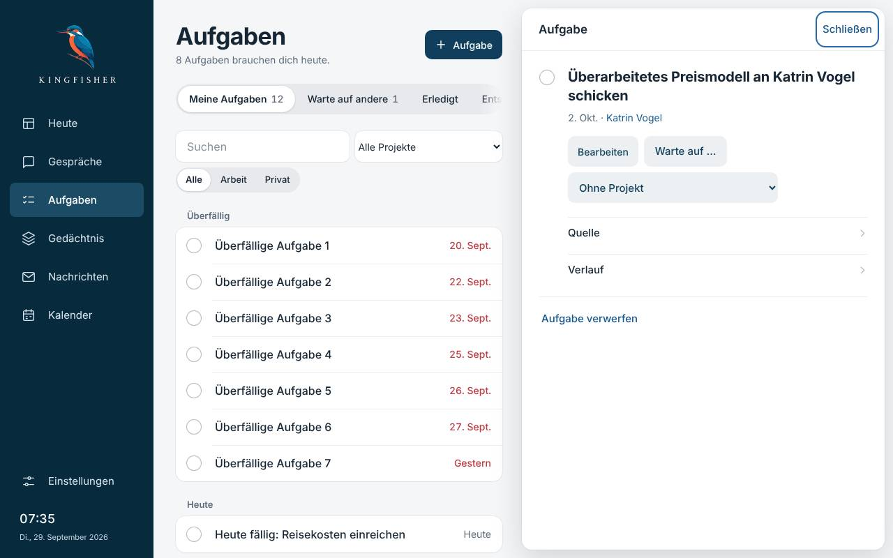 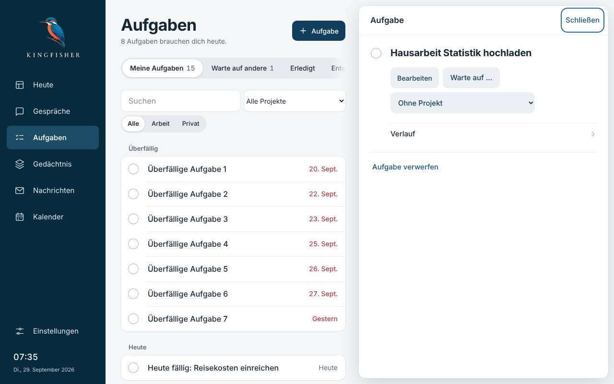

**Ursache.** `onAccepted` und `create` in `App.tsx` riefen `openTask` und wechselten die Ansicht.

**Behebung.** Beides bleibt in der Liste: „„…“ übernommen. · Rückgängig · Ansehen“ (Rückgängig: zurück zur Prüfung),
„„…“ angelegt. · Rückgängig · Öffnen“ (Rückgängig verwirft). Geöffnet wird nur auf Klick.

**Nachher.** 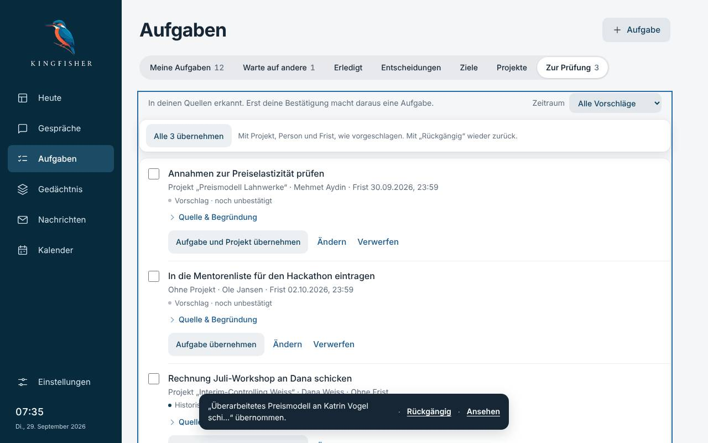 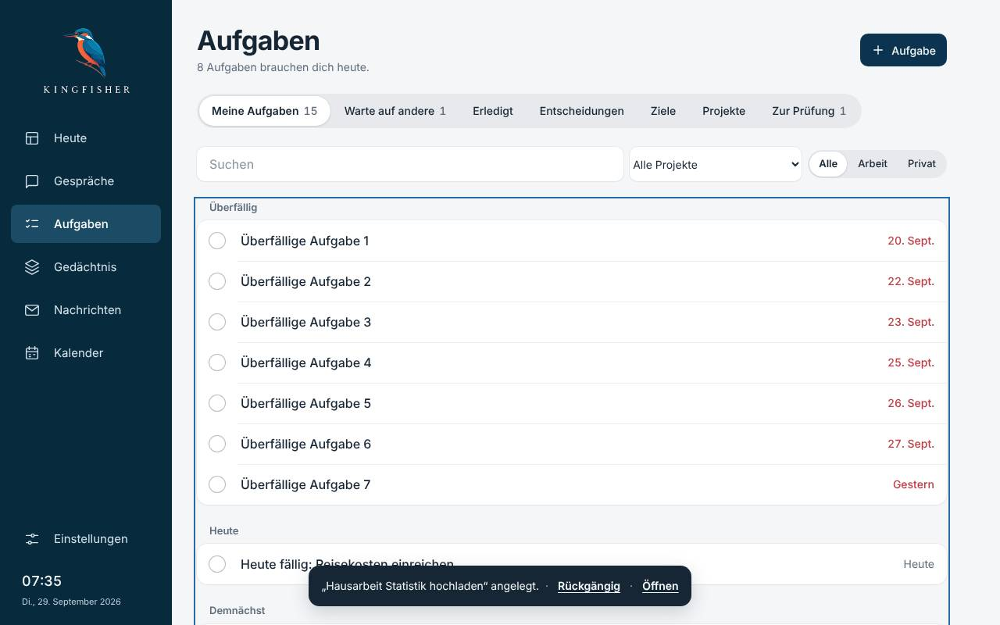

**Tests.** `rueckweg.test.mjs` (Hinweise, kein `openTask` in `create`, `onAccepted` lädt nur nach);
`test_rueckweg.py` (Herkunft „uebernommen“).

## Zahlen

- Backend gezielt: `test_eine_zahl.py` 10, `test_rueckweg.py` 6, verwandte (`-k task/briefing/morning/project/konten`)
  653 und 535 grün. Volle Suite: siehe unten.
- Oberfläche: `tsc` ohne Befund, 978 Tests grün, `vite build` ok.
- `probe_seiten_ui.py` hell und dunkel: je 75 Breiten geprüft, 0 nicht in Ordnung.

## Sabotageproben (alle rot, danach zurückgesetzt)

| Probe | rot wird |
|---|---|
| Wartende zählen als „braucht dich“ | `test_braucht_dich_heute_ist_offen_bei_dir…` |
| Briefing zählt nur die drei sichtbaren | `test_briefing_zaehlt_aufgaben…hinter_den_drei_punkten` |
| `/tasks` ignoriert den Bereich | `test_bereichsfilter_zaehlt_und_listet_dieselbe_auswahl` |
| Projektüberblick ohne Bereich | dieselbe |
| Heute zählt Zeilen statt `braucht_dich` | `eine-zahl` 2 |
| Zugänge ohne Mac-Kalender | `eine-zahl` 5 |
| ausgeblendete Termine ohne Bereich | `eine-zahl` 6 |
| Hinweis wieder 6 s | `rueckweg` 1, 2 |
| Finger hält nicht | `rueckweg` 2 |
| Fokus darf in den Hinweis | `rueckweg` 4 |
| Fokus auf die Seite statt die Liste | `rueckweg` 3 |
| „Zurückgenommen“ nur einen Tag | `test_zurueckgenommene…wiederherstellbar` |
| „Zurück zur Prüfung“ verwirft | `test_einzeln_uebernommener…zur_pruefung` |
| Erledigtes geht zurück zur Prüfung | `test_was_dir_gehoert_bleibt` |
| Einzeln übernommen ohne Herkunft | `test_einzeln_uebernommener…zur_pruefung` |
| „+ Aufgabe“ wieder im Vollbild | `rueckweg` 10 |

## Grenzen

- **Handy, dichte Listen:** Der Hinweis ist eine Fläche über der Seite. Er verdeckt nie, was man gerade bedient hat, und
  steht oben, wenn er unten etwas verdecken würde; liegen oben wie unten Bedienelemente (Liste ganz oben, Navigation),
  überdeckt er für seine Standzeit (10 s) eine Zeile am unteren Rand, die sich darunter hervorrollen lässt. Ein
  Hinweis, der nie etwas überdeckt, müsste in den Fluss der Seite; das ist eine Gestaltungsfrage, keine Behebung.
- Die Gruppen „Überfällig“/„Heute“ der Liste rechnen im Browser in seiner Zeitzone; die Zahl darüber in der
  eingestellten. Auf einem Rechner sind beide gleich.
- „Rückgängig“ nach „+ Aufgabe“ verwirft die Aufgabe (sie steht danach als verworfen in der Geschichte); ein Löschen gibt
  es nicht.
- „Zurück zur Prüfung“ lässt ein dabei neu angelegtes Projekt stehen.
- Kein echtes iOS, kein echter Vorleser; Ansagen aus dem Barrierefreiheitsbaum und dem DOM abgeleitet.
- Skripte, Messwerte und alle Bilder liegen im Arbeitsordner der Sitzung (`befunde/zahlen/`), hier eine Auswahl.
