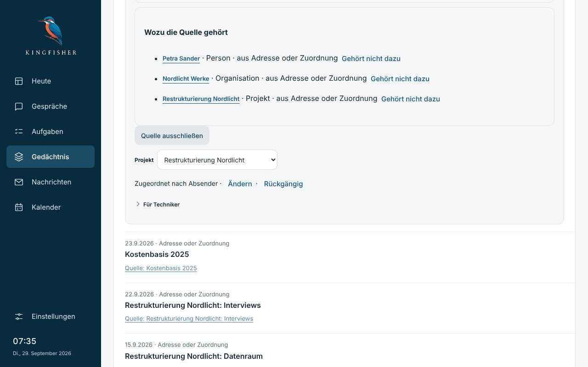
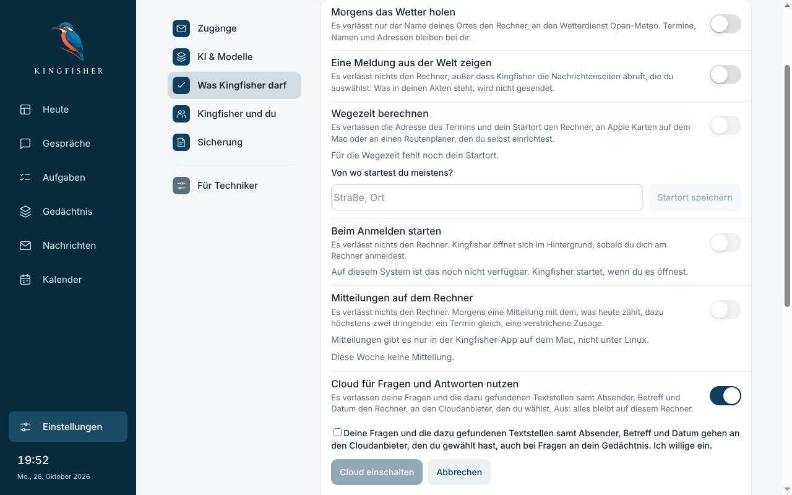
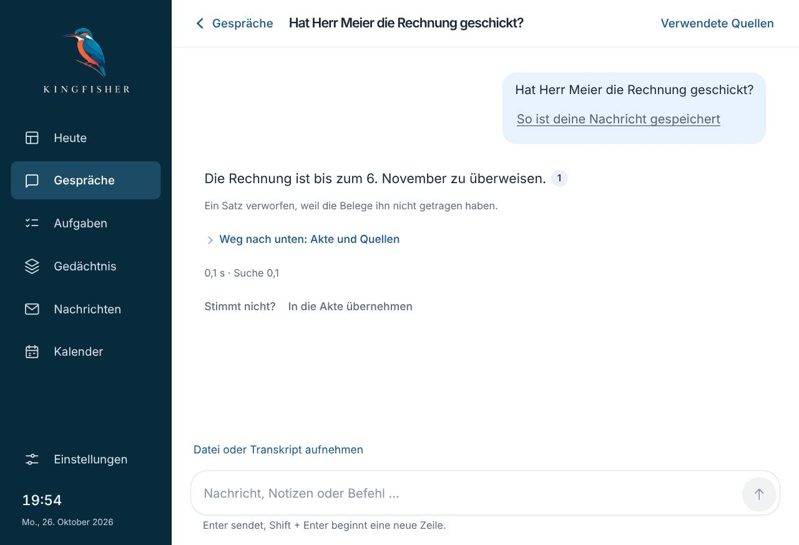
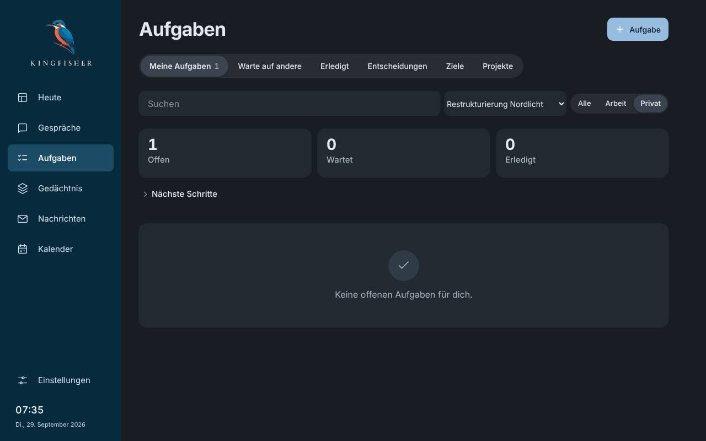
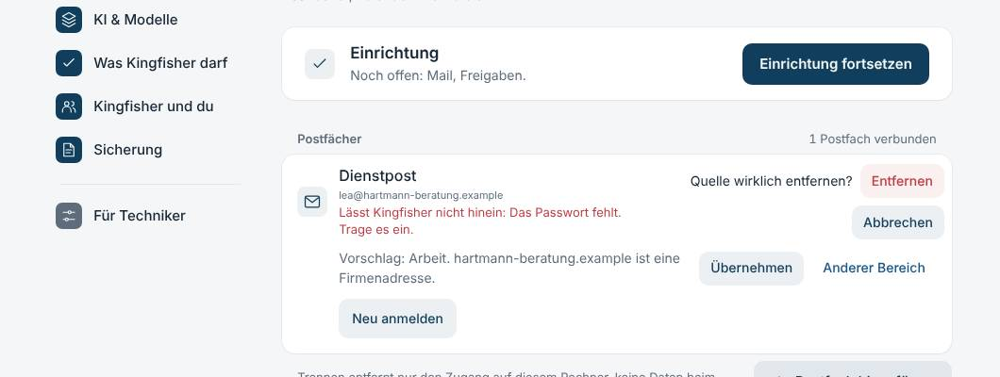
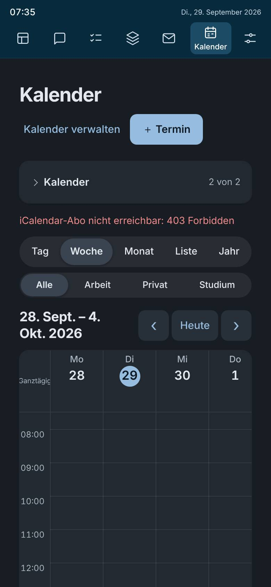

# Persona-Prüfung von Kingfisher 1.0.29

Stand 26.10.2026, Fassung 1.0.29 (main `9bfe625`). Sieben Personas haben die App so benutzt, wie
diese Menschen es täten: im echten Chromium, mit dem echten Sidecar und der gebauten Oberfläche, mit
synthetischen Daten (Messlatte-Welt „Lea Hartmann“ und eigene Fantasie-Postfächer). Statt echter
Postfächer, Modelle und Cloud liefen Attrappen. Es gab keine persönlichen Daten und keinen echten
Cloud-Aufruf. Im Code wurde nichts geändert.

## Die Personas

| Persona | Schwerpunkt | Urteil | In einem Satz |
|---|---|---|---|
| **Dr. Miriam Fehr**, 52, Hausärztin | Einrichtung in 20 Minuten, nichts in die Cloud | ★★★☆☆ | „Bei jedem Schalter steht ehrlich, was hinausgeht. Aber als ich die Cloud-Frage aufgemacht habe, stand der Schalter plötzlich auf an, und wohin meine Patientendaten gehen würden, stand nirgends.“ |
| **Jonas Weber**, 34, Berater | Drei Postfächer, fünf Projekte, Automatik | ★★★☆☆ | „Projekte und Aufgaben sortieren sich wirklich von selbst und lassen sich sauber zurücknehmen. Beim Kunden-Gmail und bei ‚Alle übernehmen‘ muss man aber aufpassen, und die Zahlen in der Aufgabenliste stimmen nicht.“ |
| **Helga Brandt**, 71, Rentnerin | Ohne Fachwissen, größere Schrift | ★★★☆☆ | „Das Einrichten ging erstaunlich glatt. Aber dann wusste es nicht mal, wann unsere Vorstandssitzung ist, und überall standen so komische Wörter.“ |
| **Leon Krüger**, 24, Student | Nur Handy, 390 px, dunkel | ★★★☆☆ | „Sieht aus wie eine echte App und antwortet schnell. Aber die Woche zeigt nur vier Tage, nach jeder neuen Aufgabe muss ich ein Fenster wegdrücken, und die Links zum Antippen sind winzig.“ |
| **Sabine Ott**, 45, Assistentin | Viel Bestand, Tempo, Tastatur | ★★★☆☆ | „Die Seiten sind blitzschnell und Rückgängig klappt fast überall. Aber genau die Fragen, die ich jeden Morgen stelle, brauchen eine halbe Minute, und dann fehlt auch noch das Wichtigste.“ |
| **Tarik Aydin**, 39, stark sehbehindert | Nur Tastatur und Vorleser, WCAG 2.2 AA | ★★★☆☆ | „Die Knöpfe sind sauber beschriftet und das Rückgängig ist vorbildlich gelöst. Aber wenn Kingfisher antwortet oder ich die Seite wechsle, sagt mir der Vorleser nichts mehr.“ |
| **Dr. Paul Siebert**, 58, Datenschutzanwalt | Versprechen brechen, Netzverkehr prüfen | ★★★☆☆ | „Die Voreinstellungen sind vorbildlich, und gesendet wird nichts ohne Freigabe. Aber der Widerruf greift nicht sofort, und drei Wege nach draußen stehen nicht auf der Seite, die alle Wege nach draußen aufzählen soll.“ |

Alle sieben geben drei von fünf Sternen. Das Fundament trägt, und das sagen alle. Bevor jemand
Kingfisher ohne Begleitung empfehlen würde, fehlen aber Verlässlichkeit in den Antworten, ehrliche
Zahlen und einige Stellen der Datenschutz-Zusagen.

## Was alle gut fanden

- **Ehrliche Schalter:** Unter „Was Kingfisher darf“ sagt jede Zeile in einem Satz, was den Rechner
  verlässt, und alles mit Außenwirkung ist von Haus aus aus (Ärztin, Anwalt).
- **Nichts geht ungefragt hinaus:** Eine Mail geht erst nach der Freigabekarte mit abgetippter
  Adresse hinaus, ein Entwurf „wird erst nach deiner Freigabe versendet“ (Anwalt, Assistentin).
- **Automatik mit Rückgängig:** Projekte entstehen mit Grund („aus 4 Mails mit Katrin Vogel und
  Mehmet Aydin“), ein falsches ist mit zwei Klicks weg und kommt nicht wieder. Neue Mails eines
  bekannten Absenders landen im richtigen Projekt. Über Personen werden keine Fakten abgelegt
  (Berater, Anwalt, Ärztin).
- **Einrichtung:** Die Mailadresse wird erkannt, man tippt nur das Passwort, und der Kalender braucht
  kein zweites Passwort. Helga hat sie allein in drei Minuten geschafft.
- **Tempo der Seiten:** Heute, Nachrichten und Personen laden auch bei 2.000 Quellen in unter einer
  Sekunde. „Alle 25 übernehmen“ samt Rückgängig dauert 0,9 s (Assistentin).
- **Gestaltung:** Kein seitliches Verrutschen, ein ruhiger Dunkelmodus, und alle Bedienelemente
  tragen verständliche Namen für den Vorleser (Student, Barrierefreiheit).

## Befunde nach Dringlichkeit

Die Zahl in Klammern sagt, wie viele Personas den Befund unabhängig voneinander fanden.

### 1. Zusagen zum Datenschutz (zuerst)

| # | Befund | Wer |
|---|---|---|
| D1 | **Widerruf greift nicht sofort.** Wer die Cloud mitten in einer laufenden Antwort ausschaltet, sieht den Schalter bis zu 12 s weiter auf „an“, und es gehen noch zwei Anfragen an den Anbieter. | Anwalt |
| D2 | **Das Modell ruft ohne Freigabe Webseiten ab** (Werkzeug `web_abruf` im Gespräch). Am Code geprüft: In einer Runde ohne fremden Inhalt braucht der Abruf keine Freigabe, erst danach eine genaue. In der Oberfläche ist der Abruf nicht zu sehen, und unter „Was Kingfisher darf“ steht er nicht. | Anwalt |
| D3 | **Update-Prüfung von Haus aus an**, ruft 60 s nach dem Start GitHub auf und fehlt unter „Was Kingfisher darf“. Unter „Speicherorte“ steht aber, nichts verlasse den Rechner außer dem dort Eingeschalteten. | Anwalt |
| D4 | **Die Einwilligung nennt weder Anbieter noch Land:** „an den Cloudanbieter, den du gewählt hast“, obwohl niemand gewählt hat. „Textstellen“ untertreibt: Für eine Frage gingen 16 ganze Mails hinaus. Bei der Ärztin wären das Patientendaten. | Ärztin, Anwalt (2) |
| D5 | **Der Schalter steht auf „an“, solange die Zustimmung noch offen ist.** Man glaubt, die Cloud sei schon eingeschaltet. | Ärztin, Student (2) |
| D6 | Der Hinweis „Mit der Cloud geht es in wenigen Sekunden“ nach einer langsamen Antwort nennt nur den Nutzen, nicht, was hinausginge. Bei jeder langsamen Antwort ein leiser Druck. | Ärztin |
| D7 | Es gibt kein Löschen und keinen Export je Person (Auskunftsrecht). Die Sicherung lässt sich in der Oberfläche nicht wiederherstellen. | Anwalt |

### 2. Verlässliche Antworten

| # | Befund | Wer |
|---|---|---|
| A1 | **Die Satzprüfung verwirft richtige Sätze:** „um 18 Uhr“ gegen den Termin „18:00“ und ein „Ja“ am Satzanfang. Übrig bleiben Bruchstücke oder eine Rohliste mit „Quelle berichtet · Angabe · Quellenzeit“. | Rentnerin |
| A2 | **Kurz nach der Einrichtung kommt „Das kann ich mit den gefundenen Belegen nicht beantworten“**, obwohl Mail und Termin da sind. Kingfisher liest noch, sagt es aber nicht. | Rentnerin |
| A3 | **„Worauf warte ich noch?“ ist zum Teil falsch:** Eine erledigte Bitte steht weiter als offen, der Kernpunkt fehlt, und Einladungen erscheinen als Zusage. | Assistentin |
| A4 | **Die Standardfragen sind langsam:** „Worauf warte ich?“ 28 s, „Was brauche ich morgen?“ 49 s, „Tageslage“ auf Heute 64 s, ein gespeichertes Gespräch öffnen 13,6 s. Gemessen bei 2.000 Quellen unter Last durch parallele Prüfungen; die ersten beiden laufen eigentlich ohne Modell. | Assistentin |
| A5 | Frische Bitten von gestern oder heute heißen „Historisch · Aktualität prüfen“ oder „zeitlich ungeklärt“; Heute meldet „8 Vorschläge sind zeitlich ungeklärt“ und zugleich „Nichts wartet auf dich“. **Vorsicht:** Ein Teil kann von der eingefrorenen Prüfuhr kommen; das muss erst geklärt werden. | Ärztin, Assistentin (2) |
| A6 | Die Terminvorbereitung bleibt leer („Kein Projekt ausgewählt“), obwohl die offenen Bitten des Teilnehmers in seiner Akte stehen. Die Terminkarte nennt Adressen statt Namen. | Assistentin |
| A7 | Die Suche nach „Müller“ findet „Mueller“ nicht. Bei einer Person steht oben „Noch keine Rückmeldung vorgemerkt“, darunter „Du wartest auf …“. | Assistentin |

### 3. Stimmige Zahlen und ein Rückweg

| # | Befund | Wer |
|---|---|---|
| Z1 | **Heute und Aufgaben zählen verschieden:** Heute „Ein Punkt braucht dich“, Aufgaben „2 … brauchen dich heute“; bei der Assistentin 2 gegen 18. Die Zähler am Bereichsfilter stimmen nicht mit der Liste („1 offen“ über „Keine offenen Aufgaben“). Unter Zugänge steht „2 Kalender verbunden“, die Liste zeigt 3. | Rentnerin, Assistentin, Berater, Student (4) |
| Z2 | **Rückgängig nur 6 Sekunden:** Danach gibt es für eine zurückgenommene automatische Aufgabe und für „Alle übernehmen“ keinen Rückweg mehr; Berühren am Handy hält den Hinweis nicht. | Student, Rentnerin, Berater (3) |
| Z3 | Nach Enter (Umbenennen, Übernehmen) springt der Fokus auf „Rückgängig“: Ein zweites Enter nimmt alles sofort zurück, und am Handy bleibt der Hinweis 20 s stehen und verdeckt den Schalter darunter. | Barrierefreiheit, Student (2) |
| Z4 | Einen einzelnen Vorschlag übernehmen öffnet die Aufgabe im Vollbild, ohne Hinweis und ohne Rückgängig, und die Vorschlagsliste ist weg. Ebenso nach „+ Aufgabe“. | Assistentin, Student (2) |

### 4. Barrierefreiheit (WCAG 2.2 AA)

| # | Befund |
|---|---|
| B1 | Die fertige Antwort wird nicht angesagt, und der Fokus liegt danach auf `body` (4.1.3, 2.4.3). |
| B2 | Nach jedem Seitenwechsel liegt der Fokus auf `body`. Jede Seite heißt „Kingfisher“, und es gibt kein „Zum Inhalt springen“ (2.4.2, 2.4.3). |
| B3 | Bei der Rückfrage „Quelle wirklich entfernen?“ fällt der Fokus ins Leere, und Escape bricht nicht ab. Der erste Tab landet auf „Entfernen“, das sich nicht zurücknehmen lässt. |
| B4 | Die Suchfelder unter Aufgaben haben keinen sichtbaren Fokus. Die Platzhalter liegen bei 2,6–3,9:1 Kontrast. „Stand 07:30“ auf dem Bergbild erreicht nur 3,6–3,8:1. |
| B5 | Im Kalendermonat sind die Termine 6 × 6 px große Punkte, und der Monat braucht rund 45 Tab-Stopps ohne Pfeiltasten. Die Überschriften sind auf Aufgaben, Gedächtnis und Nachrichten zu flach oder doppelt. |

### 5. Handy

| # | Befund |
|---|---|
| H1 | Die Kalenderwoche zeigt nur Montag bis Donnerstag. Freitag bis Sonntag liegen seitlich versteckt, und Titel brechen mitten im Wort. Monatsansicht als Vorgabe: Die laufende Woche liegt unter dem Rand (auch bei 1024 px mit Zoom). |
| H2 | Die Navigation besteht aus sieben Symbolen ohne Beschriftung und rollt mit weg. Akten und Personen heißen „Gedächtnis → Menschen / Projekte“; „Projekte“ gibt es zusätzlich unter Aufgaben. |
| H3 | Viele Tippziele sind unter 44 px: „Rückgängig“ 83 × 20, „Ansehen“ 58 × 17, Belegnummern 22 × 22, Kalenderpunkte 6 × 6. |

### 6. Sprache und Kleinigkeiten

- **Fachwörter:** „IMAP“, „Sprachmodell“, „Quellenzeit“, „Lokal speichern“, „Befehl“, „qwen3.5:4b“,
  „Endpunkt“, „API-Schlüssel“, der Knopf „Continue with ChatGPT“, „iCalendar-Abo nicht erreichbar:
  403 Forbidden“ (Rentnerin, Ärztin, Student).
- **Technikzeilen unter Antworten:** etwa „10 s · Auswahl 4,0 · Sätze 6,0 …“ und „Kalender:
  127.0.0.1: Privat“ (Ärztin, Student).
- **Falscher Bereichsvorschlag:** Das Gmail-Konto des Großkunden bekommt „Privat“ vorgeschlagen,
  „Alle Vorschläge übernehmen“ sortiert es damit falsch ein (Berater).
- **Doppeltes Postfach:** wird erst nach dem App-Passwort erkannt, und die Meldung steht im roten
  Fehlerrahmen (Berater).
- **Cloud einschalten:** Das Feld „Modell“ ist leer, man muss den Modellnamen kennen (Berater).
- **Texte:** „Guten Tag“ um 19:47; „Anhalten kannst du beides“ unter einem einzigen Häkchen;
  „Privat gehört jetzt zu Privat.“; ein Hinweis steht doppelt; „0 Mails gelesen“ direkt nach
  „Mails gelesen 5“.
- **Aufgabensuche:** findet keine Projektnamen. „Neu eingegangen → Mehr“ führt in die allgemeine
  Suche statt zu den neuen Mails.

## Empfehlung

Die Reihenfolge folgt dem Grundsatz „Kontrolle vor Einfachheit“ und danach dem Nutzen im Alltag.

1. **Datenschutz-Zusagen schließen (D1–D5).** Widerruf sofort wirksam. Webabruf und
   Update-Prüfung unter „Was Kingfisher darf“, der Webabruf nur mit Freigabe. Einwilligung mit
   Anbieter, Land und „Inhalte deiner Mails“. Der Schalter erst nach der Zustimmung auf „an“. Das
   ist klein und betrifft eine Zusage.
2. **Antworten verlässlich machen (A1–A4).** Die Satzprüfung lernt „um 18 Uhr“ und „Ja“, beim
   Einlesen kommt ein ehrlicher Satz statt „nicht beantwortbar“, und „Worauf warte ich?“ lässt
   Erledigtes weg. Danach die Wartezeit der Standardfragen messen, ohne Last.
3. **Eine Zahl, ein Rückweg (Z1–Z4).** Heute, Aufgaben und Filter zählen gleich. Eine
   zurückgenommene automatische Aufgabe und „Alle übernehmen“ lassen sich auch nach 6 s noch
   zurückholen, etwa unter „Erledigt“ oder in der Aufgabe selbst.
4. **Vorleser und Tastatur (B1–B3).** Die Antwort ansagen, den Fokus nach dem Seitenwechsel
   setzen, die Rückfrage zu einem echten Dialog machen.
5. **Handy (H1–H3).** Am Handy drei Tage oder die Liste als Vorgabe, eine beschriftete
   Navigationsleiste unten, Tippziele ab 44 px.
6. **Sprache.** Fachwörter durch Alltagswörter ersetzen und die Technikzeile hinter ein „Details“
   legen.

Vor Punkt 2 ist A5 („Historisch“) mit richtiger Uhr nachzuprüfen. Die Persona-Prüfungen liefen
mit eingefrorener Uhr, und ein Agent hat einen Teil davon als Prüfartefakt erkannt.

## Grenzen dieser Prüfung

- **Testumgebung:** Chromium unter Linux, keine Mac-App, kein echtes iOS-Safari und kein echtes
  VoiceOver. Die Ansagen sind aus dem Barrierefreiheitsbaum abgeleitet.
- **Attrappen statt echter Dienste:** Postfach, Kalender, Ollama und Cloud waren nachgebildet,
  ebenso das Handy (Touch und Bildschirmgröße). Die Qualität der Antworten hängt an Skriptmodellen
  und ist deshalb nur dort bewertet, wo die Prüfung des Produkts selbst eingreift (A1).
- **Uhr und Last:** Die Uhr war eingefroren, meist auf den 29.09.2026. Die Zeiten unter A4 sind
  bei Last durch parallele Prüfungen gemessen und streuen.
- **Bestand:** Die größte Welt hatte rund 2.000 Quellen, nicht 8.000.
- **Ablage der Rohdaten:** Skripte, Messwerte und alle Bilder liegen außerhalb des Repos im
  Arbeitsordner der Sitzung. Hier liegen nur 14 ausgewählte Bilder.
