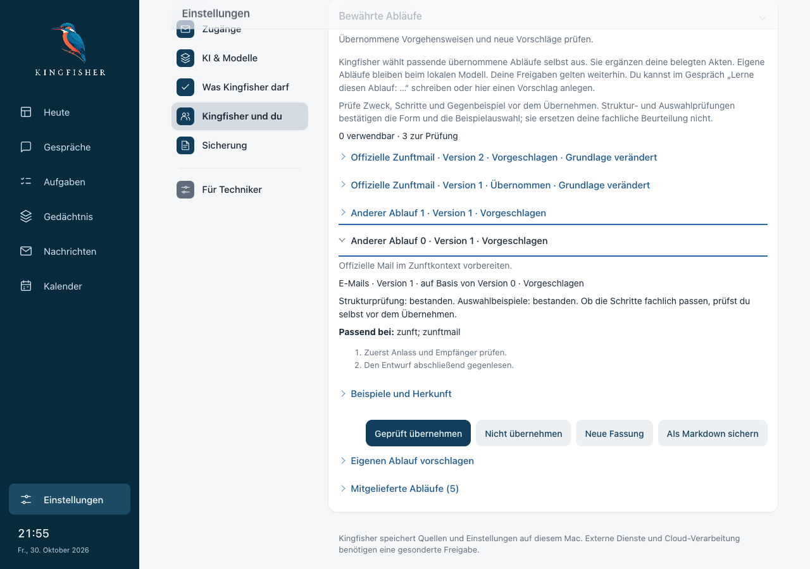
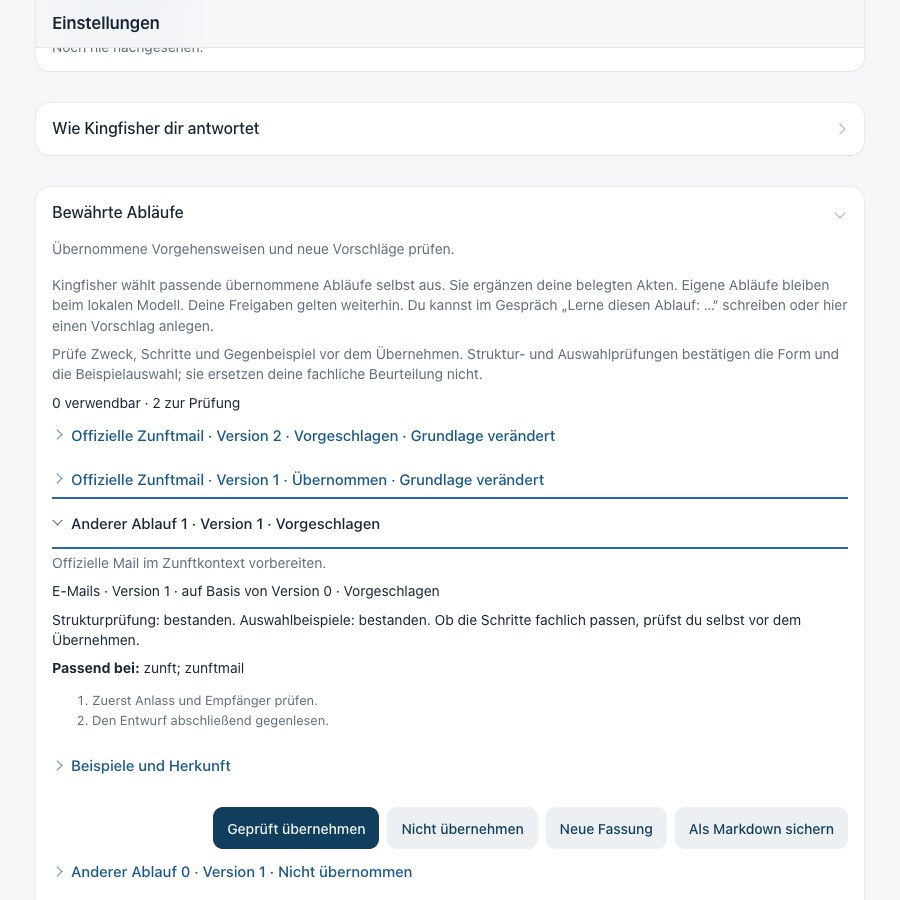

# Lernvorschlag direkt prüfen — 30.10.2026

## Ergebnis

„Ablauf prüfen“ im Gespräch führt zum genau bezeichneten Vorschlag. Die Bibliothek und die Zielzeile öffnen sich, die Schritte werden frisch gelesen, und die Zielzeile erhält den Tastaturfokus. Ähnliche Titel sind kein Auswahlkriterium. Ohne Ziel bleibt die Ansicht kompakt; unbekannte Kennungen erhalten einen Hinweis statt eines Ersatztreffers. Keine automatische Übernahme.

Basis: `bb94507493efab70d8835593069ac3a73d366823` (PR #103, inzwischen gemergt). Keine Backendänderungen, Datenmigrationen oder Modellaufrufe in dieser Lieferung.

## Nachweis

- Tatsächliche FastAPI-App und gebautes React-Frontend, ausschließlich künstlicher Bestand auf `127.0.0.1:8893`. Persönliches Kingfisher auf Port 8890 blieb unberührt. Synthetischer Provider; keine Qualitätsbehauptung über Qwen oder echte Mails.
- Vorher: Gesprächsknopf führte nur zur Bibliothek, alle drei Vorschläge waren geschlossen. Sechs neue Regressionsprüfungen zunächst rot; danach grün. Weitere Gegenfälle für den erneuten Sprung in die geschlossene Bibliothek und eine verzögerte native Schließmeldung ebenfalls rot→grün.
- Gesamte Oberfläche: `npm --prefix app/kingfisher test` → **964/964 bestanden** (vorher 955). Produktionsbuild bestanden; bekannte Größenwarnung des Bundlers. `python3 scripts/check_asset_manifest.py` → **11 Dateien, 14 Icons bestanden**. Keine neue Backendvollsuite, weil ausschließlich Oberfläche geändert; PR #103 hat einen getrennten vollständigen Backendnachweis.
- Browser: Gespräch → exakter Vorschlag → frische Details → ausdrückliche Übernahme → erneut gelesen „Übernommen“. Rückweg erhält den bereits eingegebenen Gesprächsentwurf.
- Unbekannte ID öffnet keinen anderen Eintrag und ruft keine unbekannte Detailroute ab. Wechsel zweier IDs auf derselben Einstellungsseite sowie zuvor manuell geschlossene Bibliothek geprüft.
- Simulierter Detailfehler HTTP 503: sichtbarer Fehler, keine Übernahme möglich; „Erneut laden“ liest die wirkliche Fassung frisch.
- Quelle nach Detailanzeige entzogen: Übernahme antwortet HTTP 409, Vorschlag bleibt inaktiv. Nach erneutem Lesen ist „Grundlage verändert“ sichtbar und Übernahme gesperrt. Diese beiden HTTP-Fehler sind absichtliche Gegenfälle, keine unerklärten Browserausnahmen.
- Abschließend Neuladen mit Ziel, Fokus, Bibliothek per Leertaste schließen / Enter öffnen, Zielzeile per Enter schließen / Leertaste öffnen: bestanden. Bei **1280×900 und 900×900** kein horizontaler Überlauf, Handlungen sichtbar; keine unbehandelten Browserausnahmen. Die beiden Schlussbilder wurden visuell angesehen.

## Entscheidungen und Grenzen

- Vorhandene Komponenten und Gestaltung wiederverwendet; die ID steht kodiert im Queryparameter, die bekannte Einstellungsgruppe weiterhin im Fragment. Zusätzliche Zeilen und Vorlagen werden nicht automatisch geöffnet.
- Die echte Browserprüfung fand eine verspätete native `toggle`-Schließmeldung. Die äußere Einstellungsklappe übernimmt deshalb ausdrücklich den Benutzerklick; native Öffnung etwa durch eine Fundstelle bleibt möglich. Tastatur und Erhalt bereits aufgebauter Inhalte sind mitgeprüft. Bestehende Quelltext-Vertragstests wurden an die neue Navigation und das Summary-Klickattribut angepasst, ihre ursprünglichen Sicherheits-/Gestaltungsaussagen bleiben bestehen.
- Browser-Plugin nicht verfügbar; vorhandene lokal gecachte Playwright-CLI verwendet. Keine Abhängigkeit oder Browser neu heruntergeladen.
- Die Schlussprobe wurde auf tatsächliches Neuladen und den sichtbaren Knopfnamen „Geprüft übernehmen“ korrigiert; bloße erneute Navigation auf dieselbe unveränderte URL ist kein Neuladetest. Produktcode wurde hierfür nicht angepasst.
- **Native Mac-Fensterprüfung, persönliche Mail-Stichprobe und Alltagswoche stehen aus.** Der Großimport bleibt pausiert. Diese schmale Lieferung schließt den direkten Prüfweg, nicht das gesamte Gedächtnisziel.

## Unabhängiges Review

Ein unabhängiges Schlussreview der gesamten UI-Änderung (Basis `bb94507`, Kopf `31b1d5f`) fand einen wichtigen Randfall: Wird eine bereits manuell geöffnete Zeile erst nachträglich zum Navigationsziel, wurde ihr alter Detailstand weiter angezeigt. Der Server verhindert eine unzulässige Übernahme weiterhin, aber die Prüfung muss vor der Handlung frisch sein.

Gezielte Regression zunächst **1 statt 2 Detailabrufe**, nach Ergänzung der Zielabhängigkeit grün. Die Prüfung hält die zweite Antwort zurück und belegt zusätzlich: Während des neuen Lesens ist keine Übernahme sichtbar. Alle acht direkten Prüfwegtests bestanden. Keine kritischen oder kleineren Befunde; eine Korrekturrunde, kein zweites Review.

Abgegrenzte Abnahmen: Das Review bewertet nicht den echten Mac, reale Quellen oder die Alltagswoche. Die bereits vorhandene Entwurfsbehandlung des allgemeinen Vorlageneditors wurde nicht umgebaut; dieser Schritt belegt den Gesprächsentwurf beim Rückweg und die direkte Vorschlagsprüfung, keinen allgemeinen Editor-Umbau.
